# Compile the project

The below cmake configuration will compile: 

- NFD
- NFD-tools 
- ndn-cxx ( the simple version )


```
mkdir build
cd build
cmake ..
make
```


Note that you might need to install the following dependencies: 

```
sudo apt install libsqlite3-dev
sudo apt install libpcap-dev
sudo apt install libsystemd
sudo apt install libboost-all-dev
```

Also you probably need to use: 

```
sudo make
```

# Run 

You should be able to run everything from: 

```
sudo ./run-nfd.sh
```

Note you might need to copy the file that is located inside: 
```
build/NFD/install/etc/ndn/ndf.conf.sample
```

Inside the same folder: 

```
build/NFD/install/etc/ndn/ndf.conf
```

It is the same file without the .sample


Run the SNDS daemon: 

```
fotis@fotis-MS-7B86:~/Github/SeEDS/build$ ./snds_daemon_bin --help
SNDS daemon with CLI configuration
Usage:
  snds [OPTION...]

 global options:
      --log-level arg           Global log level 
                                (trace|debug|info|warn|error|critical|off) 
                                (default: info)
      --num-services arg        Global number of SNDS services (default: 1)
      --snds-prefix arg         Global SNDS root prefix (default: SNDS)
      --state-prefix arg        Global state prefix (default: state)
      --is-alive-prefix arg     Global liveness prefix (default: is_alive)
      --snds-id arg             Global SNDS node id (default: 0)
      --id-scope-prefix arg     Global ID scope prefix (default: 
                                SNDS_ID_scope_)
      --registry-file-postfix arg
                                Global registry file postfix (default: 
                                _registry)
      --help                    Show help

 producer options:
      --producer.log-level arg  Producer log level (default: "")
      --producer.log-file arg   Producer log file (default: Producer.log)
      --producer.num-services arg
                                Producer num services (default: 0)
      --producer.snds-prefix arg
                                Producer SNDS prefix (default: "")
      --producer.state-prefix arg
                                Producer state prefix (default: "")
      --producer.is-alive-prefix arg
                                Producer liveness prefix (default: "")
      --producer.snds-id arg    Producer SNDS id (default: "")
      --producer.id-scope-prefix arg
                                Producer ID scope prefix (default: "")
      --producer.registry-file-postfix arg
                                Producer registry postfix (default: "")
      --producer.service-name arg
                                Producer service name (default: Producer)
      --producer.broker-ip arg  Producer broker IP/host (default: 
                                127.0.0.1)
      --producer.broker-port arg
                                Producer broker port (default: 10000)
      --producer.registry-type arg
                                Producer initial registry type (default: 
                                CAR)
      --producer.enable-resilience-ipc arg
                                Enable resilience IPC (true/false) 
                                (default: false)
      --producer.resilience-ipc-host arg
                                IPC host (default: 127.0.0.1)
      --producer.resilience-ipc-port arg
                                IPC port (default: 47832)
      --producer.is-primary     Start Producer as PRIMARY (overrides 
                                default derived from IPC setting)
      --producer.seed-from-broker-ip arg
                                Seed-from PRIMARY broker IP/host (used to 
                                bootstrap from /dump) (default: "")
      --producer.seed-from-broker-port arg
                                Seed-from PRIMARY broker port (default: 0)

 consumer options:
      --consumer.log-level arg  Consumer log level (default: "")
      --consumer.log-file arg   Consumer log file (default: Consumer.log)
      --consumer.num-services arg
                                Consumer num services (default: 0)
      --consumer.snds-prefix arg
                                Consumer SNDS prefix (default: "")
      --consumer.state-prefix arg
                                Consumer state prefix (default: "")
      --consumer.is-alive-prefix arg
                                Consumer liveness prefix (default: "")
      --consumer.snds-id arg    Consumer SNDS id (default: "")
      --consumer.id-scope-prefix arg
                                Consumer ID scope prefix (default: "")
      --consumer.registry-file-postfix arg
                                Consumer registry postfix (default: "")
      --consumer.service-name arg
                                Consumer service name (default: Consumer)

 worker options:
      --worker.log-level arg    Worker log level (default: "")
      --worker.log-file arg     Worker log file (default: Worker.log)
      --worker.num-services arg
                                Worker num services (default: 0)
      --worker.snds-prefix arg  Worker SNDS prefix (default: "")
      --worker.state-prefix arg
                                Worker state prefix (default: "")
      --worker.is-alive-prefix arg
                                Worker liveness prefix (default: "")
      --worker.snds-id arg      Worker SNDS id (default: "")
      --worker.id-scope-prefix arg
                                Worker ID scope prefix (default: "")
      --worker.registry-file-postfix arg
                                Worker registry postfix (default: "")
      --worker.service-name arg
                                Worker service name (default: Worker)

 http options:
      --http.log-level arg      HTTP log level (default: "")
      --http.log-file arg       HTTP log file (default: HTTPServer.log)
      --http.num-services arg   HTTP num services (default: 0)
      --http.snds-prefix arg    HTTP SNDS prefix (default: "")
      --http.state-prefix arg   HTTP state prefix (default: "")
      --http.is-alive-prefix arg
                                HTTP liveness prefix (default: "")
      --http.snds-id arg        HTTP SNDS id (default: "")
      --http.id-scope-prefix arg
                                HTTP ID scope prefix (default: "")
      --http.registry-file-postfix arg
                                HTTP registry postfix (default: "")
      --http.service-name arg   HTTP service name (default: HTTPServer)

 digitaltwin options:
      --dt.log-level arg        DigitalTwin log level (default: "")
      --dt.log-file arg         DigitalTwin log file (default: 
                                DigitalTwin.log)
      --dt.num-services arg     DigitalTwin num services (default: 0)
      --dt.snds-prefix arg      DigitalTwin SNDS prefix (default: "")
      --dt.state-prefix arg     DigitalTwin state prefix (default: "")
      --dt.is-alive-prefix arg  DigitalTwin liveness prefix (default: "")
      --dt.snds-id arg          DigitalTwin SNDS id (default: "")
      --dt.id-scope-prefix arg  DigitalTwin ID scope prefix (default: "")
      --dt.registry-file-postfix arg
                                DigitalTwin registry postfix (default: "")
      --dt.service-name arg     DigitalTwin service name (default: 
                                DigitalTwin)
```


Note when you want to insert complex prefixes like ``/ndn/gr/edu/mmlab1/aueb/thomasi/`` skip the first and last ``\`` and insert it like this: 

```
ndn/gr/edu/mmlab1/aueb/thomasi
```

Run the Broker Bin: 

```
fotis@fotis-MS-7B86:~/Github/SeEDS/build$ ./snds_broker_bin --help
SNDS Broker (Mongo-backed) with CLI configuration
Usage:
  snds_broker_bin [OPTION...]

      --mongo.uri arg     Full MongoDB URI (overrides user/pass/db if set) 
                          (default: mongodb://127.0.0.1:10000)
      --mongo.user arg    MongoDB username (default: "")
      --mongo.pass arg    MongoDB password (default: "")
      --mongo.db arg      MongoDB database name (default: SeEDS)
      --log-level arg     Log level 
                          (trace|debug|info|warn|error|critical|off) 
                          (default: debug)
      --log-file arg      Log file name (default: Broker.log)
      --service-name arg  Service label (default: Broker)
      --bind-ip arg       Bind IP for HTTP server (default: 0.0.0.0)
      --bind-port arg     Bind port for HTTP server (default: 10000)
  -h, --help              Show help
```


Resilience poller: 

```
fotis@fotis-MS-7B86:~/Github/SeEDS/build$ ./resilience_poller_bin --help
SeEDS Resilience Poller
Usage:
  resilience_poller_bin [OPTION...]

      --prefix arg          SNDS root prefix (default: SNDS)
      --peer-alive arg      Remote is_alive state name (default: 
                            is_alive_0)
      --peer-state arg      Remote state name (default: state_0)
      --alive-ms arg        Heartbeat probe period (ms) (default: 2000)
      --meta-ms arg         Meta probe period (ms) (default: 2000)
      --ipc-host arg        IPC host (default: 127.0.0.1)
      --ipc-port arg        IPC port (default: 47832)
      --log-level arg       Log level 
                            (trace|debug|info|warn|error|critical|off) 
                            (default: info)
      --miss-threshold arg  Consecutive missed heartbeats before promotion 
                            (default: 3)
  -h, --help                Show help
```

# Requests 

## Post ID

```
curl -v -i -X POST http://127.0.0.1:8080 -d id=car1
```

## Post to registry

```
curl -v -i -X POST http://127.0.0.1:8080 -d id=car1&type=CAR
```

## Get by ID

```
curl -i -X GET http://localhost:8080/?id=car1
```

## Get by TYPE

```
curl -i -X GET http://localhost:8080/?type=CAR
```

## Subscriptions

For subscriptions append the ``isSub=true&suburl=MYURL`` at the url. Add quotes to all variables e.g., ``?id=car1&isSub=true&suburl=MYURL``

### Subscription By ID:

```
curl -i -X GET http://localhost:8080/?id=car1&isSub=true&suburl=MYURL
```

### Subscription By Type: 

```
curl -i -X GET http://localhost:8080/?type=CAR&isSub=true&suburl=MYURL
```


## Publish versioned ID 
Note this will try to publish it to endpoint add. If you don't have an endpoint setup you will get an error: 
```cpp
if(message.get()->getMessageType() == SNDS_INTRA_MESSAGE_TYPE::TEMPORAL_QUERY_REQUEST){
    m_logger->info("Got new Temporal Query request...\n{}", message.get()->printDetails());
    auto query = deserialize_temporal_query(content);
    //query.date = md5_hex(&query.date, query.date.size());
    auto name = to_path(query, false, false);
    m_logger->info("Annoucing name {}", name);
    m_face.setInterestFilter(name,
      std::bind(&SNDSProducer::onInterest, this, std::placeholders::_2),
      std::bind(&SNDSProducer::onRegisterSuccess, this, std::placeholders::_1),
      std::bind(&SNDSProducer::onRegisterFailed, this, std::placeholders::_1, std::placeholders::_2));

    std::string payload = serialize_temporal_query(query);
    httplib::Client cli(broker_ip.c_str(), broker_port);
    auto res = cli.Post("/add", payload, "application/json");
    if (res && res->status == 200) {
        m_logger->info("Successfully POSTed to /add: {}", res->body);
    } else {
        m_logger->error("Failed to POST to /add: {}", res ? res->body : "No response");
    }
    continue;
}
```
The request can look like this: 
```
curl -X POST http://localhost:8080/ \
  --data-urlencode "id=car2" \
  --data-urlencode "date=2025-06-28T15:41:50Z" \
  -H "Accept: application/json"
```
## Temporal Query:

This will retrieve the metafile from the database:

```
curl -G http://localhost:8080/ \
  --data-urlencode "id=car2" \
  --data-urlencode "date=2025-06-28T15:41:50Z" \
  --data-urlencode "timeframe=before+after" \
  --data-urlencode "count=10" \
  -H "Accept: application/json"
```

A full temporal query: 

```
curl -i -X GET "http://localhost:8080" \
  --data-urlencode "id=car1" \
  --data-urlencode "timeframe=now" \
  --data-urlencode "count=5" \
  --data-urlencode "date=2025-09-28" \
  --data-urlencode "type=CAR" \
  --data-urlencode "filters=sensor|battery" \
  -H "Accept: application/json"
```

# Run the MiniNDN


## Install MiniNDN 

Clone the repo: 
```
git clone https://github.com/named-data/mini-ndn
```
Install the MiniNDN: 
```
./install.sh
```

## Make it work with mongo

Install MongoDB locally to not have internet connectivity issues: 

```
# Ubuntu 22.04/24.04 example — installs MongoDB 7.0
wget -qO - https://www.mongodb.org/static/pgp/server-7.0.asc | sudo gpg --dearmor -o /usr/share/keyrings/mongodb-server-7.0.gpg
echo "deb [ arch=amd64,arm64 signed-by=/usr/share/keyrings/mongodb-server-7.0.gpg ] https://repo.mongodb.org/apt/ubuntu $(. /etc/os-release; echo $UBUNTU_CODENAME)/mongodb-org/7.0 multiverse" | \
  sudo tee /etc/apt/sources.list.d/mongodb-org-7.0.list
```

Install: 

```
sudo apt update
sudo apt install -y mongodb-org
sudo systemctl enable --now mongod
```

Sanity check: 

```
mongosh --eval 'db.runCommand({buildInfo:1}).version'
# and:
ss -lnt | grep 27017
```

A good GUI I use for mongo is Compass: https://www.mongodb.com/try/download/compass


Just download the apt file and install it. Connect to the local cluster ( you can connect to any cluster you want ): "mongodb://127.0.0.1:27017"


### Populate database

```
mongosh SeEDS --eval 'db.CAR_VERSIONED.insertOne({
  _id: { _id: "car001", timestamp: new Date("2025-09-25T09:30:00Z") },
  id: "car001",
  type: "CAR",
  speed: 62,
  engine_temp: 85.2,
  battery: 91,
  timestamp: new Date("2025-09-25T09:30:00Z")
})'
```

```
mongosh SeEDS --eval 'db.CAR_VERSIONED.insertOne({
  _id: { _id: "car001", timestamp: new Date("2025-09-25T09:00:00Z") },
  id: "car001",
  type: "CAR",
  speed: 50,
  engine_temp: 80.1,
  battery: 95,
  timestamp: new Date("2025-09-25T09:00:00Z")
})'
```

```
mongosh SeEDS --eval 'db.CAR_VERSIONED.insertOne({
  _id: { _id: "car001", timestamp: new Date("2025-09-25T09:30:00Z") },
  id: "car001",
  type: "CAR",
  speed: 62,
  engine_temp: 85.2,
  battery: 91,
  timestamp: new Date("2025-09-25T09:30:00Z")
})'
```

```
mongosh SeEDS --eval 'db.CAR_VERSIONED.insertOne({
  _id: { _id: "car001", timestamp: new Date("2025-09-25T10:00:00Z") },
  id: "car001",
  type: "CAR",
  speed: 75,
  engine_temp: 92.4,
  battery: 87,
  timestamp: new Date("2025-09-25T10:00:00Z")
})'
```

```
mongosh SeEDS --eval 'db.CAR_VERSIONED.insertOne({
  _id: { _id: "car002", timestamp: new Date("2025-09-25T09:40:00Z") },
  id: "car002",
  type: "CAR",
  speed: 70,
  engine_temp: 90.1,
  battery: 78,
  timestamp: new Date("2025-09-25T09:40:00Z")
})'
```

```
mongosh SeEDS --eval 'db.CAR_VERSIONED.insertOne({
  _id: { _id: "car003", timestamp: new Date("2025-09-25T09:50:00Z") },
  id: "car003",
  type: "CAR",
  speed: 55,
  engine_temp: 79.4,
  battery: 95,
  timestamp: new Date("2025-09-25T09:50:00Z")
})'
```


## Run 

```
sudo python run.py <specify_topology_file_here>
```


## Test the project effectively 

### Install mongo locally

```bash
# Import the MongoDB public GPG key
curl -fsSL https://www.mongodb.org/static/pgp/server-7.0.asc | sudo gpg -o /usr/share/keyrings/mongodb-server-7.0.gpg --dearmor

# Add the repository
echo "deb [ signed-by=/usr/share/keyrings/mongodb-server-7.0.gpg ] https://repo.mongodb.org/apt/ubuntu $(lsb_release -sc)/mongodb-org/7.0 multiverse" | sudo tee /etc/apt/sources.list.d/mongodb-org-7.0.list

# Update and install
sudo apt-get update
sudo apt-get install -y mongodb-org

# Start the service
sudo systemctl start mongod
sudo systemctl enable mongod

```

I spin up nodes through the ``topology.conf``.

### Requests 


Requests are exactly the same as [above](#requests). Just make sure to publish from one node and ask from another. Also make sure you subscribe to other nodes and you get results etc. Here are some examples tested on four nodes:

#### Post ID and get ID


Publish IDs through A:

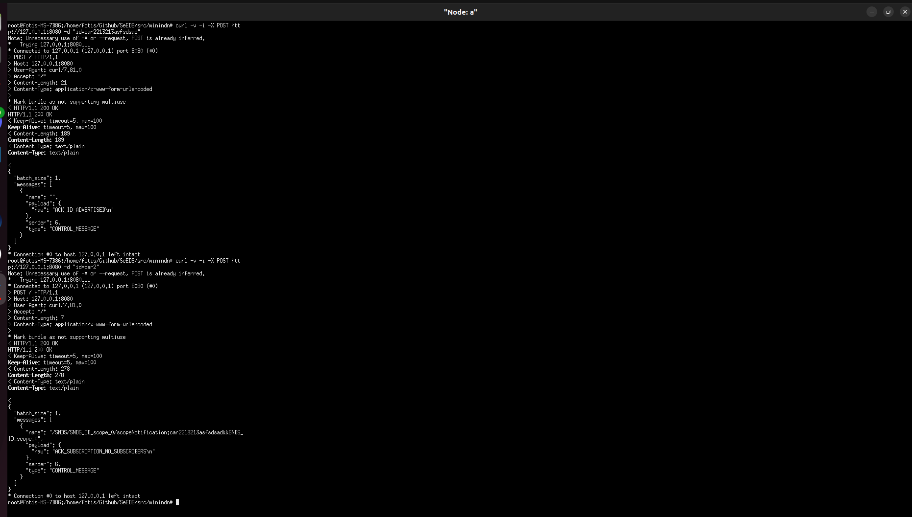


A's logs after performing get requests through the other nodes: 

```
[2025-09-25 00:33:40.583] [info] [Producer] Received interest in function: onInterest, name: /SNDS/car1/temporalQuery%3Aid%3Dcar1%26type%3D%26date%3D%26count%3D%26timeframe%3D%26filters%3D
[2025-09-25 00:33:40.583] [info] [Producer] Parsed interest: Prefix: SNDS, Name: car1, Command: temporalQuery, Params: [id=car1, type=, date=, count=, timeframe=, filters=]
[2025-09-25 00:33:40.583] [debug] [Producer] Created interest response: /SNDS/car1/temporalQuery%3Aid%3Dcar1%26type%3D%26date%3D%26count%3D%26timeframe%3D%26filters%3D in: process_temporal_query_interest
[2025-09-25 00:33:40.583] [debug] [Producer] TemporalQuery → id: car1, date: , type: , timeframe: , count: , filters: 
[2025-09-25 00:33:40.583] [debug] [Producer] Requesting to endpoint: /temporal-query?id=car1&type=&count=&date=&timeframe=&filters=
[2025-09-25 00:33:40.585] [info] [Producer] Successfully queried /temporal-query
[2025-09-25 00:33:40.585] [debug] [Producer] Sending data to the NDN…
[2025-09-25 00:35:26.584] [info] [Producer] Received interest in function: onInterest, name: /SNDS/SNDS_ID_scope_0/scopeNotification%3Acar2%26%26SNDS_ID_scope_2
[2025-09-25 00:35:26.584] [info] [Producer] Parsed interest: Prefix: SNDS, Name: SNDS_ID_scope_0, Command: scopeNotification, Params: [car2, , SNDS_ID_scope_2]
[2025-09-25 00:35:26.584] [info] [Producer] [BY_ID] Subscription notification for ID name car2 and/or TYPE: .
[2025-09-25 00:35:26.584] [info] [Producer] No subscribers found for ID: car2 and/or TYPE: .
[2025-09-25 00:35:26.584] [info] [Producer] Responding to interest: /SNDS/SNDS_ID_scope_0/scopeNotification%3Acar2%26%26SNDS_ID_scope_2
[2025-09-25 00:35:26.584] [debug] [Producer] Sending data to the NDN…
[2025-09-25 00:35:41.239] [info] [Producer] Received interest in function: onInterest, name: /SNDS/car3/temporalQuery%3Aid%3Dcar3%26type%3D%26date%3D%26count%3D%26timeframe%3D%26filters%3D
[2025-09-25 00:35:41.239] [info] [Producer] Parsed interest: Prefix: SNDS, Name: car3, Command: temporalQuery, Params: [id=car3, type=, date=, count=, timeframe=, filters=]
[2025-09-25 00:35:41.239] [debug] [Producer] Created interest response: /SNDS/car3/temporalQuery%3Aid%3Dcar3%26type%3D%26date%3D%26count%3D%26timeframe%3D%26filters%3D in: process_temporal_query_interest
[2025-09-25 00:35:41.239] [debug] [Producer] TemporalQuery → id: car3, date: , type: , timeframe: , count: , filters: 
[2025-09-25 00:35:41.239] [debug] [Producer] Requesting to endpoint: /temporal-query?id=car3&type=&count=&date=&timeframe=&filters=
[2025-09-25 00:35:41.241] [info] [Producer] Successfully queried /temporal-query
[2025-09-25 00:35:41.241] [debug] [Producer] Sending data to the NDN…
```

Get the ``car1`` through B ( B's logs ):

```
[2025-09-25 00:33:40.583] [info] [Worker] Inserted ID: car1 into set. Pushing regular getByID request for ID: car1
[2025-09-25 00:33:40.583] [info] [Worker] Reading packet...
[2025-09-25 00:33:40.583] [debug] [Consumer] Extracted content from message: /SNDS/car1/getByID:car1
[2025-09-25 00:33:40.583] [debug] [Consumer] Extracted content length from message: 23
[2025-09-25 00:33:40.583] [debug] [Consumer] Extracted message type from message: GET_BY_ID_REQUEST
[2025-09-25 00:33:40.583] [debug] [Consumer] Query.type: 
[2025-09-25 00:33:40.583] [debug] [Consumer] Query.id: car1
[2025-09-25 00:33:40.583] [info] [Consumer] Created name /SNDS/car1/temporalQuery:id%3Dcar1&type%3D&date%3D&count%3D&timeframe%3D&filters%3D
[2025-09-25 00:33:40.583] [info] [Consumer] Sending actual Interest /SNDS/car1/temporalQuery%3Aid%3Dcar1%26type%3D%26date%3D%26count%3D%26timeframe%3D%26filters%3D?CanBePrefix&Lifetime=6000
[2025-09-25 00:33:40.585] [info] [Consumer] Received Data with name: /SNDS/car1/temporalQuery%3Aid%3Dcar1%26type%3D%26date%3D%26count%3D%26timeframe%3D%26filters%3D in function onData
[2025-09-25 00:33:40.585] [info] [Consumer] Data packet payload: [
  {
    "": {
      "_id": "car1",
      "id": "car1",
      "timestamp": {
        "$date": 1758749528574
      },
      "type": "GENERIC"
    }
  }
] in function onData
[2025-09-25 00:33:40.585] [info] [Consumer] Parsed interest: Prefix: SNDS, Name: car1, Command: temporalQuery, Params: [id=car1, type=, date=, count=, timeframe=, filters=] in onData
[2025-09-25 00:33:40.585] [info] [Consumer] Temporal Query Reponse...
```

Get the ``car2`` through C ( C's logs ): 

```
[2025-09-25 00:42:10.775] [debug] [Consumer] Extracted content from message: /SNDS/car2/getByID:car2
[2025-09-25 00:42:10.775] [debug] [Consumer] Extracted content length from message: 23
[2025-09-25 00:42:10.775] [debug] [Consumer] Extracted message type from message: GET_BY_ID_REQUEST
[2025-09-25 00:42:10.775] [debug] [Consumer] Query.type: 
[2025-09-25 00:42:10.775] [debug] [Consumer] Query.id: car2
[2025-09-25 00:42:10.775] [info] [Consumer] Created name /SNDS/car2/temporalQuery:id%3Dcar2&type%3D&date%3D&count%3D&timeframe%3D&filters%3D
[2025-09-25 00:42:10.775] [info] [Consumer] Sending actual Interest /SNDS/car2/temporalQuery%3Aid%3Dcar2%26type%3D%26date%3D%26count%3D%26timeframe%3D%26filters%3D?CanBePrefix&Lifetime=6000
[2025-09-25 00:42:10.777] [info] [Consumer] Received Data with name: /SNDS/car2/temporalQuery%3Aid%3Dcar2%26type%3D%26date%3D%26count%3D%26timeframe%3D%26filters%3D in function onData
[2025-09-25 00:42:10.777] [info] [Consumer] Data packet payload: [
  {
    "": {
      "_id": "car2",
      "id": "car2",
      "timestamp": {
        "$date": 1758749532578
      },
      "type": "GENERIC"
    }
  }
] in function onData
[2025-09-25 00:42:10.777] [info] [Consumer] Parsed interest: Prefix: SNDS, Name: car2, Command: temporalQuery, Params: [id=car2, type=, date=, count=, timeframe=, filters=] in onData
```

Get the ``car3`` through D ( D's logs ): 

```
[2025-09-25 00:38:19.399] [debug] [Consumer] Extracted content from message: /SNDS/car3/getByID:car3
[2025-09-25 00:38:19.399] [debug] [Consumer] Extracted content length from message: 23
[2025-09-25 00:38:19.399] [debug] [Consumer] Extracted message type from message: GET_BY_ID_REQUEST
[2025-09-25 00:38:19.399] [debug] [Consumer] Query.type: 
[2025-09-25 00:38:19.399] [debug] [Consumer] Query.id: car3
[2025-09-25 00:38:19.399] [info] [Consumer] Created name /SNDS/car3/temporalQuery:id%3Dcar3&type%3D&date%3D&count%3D&timeframe%3D&filters%3D
[2025-09-25 00:38:19.399] [info] [Consumer] Sending actual Interest /SNDS/car3/temporalQuery%3Aid%3Dcar3%26type%3D%26date%3D%26count%3D%26timeframe%3D%26filters%3D?CanBePrefix&Lifetime=6000
[2025-09-25 00:38:19.400] [info] [Consumer] Received Data with name: /SNDS/car3/temporalQuery%3Aid%3Dcar3%26type%3D%26date%3D%26count%3D%26timeframe%3D%26filters%3D in function onData
[2025-09-25 00:38:19.400] [info] [Consumer] Data packet payload: [
  {
    "": {
      "_id": "car3",
      "id": "car3",
      "timestamp": {
        "$date": 1758749534580
      },
      "type": "GENERIC"
    }
  }
] in function onData
[2025-09-25 00:38:19.400] [info] [Consumer] Parsed interest: Prefix: SNDS, Name: car3, Command: temporalQuery, Params: [id=car3, type=, date=, count=, timeframe=, filters=] in onData
```
#### Post to TYPE and get from TYPE 

Posting to A's registry through B: 
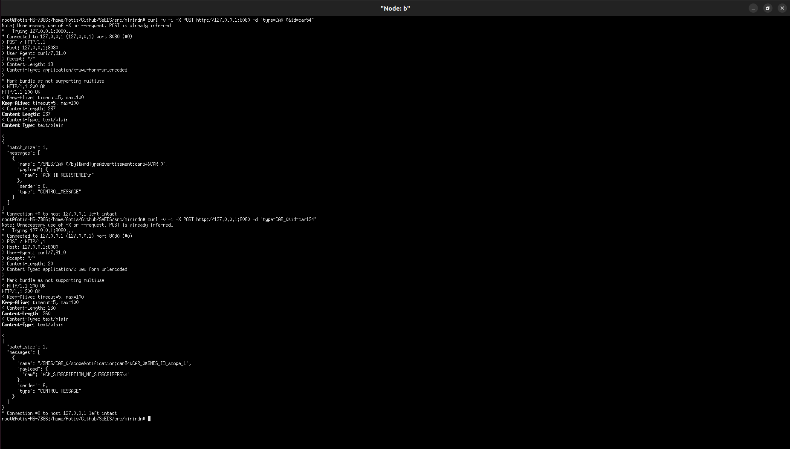

Posting to A's registry through C: 
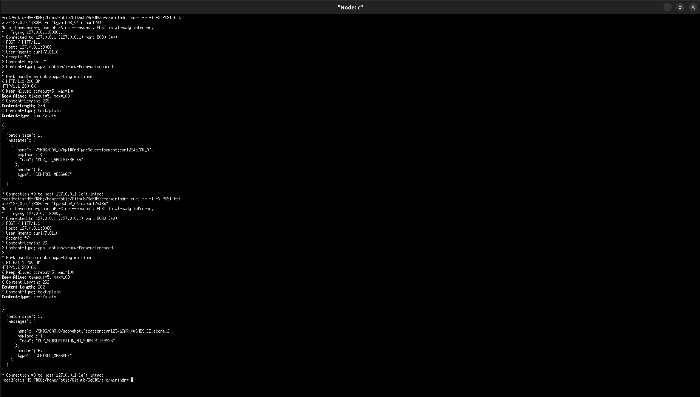

Get A's registry through D:


```
curl -i -X GET http://localhost:8080/?"type=CAR_0"
```

A's logs: 

```
[2025-09-25 00:16:25.868] [info] [Producer] Received interest in function: onInterest, name: /SNDS/CAR_0_registry/getByType%3ACAR_0
[2025-09-25 00:16:25.868] [info] [Producer] Parsed interest: Prefix: SNDS, Name: CAR_0_registry, Command: getByType, Params: [CAR_0]
[2025-09-25 00:16:25.868] [info] [Producer] Sending registry file payload for type CAR_0.
[2025-09-25 00:16:25.868] [debug] [Producer] Sending data to the NDN…
[2025-09-25 00:16:25.869] [info] [Producer] Received interest in function: onInterest, name: /SNDS/CAR_0/temporalQuery%3Aid%3Dcar123434%26type%3DCAR_0%26date%3D%26count%3D%26timeframe%3D%26filters%3D
[2025-09-25 00:16:25.869] [info] [Producer] Parsed interest: Prefix: SNDS, Name: CAR_0, Command: temporalQuery, Params: [id=car123434, type=CAR_0, date=, count=, timeframe=, filters=]
[2025-09-25 00:16:25.869] [debug] [Producer] Created interest response: /SNDS/CAR_0/temporalQuery%3Aid%3Dcar123434%26type%3DCAR_0%26date%3D%26count%3D%26timeframe%3D%26filters%3D in: process_temporal_query_interest
[2025-09-25 00:16:25.869] [debug] [Producer] TemporalQuery → id: car123434, date: , type: CAR_0, timeframe: , count: , filters: 
[2025-09-25 00:16:25.869] [debug] [Producer] Requesting to endpoint: /temporal-query?id=car123434&type=CAR_0&count=&date=&timeframe=&filters=
[2025-09-25 00:16:25.870] [info] [Producer] Successfully queried /temporal-query
[2025-09-25 00:16:25.871] [debug] [Producer] Sending data to the NDN…
[2025-09-25 00:16:25.871] [info] [Producer] Received interest in function: onInterest, name: /SNDS/CAR_0/temporalQuery%3Aid%3Dcar1234%26type%3DCAR_0%26date%3D%26count%3D%26timeframe%3D%26filters%3D
[2025-09-25 00:16:25.871] [info] [Producer] Parsed interest: Prefix: SNDS, Name: CAR_0, Command: temporalQuery, Params: [id=car1234, type=CAR_0, date=, count=, timeframe=, filters=]
[2025-09-25 00:16:25.871] [debug] [Producer] Created interest response: /SNDS/CAR_0/temporalQuery%3Aid%3Dcar1234%26type%3DCAR_0%26date%3D%26count%3D%26timeframe%3D%26filters%3D in: process_temporal_query_interest
[2025-09-25 00:16:25.871] [debug] [Producer] TemporalQuery → id: car1234, date: , type: CAR_0, timeframe: , count: , filters: 
[2025-09-25 00:16:25.871] [debug] [Producer] Requesting to endpoint: /temporal-query?id=car1234&type=CAR_0&count=&date=&timeframe=&filters=
[2025-09-25 00:16:25.872] [info] [Producer] Successfully queried /temporal-query
[2025-09-25 00:16:25.872] [debug] [Producer] Sending data to the NDN…
[2025-09-25 00:16:25.872] [info] [Producer] Received interest in function: onInterest, name: /SNDS/CAR_0/temporalQuery%3Aid%3Dcar124%26type%3DCAR_0%26date%3D%26count%3D%26timeframe%3D%26filters%3D
[2025-09-25 00:16:25.872] [info] [Producer] Parsed interest: Prefix: SNDS, Name: CAR_0, Command: temporalQuery, Params: [id=car124, type=CAR_0, date=, count=, timeframe=, filters=]
[2025-09-25 00:16:25.872] [debug] [Producer] Created interest response: /SNDS/CAR_0/temporalQuery%3Aid%3Dcar124%26type%3DCAR_0%26date%3D%26count%3D%26timeframe%3D%26filters%3D in: process_temporal_query_interest
[2025-09-25 00:16:25.872] [debug] [Producer] TemporalQuery → id: car124, date: , type: CAR_0, timeframe: , count: , filters: 
[2025-09-25 00:16:25.872] [debug] [Producer] Requesting to endpoint: /temporal-query?id=car124&type=CAR_0&count=&date=&timeframe=&filters=
[2025-09-25 00:16:25.873] [info] [Producer] Successfully queried /temporal-query
[2025-09-25 00:16:25.873] [debug] [Producer] Sending data to the NDN…
[2025-09-25 00:16:25.874] [info] [Producer] Received interest in function: onInterest, name: /SNDS/CAR_0/temporalQuery%3Aid%3Dcar54%26type%3DCAR_0%26date%3D%26count%3D%26timeframe%3D%26filters%3D
[2025-09-25 00:16:25.874] [info] [Producer] Parsed interest: Prefix: SNDS, Name: CAR_0, Command: temporalQuery, Params: [id=car54, type=CAR_0, date=, count=, timeframe=, filters=]
[2025-09-25 00:16:25.874] [debug] [Producer] Created interest response: /SNDS/CAR_0/temporalQuery%3Aid%3Dcar54%26type%3DCAR_0%26date%3D%26count%3D%26timeframe%3D%26filters%3D in: process_temporal_query_interest
[2025-09-25 00:16:25.874] [debug] [Producer] TemporalQuery → id: car54, date: , type: CAR_0, timeframe: , count: , filters: 
[2025-09-25 00:16:25.874] [debug] [Producer] Requesting to endpoint: /temporal-query?id=car54&type=CAR_0&count=&date=&timeframe=&filters=
[2025-09-25 00:16:25.875] [info] [Producer] Successfully queried /temporal-query
[2025-09-25 00:16:25.875] [debug] [Producer] Sending data to the NDN…
```

D's logs:

```
[2025-09-25 00:16:25.868] [info] [Consumer] Sending actual Interest /SNDS/CAR_0_registry/getByType%3ACAR_0?CanBePrefix&Lifetime=6000
[2025-09-25 00:16:25.869] [info] [Consumer] Received Data with name: /SNDS/CAR_0_registry/getByType%3ACAR_0 in function onData
[2025-09-25 00:16:25.869] [info] [Consumer] Data packet payload: R car123434|car1234|car124|car54 in function onData
[2025-09-25 00:16:25.869] [info] [Consumer] Parsed interest: Prefix: SNDS, Name: CAR_0_registry, Command: getByType, Params: [CAR_0] in onData
[2025-09-25 00:16:25.869] [info] [Consumer] Received Registry File
[2025-09-25 00:16:25.869] [info] [Consumer] In Function: onData sending name CAR_0 to worker R	car123434|car1234|car124|car54
[2025-09-25 00:16:25.869] [info] [Worker] Received content: CAR_0
[2025-09-25 00:16:25.869] [info] [Consumer] Reading packet...
[2025-09-25 00:16:25.869] [info] [Worker] Received payload: R car123434|car1234|car124|car54
[2025-09-25 00:16:25.869] [info] [Worker] Received type: REGISTRY_PAYLOAD
[2025-09-25 00:16:25.869] [debug] [Worker] Consumer intra message...
[2025-09-25 00:16:25.869] [debug] [Worker] Number of IDs in payload: 4
[2025-09-25 00:16:25.869] [debug] [Worker] Reading ID #1 with size 9
[2025-09-25 00:16:25.869] [info] [Worker] Parsed ID #1: car123434
[2025-09-25 00:16:25.869] [debug] [Worker] Reading ID #2 with size 7
[2025-09-25 00:16:25.869] [info] [Worker] Parsed ID #2: car1234
[2025-09-25 00:16:25.869] [debug] [Worker] Reading ID #3 with size 6
[2025-09-25 00:16:25.869] [info] [Worker] Parsed ID #3: car124
[2025-09-25 00:16:25.869] [debug] [Worker] Reading ID #4 with size 5
[2025-09-25 00:16:25.869] [info] [Worker] Parsed ID #4: car54
[2025-09-25 00:16:25.869] [info] [Worker] Size of ids in registry file: 4
[2025-09-25 00:16:25.869] [debug] [Worker] Processing registry id: car123434
[2025-09-25 00:16:25.869] [info] [Worker] Pushing request to the consumer for id car123434
[2025-09-25 00:16:25.869] [debug] [Worker] Processing registry id: car1234
[2025-09-25 00:16:25.869] [info] [Worker] Pushing request to the consumer for id car1234
[2025-09-25 00:16:25.869] [debug] [Worker] Processing registry id: car124
[2025-09-25 00:16:25.869] [info] [Worker] Pushing request to the consumer for id car124
[2025-09-25 00:16:25.869] [debug] [Worker] Processing registry id: car54
[2025-09-25 00:16:25.869] [info] [Worker] Pushing request to the consumer for id car54
[2025-09-25 00:16:25.869] [debug] [Consumer] Extracted content from message: /SNDS/CAR_0/getByIDForType:car123434&CAR_0
[2025-09-25 00:16:25.869] [debug] [Consumer] Extracted content length from message: 42
[2025-09-25 00:16:25.869] [info] [Worker] Reading packet...
```

D's send ID requests for the registry: 

```
[2025-09-25 00:16:25.869] [debug] [Consumer] Extracted message type from message: GET_BY_ID_FOR_TYPE_REQUEST
[2025-09-25 00:16:25.869] [debug] [Consumer] Query.type: CAR_0
[2025-09-25 00:16:25.869] [debug] [Consumer] Query.id: car123434
[2025-09-25 00:16:25.869] [info] [Consumer] Created name /SNDS/CAR_0/temporalQuery:id%3Dcar123434&type%3DCAR_0&date%3D&count%3D&timeframe%3D&filters%3D
[2025-09-25 00:16:25.869] [info] [Consumer] Sending actual Interest /SNDS/CAR_0/temporalQuery%3Aid%3Dcar123434%26type%3DCAR_0%26date%3D%26count%3D%26timeframe%3D%26filters%3D?CanBePrefix&Lifetime=6000
[2025-09-25 00:16:25.871] [info] [Consumer] Received Data with name: /SNDS/CAR_0/temporalQuery%3Aid%3Dcar123434%26type%3DCAR_0%26date%3D%26count%3D%26timeframe%3D%26filters%3D in function onData
[2025-09-25 00:16:25.871] [info] [Consumer] Data packet payload: null in function onData
[2025-09-25 00:16:25.871] [info] [Consumer] Parsed interest: Prefix: SNDS, Name: CAR_0, Command: temporalQuery, Params: [id=car123434, type=CAR_0, date=, count=, timeframe=, filters=] in onData
[2025-09-25 00:16:25.871] [info] [Consumer] Temporal Query Reponse...
[2025-09-25 00:16:25.871] [error] [Consumer] No JSON start detected. First 32 bytes: 6e 75 6c 6c 
[2025-09-25 00:16:25.871] [info] [Consumer] Reading packet...
[2025-09-25 00:16:25.871] [debug] [Consumer] Extracted content from message: /SNDS/CAR_0/getByIDForType:car1234&CAR_0
[2025-09-25 00:16:25.871] [debug] [Consumer] Extracted content length from message: 40
[2025-09-25 00:16:25.871] [debug] [Consumer] Extracted message type from message: GET_BY_ID_FOR_TYPE_REQUEST
[2025-09-25 00:16:25.871] [debug] [Consumer] Query.type: CAR_0
[2025-09-25 00:16:25.871] [debug] [Consumer] Query.id: car1234
[2025-09-25 00:16:25.871] [info] [Consumer] Created name /SNDS/CAR_0/temporalQuery:id%3Dcar1234&type%3DCAR_0&date%3D&count%3D&timeframe%3D&filters%3D
[2025-09-25 00:16:25.871] [info] [Consumer] Sending actual Interest /SNDS/CAR_0/temporalQuery%3Aid%3Dcar1234%26type%3DCAR_0%26date%3D%26count%3D%26timeframe%3D%26filters%3D?CanBePrefix&Lifetime=6000
[2025-09-25 00:16:25.872] [info] [Consumer] Received Data with name: /SNDS/CAR_0/temporalQuery%3Aid%3Dcar1234%26type%3DCAR_0%26date%3D%26count%3D%26timeframe%3D%26filters%3D in function onData
[2025-09-25 00:16:25.872] [info] [Consumer] Data packet payload: null in function onData
[2025-09-25 00:16:25.872] [info] [Consumer] Parsed interest: Prefix: SNDS, Name: CAR_0, Command: temporalQuery, Params: [id=car1234, type=CAR_0, date=, count=, timeframe=, filters=] in onData
[2025-09-25 00:16:25.872] [info] [Consumer] Temporal Query Reponse...
[2025-09-25 00:16:25.872] [error] [Consumer] No JSON start detected. First 32 bytes: 6e 75 6c 6c 
[2025-09-25 00:16:25.872] [info] [Consumer] Reading packet...
[2025-09-25 00:16:25.872] [debug] [Consumer] Extracted content from message: /SNDS/CAR_0/getByIDForType:car124&CAR_0
[2025-09-25 00:16:25.872] [debug] [Consumer] Extracted content length from message: 39
[2025-09-25 00:16:25.872] [debug] [Consumer] Extracted message type from message: GET_BY_ID_FOR_TYPE_REQUEST
[2025-09-25 00:16:25.872] [debug] [Consumer] Query.type: CAR_0
[2025-09-25 00:16:25.872] [debug] [Consumer] Query.id: car124
[2025-09-25 00:16:25.872] [info] [Consumer] Created name /SNDS/CAR_0/temporalQuery:id%3Dcar124&type%3DCAR_0&date%3D&count%3D&timeframe%3D&filters%3D
[2025-09-25 00:16:25.872] [info] [Consumer] Sending actual Interest /SNDS/CAR_0/temporalQuery%3Aid%3Dcar124%26type%3DCAR_0%26date%3D%26count%3D%26timeframe%3D%26filters%3D?CanBePrefix&Lifetime=6000
[2025-09-25 00:16:25.874] [info] [Consumer] Received Data with name: /SNDS/CAR_0/temporalQuery%3Aid%3Dcar124%26type%3DCAR_0%26date%3D%26count%3D%26timeframe%3D%26filters%3D in function onData
[2025-09-25 00:16:25.874] [info] [Consumer] Data packet payload: null in function onData
[2025-09-25 00:16:25.874] [info] [Consumer] Parsed interest: Prefix: SNDS, Name: CAR_0, Command: temporalQuery, Params: [id=car124, type=CAR_0, date=, count=, timeframe=, filters=] in onData
[2025-09-25 00:16:25.874] [info] [Consumer] Temporal Query Reponse...
[2025-09-25 00:16:25.874] [error] [Consumer] No JSON start detected. First 32 bytes: 6e 75 6c 6c 
[2025-09-25 00:16:25.874] [info] [Consumer] Reading packet...
[2025-09-25 00:16:25.874] [debug] [Consumer] Extracted content from message: /SNDS/CAR_0/getByIDForType:car54&CAR_0
[2025-09-25 00:16:25.874] [debug] [Consumer] Extracted content length from message: 38
[2025-09-25 00:16:25.874] [debug] [Consumer] Extracted message type from message: GET_BY_ID_FOR_TYPE_REQUEST
[2025-09-25 00:16:25.874] [debug] [Consumer] Query.type: CAR_0
[2025-09-25 00:16:25.874] [debug] [Consumer] Query.id: car54
[2025-09-25 00:16:25.874] [info] [Consumer] Created name /SNDS/CAR_0/temporalQuery:id%3Dcar54&type%3DCAR_0&date%3D&count%3D&timeframe%3D&filters%3D
[2025-09-25 00:16:25.874] [info] [Consumer] Sending actual Interest /SNDS/CAR_0/temporalQuery%3Aid%3Dcar54%26type%3DCAR_0%26date%3D%26count%3D%26timeframe%3D%26filters%3D?CanBePrefix&Lifetime=6000
[2025-09-25 00:16:25.875] [info] [Consumer] Received Data with name: /SNDS/CAR_0/temporalQuery%3Aid%3Dcar54%26type%3DCAR_0%26date%3D%26count%3D%26timeframe%3D%26filters%3D in function onData
[2025-09-25 00:16:25.875] [info] [Consumer] Data packet payload: null in function onData
[2025-09-25 00:16:25.875] [info] [Consumer] Parsed interest: Prefix: SNDS, Name: CAR_0, Command: temporalQuery, Params: [id=car54, type=CAR_0, date=, count=, timeframe=, filters=] in onData
[2025-09-25 00:16:25.875] [info] [Consumer] Temporal Query Reponse...
[2025-09-25 00:16:25.875] [error] [Consumer] No JSON start detected. First 32 bytes: 6e 75 6c 6c 
[2025-09-25 00:16:25.875] [info] [Consumer] Reading packet...
```

#### Subscribe and get notified for subscription for ID


A's logs: 

```
[2025-09-25 00:49:41.783] [info] [Worker] Received content: {id=car1234,suburl=MYURL,isSub=1}
[2025-09-25 00:49:41.783] [info] [Worker] Received payload: 
[2025-09-25 00:49:41.783] [info] [Worker] Received type: BY_ID_SUBSCRIPTION
[2025-09-25 00:49:41.783] [debug] [Worker] Server intra message...
[2025-09-25 00:49:41.783] [info] [Worker] Stored FIRST subscription for Name: car1234 and URL: MYURL
[2025-09-25 00:49:41.783] [info] [Worker] Created node scope name: SNDS_ID_scope_1 for Name: car1234 with URL: MYURL
[2025-09-25 00:49:41.783] [info] [Worker] Hi this is me: SNDS_ID_scope_0 I'm going to ask node: SNDS_ID_scope_1 to subscribe to: car1234
[2025-09-25 00:49:41.783] [info] [Worker] Created interest name: /SNDS/SNDS_ID_scope_1/newIdSubscription:car1234&SNDS_ID_scope_0
Message: /SNDS/SNDS_ID_scope_1/newIdSubscription:car1234&SNDS_ID_scope_0
Type: BY_ID_SUBSCRIPTION
Sender: WORKER
Payload: 
HTTP Type: HTTP_EMPTY
Params:
[2025-09-25 00:49:41.783] [debug] [Worker] Sending message to consumer...
Message: /SNDS/SNDS_ID_scope_1/newIdSubscription:car1234&SNDS_ID_scope_0
Type: BY_ID_SUBSCRIPTION
Sender: WORKER
Payload: 
HTTP Type: HTTP_EMPTY
Params:

[2025-09-25 00:49:41.783] [info] [Worker] Reading packet...
[2025-09-25 00:49:41.783] [debug] [Consumer] Extracted content from message: /SNDS/SNDS_ID_scope_1/newIdSubscription:car1234&SNDS_ID_scope_0
[2025-09-25 00:49:41.783] [debug] [Consumer] Extracted content length from message: 63
[2025-09-25 00:49:41.783] [debug] [Consumer] Extracted message type from message: BY_ID_SUBSCRIPTION
[2025-09-25 00:49:41.783] [info] [Consumer] Received other scope name: SNDS_ID_scope_1 in express_subscription_interest
[2025-09-25 00:49:41.783] [info] [Consumer] Received other scope name: SNDS_ID_scope_1, our scope name: SNDS_ID_scope_0 for name: car1234 in func: express_subscription_interest
[2025-09-25 00:49:41.783] [debug] [Consumer] Created name: /SNDS/SNDS_ID_scope_1/newIdSubscription:car1234&SNDS_ID_scope_0 in func: express_subscription_interest
[2025-09-25 00:49:41.783] [debug] [Consumer] Sending actual interest to the network: /SNDS/SNDS_ID_scope_1/newIdSubscription%3Acar1234%26SNDS_ID_scope_0?CanBePrefix&Lifetime=6000
[2025-09-25 00:49:41.786] [info] [Consumer] Received Data with name: /SNDS/SNDS_ID_scope_1/newIdSubscription%3Acar1234%26SNDS_ID_scope_0 in function onData
[2025-09-25 00:49:41.786] [info] [Consumer] Data packet payload: ACK_SUBSCRIPTION_NEW in function onData
[2025-09-25 00:49:41.786] [info] [Consumer] Parsed interest: Prefix: SNDS, Name: SNDS_ID_scope_1, Command: newIdSubscription, Params: [car1234, SNDS_ID_scope_0] in onData
[2025-09-25 00:49:41.786] [info] [Consumer] Got ACK ACK_SUBSCRIPTION_NEW. Skipping...
[2025-09-25 00:49:41.787] [info] [Worker] Received content: /SNDS/SNDS_ID_scope_1/newIdSubscription:car1234&SNDS_ID_scope_0
[2025-09-25 00:49:41.787] [info] [Worker] Received payload: ACK_SUBSCRIPTION_NEW
[2025-09-25 00:49:41.787] [info] [Worker] Received type: GET_BY_ID_FOR_TYPE_RESPONSE
[2025-09-25 00:49:41.787] [debug] [Worker] Consumer intra message...
[2025-09-25 00:49:41.787] [info] [Consumer] Reading packet...
```

``SNDS_ID_scope_1`` is B. B's logs: 

```
[2025-09-25 00:49:41.784] [info] [Producer] Received interest in function: onInterest, name: /SNDS/SNDS_ID_scope_1/newIdSubscription%3Acar1234%26SNDS_ID_scope_0
[2025-09-25 00:49:41.784] [info] [Producer] Parsed interest: Prefix: SNDS, Name: SNDS_ID_scope_1, Command: newIdSubscription, Params: [car1234, SNDS_ID_scope_0]
[2025-09-25 00:49:41.784] [info] [Producer] Received our_snds_node_id: SNDS_ID_scope_1 in func: process_new_subscription_interest
[2025-09-25 00:49:41.784] [info] [Producer] Got interest indicating new subscription for name: car1234, and snds node: SNDS_ID_scope_0
[2025-09-25 00:49:41.784] [info] [Producer] [event] subscribe_id: node=SNDS_ID_scope_0 -> id=car1234
[2025-09-25 00:49:41.784] [info] [Producer] [resilience] mutate → ver=8 hash=8e34f5c681180e036405122331df19b1
[2025-09-25 00:49:41.784] [debug] [Producer] [resilience] history versions: 0(37a6259c) 1(e9474c54) 2(5936a7fd) 3(efaba5de) 4(f76c4e11) 5(c8317c99) 6(a2109e4b) 7(0cf03238) 8(8e34f5c6) 
[2025-09-25 00:49:41.784] [debug] [Producer] [resilience] ops from v7 → v8:
[
  {
    "op": "add",
    "path": "/subscribers/byId/car1234",
    "value": {
      "nodes": {
        "SNDS_ID_scope_0": true
      }
    }
  }
]
[2025-09-25 00:49:41.784] [info] [Producer] [debug][event:on_subscribe_id SNDS_ID_scope_0->car1234] summary → types=1 ids=0 subs(byId)=1 subs(byType)=0 announced=6
[2025-09-25 00:49:41.784] [debug] [Producer] [debug][event:on_subscribe_id SNDS_ID_scope_0->car1234] type_registry:
[2025-09-25 00:49:41.784] [debug] [Producer]   [CAR_1] 
[2025-09-25 00:49:41.784] [debug] [Producer] [debug][event:on_subscribe_id SNDS_ID_scope_0->car1234] subscribed_nodes_for_id:
[2025-09-25 00:49:41.784] [debug] [Producer]   [car1234] SNDS_ID_scope_0 
```


Publish ``car1234`` in B:

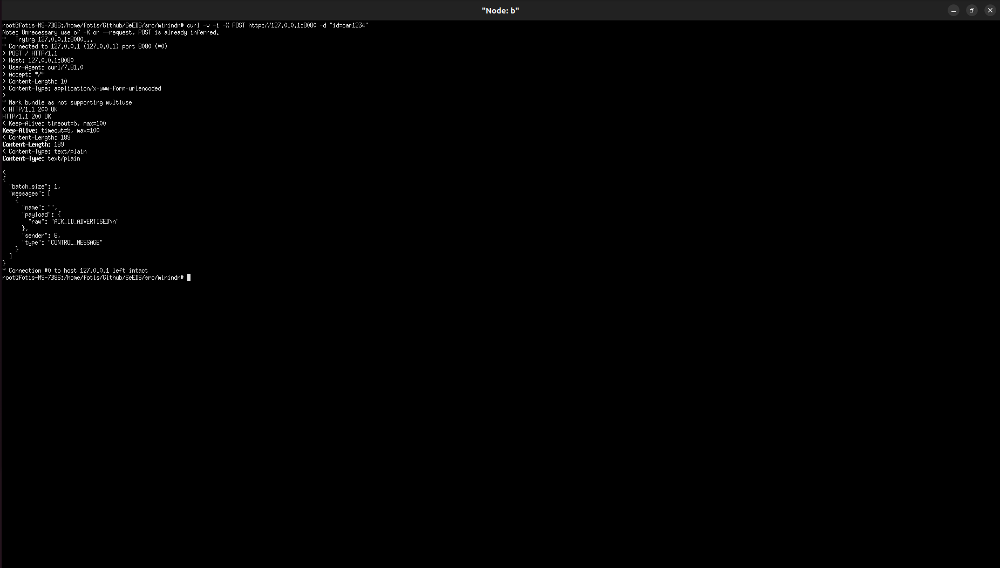


B's logs: 

```
[2025-09-25 00:55:24.647] [debug] [Consumer] Created name: /SNDS/SNDS_ID_scope_1/scopeNotification:car1234&&SNDS_ID_scope_1 in func: express_scope_interest
[2025-09-25 00:55:24.647] [debug] [Consumer] Sending actual interest to the network: /SNDS/SNDS_ID_scope_1/scopeNotification%3Acar1234%26%26SNDS_ID_scope_1?CanBePrefix&Lifetime=6000
[2025-09-25 00:55:24.648] [info] [Producer] Received interest in function: onInterest, name: /SNDS/SNDS_ID_scope_1/scopeNotification%3Acar1234%26%26SNDS_ID_scope_1
[2025-09-25 00:55:24.648] [info] [Producer] Parsed interest: Prefix: SNDS, Name: SNDS_ID_scope_1, Command: scopeNotification, Params: [car1234, , SNDS_ID_scope_1]
[2025-09-25 00:55:24.648] [info] [Producer] [BY_ID] Subscription notification for ID name car1234 and/or TYPE: .
[2025-09-25 00:55:24.648] [info] [Producer] Notifying SNDS node: /SNDS/SNDS_ID_scope_0/subscriptionNotification:car1234&&SNDS_ID_scope_1
[2025-09-25 00:55:24.648] [debug] [Producer] Sending data to the NDN…
[2025-09-25 00:55:24.648] [info] [Consumer] Received Data with name: /SNDS/SNDS_ID_scope_1/scopeNotification%3Acar1234%26%26SNDS_ID_scope_1 in function onData
[2025-09-25 00:55:24.648] [info] [Consumer] Data packet payload: ACK_SUBSCRIPTION_NOTIFICATION in function onData
[2025-09-25 00:55:24.648] [info] [Consumer] Parsed interest: Prefix: SNDS, Name: SNDS_ID_scope_1, Command: scopeNotification, Params: [car1234, , SNDS_ID_scope_1] in onData
```

A's logs: 

```
[2025-09-25 00:55:24.648] [info] [Producer] Received interest in function: onInterest, name: /SNDS/SNDS_ID_scope_0/subscriptionNotification%3Acar1234%26%26SNDS_ID_scope_1
[2025-09-25 00:55:24.648] [info] [Producer] Parsed interest: Prefix: SNDS, Name: SNDS_ID_scope_0, Command: subscriptionNotification, Params: [car1234, , SNDS_ID_scope_1]
[2025-09-25 00:55:24.648] [info] [Producer] Subscription Notification: id='car1234', type='' (byID), scope='SNDS_ID_scope_0', cb='SNDS_ID_scope_1' -> issuing GET_BY_ID_REQUEST
Message: /SNDS/car1234/getByID:car1234
Type: GET_BY_ID_REQUEST
Sender: PRODUCER
Payload: 
HTTP Type: HTTP_EMPTY
Params:
[2025-09-25 00:55:24.648] [debug] [Producer] Sending message:
Message: /SNDS/car1234/getByID:car1234
Type: GET_BY_ID_REQUEST
Sender: PRODUCER
Payload: 
HTTP Type: HTTP_EMPTY
Params:

in func: process_subscription_notification_interest
[2025-09-25 00:55:24.648] [debug] [Producer] Sending data to the NDN…
[2025-09-25 00:55:24.648] [debug] [Consumer] Extracted content from message: /SNDS/car1234/getByID:car1234
[2025-09-25 00:55:24.649] [debug] [Consumer] Extracted content length from message: 29
[2025-09-25 00:55:24.649] [debug] [Consumer] Extracted message type from message: GET_BY_ID_REQUEST
[2025-09-25 00:55:24.649] [debug] [Consumer] Query.type: 
[2025-09-25 00:55:24.649] [debug] [Consumer] Query.id: car1234
[2025-09-25 00:55:24.649] [info] [Consumer] Created name /SNDS/car1234/temporalQuery:id%3Dcar1234&type%3D&date%3D&count%3D&timeframe%3D&filters%3D
[2025-09-25 00:55:24.649] [info] [Consumer] Sending actual Interest /SNDS/car1234/temporalQuery%3Aid%3Dcar1234%26type%3D%26date%3D%26count%3D%26timeframe%3D%26filters%3D?CanBePrefix&Lifetime=6000
[2025-09-25 00:55:24.651] [info] [Consumer] Received Data with name: /SNDS/car1234/temporalQuery%3Aid%3Dcar1234%26type%3D%26date%3D%26count%3D%26timeframe%3D%26filters%3D in function onData
[2025-09-25 00:55:24.651] [info] [Consumer] Data packet payload: [
  {
    "": {
      "_id": "car1234",
      "id": "car1234",
      "timestamp": {
        "$date": 1758750923529
      },
      "type": "GENERIC"
    }
  }
] in function onData
```
#### Subscribe and get notified for subscription for TYPE

Let's subscribe from A to C: 


A's logs

```
[2025-09-25 01:24:38.968] [debug] [Consumer] Extracted content from message: /SNDS/CAR_2/newTypeSubscription:CAR_2&SNDS_ID_scope_0
[2025-09-25 01:24:38.968] [debug] [Consumer] Extracted content length from message: 53
[2025-09-25 01:24:38.968] [debug] [Consumer] Extracted message type from message: BY_TYPE_SUBSCRIPTION
[2025-09-25 01:24:38.968] [info] [Consumer] Received other scope name: CAR_2 in express_subscription_interest
[2025-09-25 01:24:38.968] [info] [Consumer] Received other scope name: CAR_2, our scope name: SNDS_ID_scope_0 for name: CAR_2 in func: express_subscription_interest
[2025-09-25 01:24:38.968] [debug] [Consumer] Created name: /SNDS/CAR_2/newTypeSubscription:CAR_2&SNDS_ID_scope_0 in func: express_subscription_interest
[2025-09-25 01:24:38.968] [debug] [Consumer] Sending actual interest to the network: /SNDS/CAR_2/newTypeSubscription%3ACAR_2%26SNDS_ID_scope_0?CanBePrefix&Lifetime=6000
[2025-09-25 01:24:38.971] [info] [Consumer] Received Data with name: /SNDS/CAR_2/newTypeSubscription%3ACAR_2%26SNDS_ID_scope_0 in function onData
[2025-09-25 01:24:38.971] [info] [Consumer] Data packet payload: ACK_SUBSCRIPTION_NEW in function onData
[2025-09-25 01:24:38.971] [info] [Consumer] Parsed interest: Prefix: SNDS, Name: CAR_2, Command: newTypeSubscription, Params: [CAR_2, SNDS_ID_scope_0] in onData
[2025-09-25 01:24:38.971] [info] [Consumer] Got ACK ACK_SUBSCRIPTION_NEW. Skipping...
[2025-09-25 01:24:38.971] [info] [Worker] Received content: /SNDS/CAR_2/newTypeSubscription:CAR_2&SNDS_ID_scope_0
[2025-09-25 01:24:38.971] [info] [Consumer] Reading packet...
[2025-09-25 01:24:38.971] [info] [Worker] Received payload: ACK_SUBSCRIPTION_NEW
[2025-09-25 01:24:38.971] [info] [Worker] Received type: GET_BY_ID_FOR_TYPE_RESPONSE
[2025-09-25 01:24:38.971] [debug] [Worker] Consumer intra message...
```

C's logs: 

```
[2025-09-25 01:24:38.968] [info] [Producer] Received interest in function: onInterest, name: /SNDS/CAR_2/newTypeSubscription%3ACAR_2%26SNDS_ID_scope_0
[2025-09-25 01:24:38.968] [info] [Producer] Parsed interest: Prefix: SNDS, Name: CAR_2, Command: newTypeSubscription, Params: [CAR_2, SNDS_ID_scope_0]
[2025-09-25 01:24:38.968] [info] [Producer] Received our_snds_node_id: CAR_2 in func: process_new_subscription_interest
[2025-09-25 01:24:38.968] [info] [Producer] Got interest indicating new subscription for name: CAR_2, and snds node: SNDS_ID_scope_0
[2025-09-25 01:24:38.968] [info] [Producer] [event] subscribe_type: node=SNDS_ID_scope_0 -> type=CAR_2
[2025-09-25 01:24:38.968] [info] [Producer] [resilience] mutate → ver=8 hash=7fc3d0f314d376888565304b531f3ba6
[2025-09-25 01:24:38.969] [debug] [Producer] [resilience] history versions: 0(37a6259c) 1(e06e4bb1) 2(8c504c48) 3(6ec8bb8e) 4(5b3c8aca) 5(50bcebe2) 6(dc177b2a) 7(97a080cd) 8(7fc3d0f3) 
[2025-09-25 01:24:38.969] [debug] [Producer] [resilience] ops from v7 → v8:
[
  {
    "op": "add",
    "path": "/subscribers/byType/CAR_2",
    "value": {
      "nodes": {
        "SNDS_ID_scope_0": true
      }
    }
  }
]
[2025-09-25 01:24:38.969] [info] [Producer] [debug][event:on_subscribe_type SNDS_ID_scope_0->CAR_2] summary → types=1 ids=0 subs(byId)=0 subs(byType)=1 announced=6
[2025-09-25 01:24:38.969] [debug] [Producer] [debug][event:on_subscribe_type SNDS_ID_scope_0->CAR_2] type_registry:
[2025-09-25 01:24:38.969] [debug] [Producer]   [CAR_2] 
[2025-09-25 01:24:38.969] [debug] [Producer] [debug][event:on_subscribe_type SNDS_ID_scope_0->CAR_2] subscribed_nodes_for_id:
[2025-09-25 01:24:38.969] [debug] [Producer] [debug][event:on_subscribe_type SNDS_ID_scope_0->CAR_2] subscribed_nodes_for_type:
[2025-09-25 01:24:38.969] [debug] [Producer]   [CAR_2] SNDS_ID_scope_0 
[2025-09-25 01:24:38.969] [debug] [Producer] [debug][event:on_subscribe_type SNDS_ID_scope_0->CAR_2] announcements: /SNDS/CAR_2 /SNDS/state_2 /SNDS/is_alive_2 /SNDS/SNDS_ID_scope_2 /SNDS/CAR_2_registry /SNDS_2 
[2025-09-25 01:24:38.969] [info] [Producer] [debug][event:on_subscribe_type SNDS_ID_scope_0->CAR_2] broker.journal: entries=0 cursor=0 last_fp=
[2025-09-25 01:24:38.969] [debug] [Producer] [overlay][event:on_subscribe_type SNDS_ID_scope_0->CAR_2] ver=0 hash=d41d8cd98f00b204e9800998ecf8427e keys=0
[2025-09-25 01:24:38.969] [info] [Producer] [BY_TYPE] New subscription: SNDS_ID_scope_0 subscribed to CAR_2
[2025-09-25 01:24:38.969] [info] [Producer] [BY_TYPE] Responding to interest: /SNDS/CAR_2/newTypeSubscription%3ACAR_2%26SNDS_ID_scope_0
[2025-09-25 01:24:38.969] [debug] [Producer] Sending data to the NDN…

```


Let's publish to C's registry through B: 

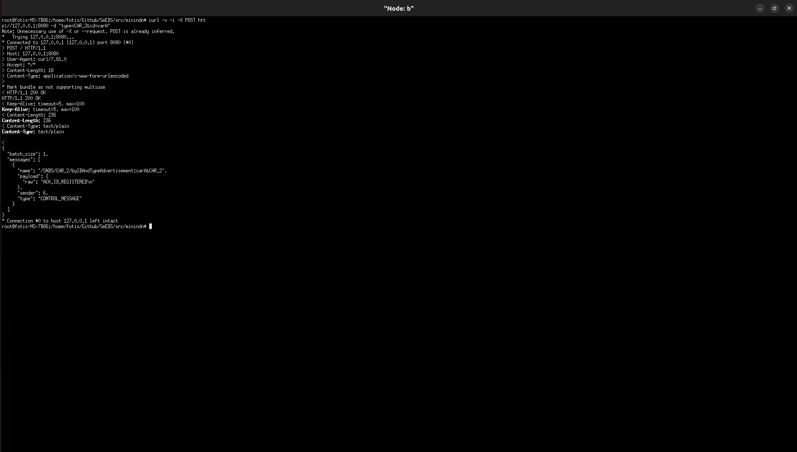

B's logs: 

```
[2025-09-25 01:31:05.584] [debug] [DigitalTwin] Extracted content from message {id=carA,type=CAR_2}
[2025-09-25 01:31:05.584] [debug] [DigitalTwin] Extracted content length from message 20
[2025-09-25 01:31:05.584] [debug] [DigitalTwin] Extracted type from message: BY_ID_AND_TYPE_ADVERTISEMENT
[2025-09-25 01:31:05.584] [info] [DigitalTwin] Received by Type get request...
[2025-09-25 01:31:05.584] [debug] [DigitalTwin] The Type is the following: CAR_2
[2025-09-25 01:31:05.584] [debug] [DigitalTwin] The ID is the following: carA
Message: /SNDS/CAR_2/byIDAndTypeAdvertisement:carA&CAR_2
Type: BY_ID_AND_TYPE_ADVERTISEMENT
Sender: DIGITAL_TWIN
Payload: 
HTTP Type: HTTP_EMPTY
Params:
[2025-09-25 01:31:05.584] [info] [DigitalTwin] Pushing byType advertisement to the Consumer...
Message: /SNDS/CAR_2/byIDAndTypeAdvertisement:carA&CAR_2
Type: BY_ID_AND_TYPE_ADVERTISEMENT
Sender: DIGITAL_TWIN
Payload: 
HTTP Type: HTTP_EMPTY
Params:

[2025-09-25 01:31:05.584] [debug] [DigitalTwin] Sleeping 2000 ms before sending scope advertisement...
[2025-09-25 01:31:05.584] [debug] [Consumer] Extracted content from message: /SNDS/CAR_2/byIDAndTypeAdvertisement:carA&CAR_2
[2025-09-25 01:31:05.584] [debug] [Consumer] Extracted content length from message: 47
[2025-09-25 01:31:05.584] [debug] [Consumer] Extracted message type from message: BY_ID_AND_TYPE_ADVERTISEMENT
[2025-09-25 01:31:05.584] [debug] [Consumer] Created name: /SNDS/CAR_2/byIDAndTypeAdvertisement:carA&CAR_2 in func: express_by_id_and_type_advertisement_interest
[2025-09-25 01:31:05.584] [info] [Consumer] Sending actual Interest /SNDS/CAR_2/byIDAndTypeAdvertisement%3AcarA%26CAR_2?CanBePrefix&Lifetime=6000
[2025-09-25 01:31:05.588] [info] [Consumer] Received Data with name: /SNDS/CAR_2/byIDAndTypeAdvertisement%3AcarA%26CAR_2 in function onData
[2025-09-25 01:31:05.588] [info] [Consumer] Data packet payload: ACK_ID_REGISTERED in function onData
[2025-09-25 01:31:05.588] [info] [Consumer] Parsed interest: Prefix: SNDS, Name: CAR_2, Command: byIDAndTypeAdvertisement, Params: [carA, CAR_2] in onData
[2025-09-25 01:31:05.588] [info] [Consumer] Got ACK ACK_ID_REGISTERED. Skipping...
[2025-09-25 01:31:05.588] [info] [Consumer] Reading packet...
[2025-09-25 01:31:05.588] [info] [Worker] Received content: /SNDS/CAR_2/byIDAndTypeAdvertisement:carA&CAR_2
[2025-09-25 01:31:05.588] [info] [Worker] Received payload: ACK_ID_REGISTERED
[2025-09-25 01:31:05.588] [info] [Worker] Received type: GET_BY_ID_FOR_TYPE_RESPONSE
[2025-09-25 01:31:05.588] [debug] [Worker] Consumer intra message...
```

A's logs: 

```
[2025-09-25 01:31:07.585] [info] [Producer] Received interest in function: onInterest, name: /SNDS/SNDS_ID_scope_0/subscriptionNotification%3AcarA%26CAR_2%26SNDS_ID_scope_2
[2025-09-25 01:31:07.585] [info] [Producer] Parsed interest: Prefix: SNDS, Name: SNDS_ID_scope_0, Command: subscriptionNotification, Params: [carA, CAR_2, SNDS_ID_scope_2]
[2025-09-25 01:31:07.585] [info] [Producer] Subscription Notification: id='carA', type='CAR_2' (byTYPE), scope='SNDS_ID_scope_0', cb='SNDS_ID_scope_2' -> issuing GET_BY_TYPE_REQUEST
Message: /SNDS/CAR_2/getByType:CAR_2
Type: GET_BY_TYPE_REQUEST
Sender: PRODUCER
Payload: 
HTTP Type: HTTP_EMPTY
Params:
[2025-09-25 01:31:07.585] [debug] [Producer] Sending message:
Message: /SNDS/CAR_2/getByType:CAR_2
Type: GET_BY_TYPE_REQUEST
Sender: PRODUCER
Payload: 
HTTP Type: HTTP_EMPTY
Params:

in func: process_subscription_notification_interest
[2025-09-25 01:31:07.585] [debug] [Producer] Sending data to the NDN…
[2025-09-25 01:31:07.585] [debug] [Consumer] Extracted content from message: /SNDS/CAR_2/getByType:CAR_2
[2025-09-25 01:31:07.585] [debug] [Consumer] Extracted content length from message: 27
[2025-09-25 01:31:07.585] [debug] [Consumer] Extracted message type from message: GET_BY_TYPE_REQUEST
[2025-09-25 01:31:07.585] [debug] [Consumer] Created name: /SNDS/CAR_2/getByType:CAR_2 in func: express_get_by_type_interest
[2025-09-25 01:31:07.585] [info] [Consumer] Sending actual Interest /SNDS/CAR_2/getByType%3ACAR_2?CanBePrefix&Lifetime=6000
[2025-09-25 01:31:07.586] [info] [Consumer] Received Data with name: /SNDS/CAR_2/getByType%3ACAR_2 in function onData
[2025-09-25 01:31:07.586] [info] [Consumer] Data packet payload: RcarA in function onData
[2025-09-25 01:31:07.586] [info] [Consumer] Parsed interest: Prefix: SNDS, Name: CAR_2, Command: getByType, Params: [CAR_2] in onData
[2025-09-25 01:31:07.586] [info] [Consumer] Received Registry File
[2025-09-25 01:31:07.586] [info] [Consumer] In Function: onData sending name CAR_2 to worker RcarA
[2025-09-25 01:31:07.586] [info] [Consumer] Reading packet...
[2025-09-25 01:31:07.586] [info] [Worker] Received content: CAR_2
[2025-09-25 01:31:07.586] [info] [Worker] Received payload: RcarA
[2025-09-25 01:31:07.586] [info] [Worker] Received type: REGISTRY_PAYLOAD
[2025-09-25 01:31:07.586] [debug] [Worker] Consumer intra message...
[2025-09-25 01:31:07.586] [debug] [Worker] Number of IDs in payload: 1
[2025-09-25 01:31:07.586] [debug] [Worker] Reading ID #1 with size 4
[2025-09-25 01:31:07.586] [info] [Worker] Parsed ID #1: carA
[2025-09-25 01:31:07.586] [info] [Worker] Size of ids in registry file: 1
[2025-09-25 01:31:07.586] [debug] [Worker] Processing registry id: carA
[2025-09-25 01:31:07.586] [info] [Worker] Pushing request to the consumer for id carA
[2025-09-25 01:31:07.586] [info] [Worker] Reading packet...
[2025-09-25 01:31:07.586] [debug] [Consumer] Extracted content from message: /SNDS/CAR_2/getByIDForType:carA&CAR_2
[2025-09-25 01:31:07.586] [debug] [Consumer] Extracted content length from message: 37
[2025-09-25 01:31:07.586] [debug] [Consumer] Extracted message type from message: GET_BY_ID_FOR_TYPE_REQUEST
[2025-09-25 01:31:07.586] [debug] [Consumer] Query.type: CAR_2
[2025-09-25 01:31:07.586] [debug] [Consumer] Query.id: carA
[2025-09-25 01:31:07.586] [info] [Consumer] Created name /SNDS/CAR_2/temporalQuery:id%3DcarA&type%3DCAR_2&date%3D&count%3D&timeframe%3D&filters%3D
[2025-09-25 01:31:07.586] [info] [Consumer] Sending actual Interest /SNDS/CAR_2/temporalQuery%3Aid%3DcarA%26type%3DCAR_2%26date%3D%26count%3D%26timeframe%3D%26filters%3D?CanBePrefix&Lifetime=6000
[2025-09-25 01:31:07.588] [info] [Consumer] Received Data with name: /SNDS/CAR_2/temporalQuery%3Aid%3DcarA%26type%3DCAR_2%26date%3D%26count%3D%26timeframe%3D%26filters%3D in function onData
[2025-09-25 01:31:07.588] [info] [Consumer] Data packet payload: null in function onData
[2025-09-25 01:31:07.588] [info] [Consumer] Parsed interest: Prefix: SNDS, Name: CAR_2, Command: temporalQuery, Params: [id=carA, type=CAR_2, date=, count=, timeframe=, filters=] in onData
```

#### Temporal Query 

Publish multiple versions of ``car1`` in B: 

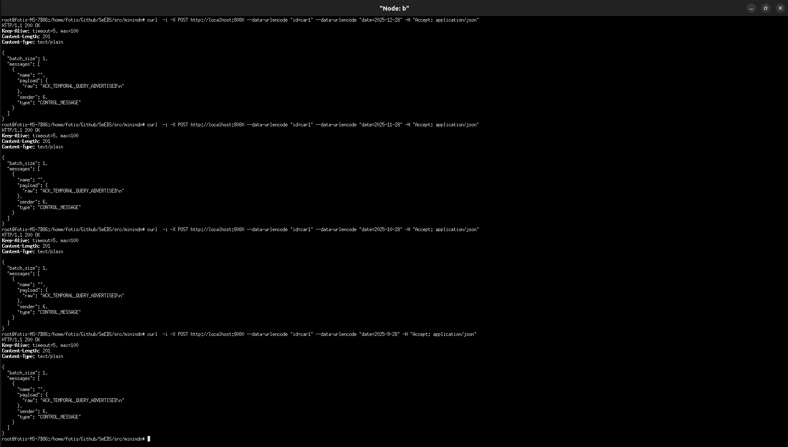


Let's check the logs of B's Broker:

```
Using URI: mongodb://10.0.0.2:27017/?serverSelectionTimeoutMS=60000
[2025-09-25 01:22:37.802] [info] [Broker] HTTP server listening on 10.0.0.2:10000
[2025-09-25 01:39:07.828] [info] [Broker] Received /add request: {"count":"","date":"2025-12-28","id":"car1","timeframe":0,"type":""}
[2025-09-25 01:39:07.829] [warning] [Broker] Missing 'type' in /add body, defaulting to 'GENERIC'
[2025-09-25 01:39:07.829] [debug] [Broker] Received type: GENERIC and id: car1 inside
[2025-09-25 01:39:07.829] [debug] [Broker] Constructed ID document: { "_id" : { "_id" : "car1", "timestamp" : { "$date" : 1758753547829 } }, "count" : "", "date" : "2025-12-28", "id" : "car1", "timeframe" : 0, "type" : "GENERIC", "timestamp" : { "$date" : 1758753547829 } }
[2025-09-25 01:39:07.829] [debug] [Broker] Created type version: GENERIC_VERSIONED
[2025-09-25 01:39:07.833] [debug] [Broker] Received type: GENERIC and id: car1 inside
[2025-09-25 01:39:07.833] [debug] [Broker] Constructed ID document: { "_id" : "car1", "count" : "", "date" : "2025-12-28", "id" : "car1", "timeframe" : 0, "type" : "GENERIC", "timestamp" : { "$date" : 1758753547833 } }
[2025-09-25 01:39:07.833] [debug] [Broker] Constructed filter document: { "_id" : "car1" }
[2025-09-25 01:39:07.838] [info] [Broker] Inserted 1 versioned, replaced/upserted 1 non-versioned
[2025-09-25 01:39:07.839] [info] [Broker] Received HTTP request for , with target /state?type=GENERIC
[2025-09-25 01:39:07.839] [info] [Broker] Collection fingerprint: c2f5b06058659c2d8a964e3a2c55aa12561c45146fcf8311c340e826c3315be9
[2025-09-25 01:39:07.840] [info] [Broker] Collection GENERIC fingerprint: c2f5b06058659c2d8a964e3a2c55aa12561c45146fcf8311c340e826c3315be9
[2025-09-25 01:39:13.841] [info] [Broker] Received /add request: {"count":"","date":"2025-12-28","id":"car1","timeframe":0,"type":""}
[2025-09-25 01:39:13.841] [warning] [Broker] Missing 'type' in /add body, defaulting to 'GENERIC'
[2025-09-25 01:39:13.841] [debug] [Broker] Received type: GENERIC and id: car1 inside
[2025-09-25 01:39:13.841] [debug] [Broker] Constructed ID document: { "_id" : { "_id" : "car1", "timestamp" : { "$date" : 1758753553841 } }, "count" : "", "date" : "2025-12-28", "id" : "car1", "timeframe" : 0, "type" : "GENERIC", "timestamp" : { "$date" : 1758753553841 } }
[2025-09-25 01:39:13.841] [debug] [Broker] Created type version: GENERIC_VERSIONED
[2025-09-25 01:39:13.842] [debug] [Broker] Received type: GENERIC and id: car1 inside
[2025-09-25 01:39:13.842] [debug] [Broker] Constructed ID document: { "_id" : "car1", "count" : "", "date" : "2025-12-28", "id" : "car1", "timeframe" : 0, "type" : "GENERIC", "timestamp" : { "$date" : 1758753553842 } }
[2025-09-25 01:39:13.842] [debug] [Broker] Constructed filter document: { "_id" : "car1" }
[2025-09-25 01:39:13.842] [info] [Broker] Inserted 1 versioned, replaced/upserted 1 non-versioned
[2025-09-25 01:39:13.843] [info] [Broker] Received HTTP request for , with target /state?type=GENERIC
[2025-09-25 01:39:13.843] [info] [Broker] Collection fingerprint: 797238086b694e2f0f3c16493534a95db1e9f82e996ae209ea1fea93ff7dca31
[2025-09-25 01:39:13.843] [info] [Broker] Collection GENERIC fingerprint: 797238086b694e2f0f3c16493534a95db1e9f82e996ae209ea1fea93ff7dca31
[2025-09-25 01:39:19.845] [info] [Broker] Received /add request: {"count":"","date":"2025-11-28","id":"car1","timeframe":0,"type":""}
[2025-09-25 01:39:19.845] [warning] [Broker] Missing 'type' in /add body, defaulting to 'GENERIC'
[2025-09-25 01:39:19.845] [debug] [Broker] Received type: GENERIC and id: car1 inside
[2025-09-25 01:39:19.845] [debug] [Broker] Constructed ID document: { "_id" : { "_id" : "car1", "timestamp" : { "$date" : 1758753559845 } }, "count" : "", "date" : "2025-11-28", "id" : "car1", "timeframe" : 0, "type" : "GENERIC", "timestamp" : { "$date" : 1758753559845 } }
[2025-09-25 01:39:19.845] [debug] [Broker] Created type version: GENERIC_VERSIONED
[2025-09-25 01:39:19.845] [debug] [Broker] Received type: GENERIC and id: car1 inside
[2025-09-25 01:39:19.846] [debug] [Broker] Constructed ID document: { "_id" : "car1", "count" : "", "date" : "2025-11-28", "id" : "car1", "timeframe" : 0, "type" : "GENERIC", "timestamp" : { "$date" : 1758753559845 } }
[2025-09-25 01:39:19.846] [debug] [Broker] Constructed filter document: { "_id" : "car1" }
[2025-09-25 01:39:19.846] [info] [Broker] Inserted 1 versioned, replaced/upserted 1 non-versioned
[2025-09-25 01:39:19.847] [info] [Broker] Received HTTP request for , with target /state?type=GENERIC
[2025-09-25 01:39:19.847] [info] [Broker] Collection fingerprint: e68cb455e86c96702dc7030d8156a91820f33fecb653fe8dd90696a69dcfe4a1
[2025-09-25 01:39:19.847] [info] [Broker] Collection GENERIC fingerprint: e68cb455e86c96702dc7030d8156a91820f33fecb653fe8dd90696a69dcfe4a1
[2025-09-25 01:39:23.849] [info] [Broker] Received /add request: {"count":"","date":"2025-10-28","id":"car1","timeframe":0,"type":""}
[2025-09-25 01:39:23.849] [warning] [Broker] Missing 'type' in /add body, defaulting to 'GENERIC'
[2025-09-25 01:39:23.849] [debug] [Broker] Received type: GENERIC and id: car1 inside
[2025-09-25 01:39:23.849] [debug] [Broker] Constructed ID document: { "_id" : { "_id" : "car1", "timestamp" : { "$date" : 1758753563849 } }, "count" : "", "date" : "2025-10-28", "id" : "car1", "timeframe" : 0, "type" : "GENERIC", "timestamp" : { "$date" : 1758753563849 } }
[2025-09-25 01:39:23.849] [debug] [Broker] Created type version: GENERIC_VERSIONED
[2025-09-25 01:39:23.849] [debug] [Broker] Received type: GENERIC and id: car1 inside
[2025-09-25 01:39:23.849] [debug] [Broker] Constructed ID document: { "_id" : "car1", "count" : "", "date" : "2025-10-28", "id" : "car1", "timeframe" : 0, "type" : "GENERIC", "timestamp" : { "$date" : 1758753563849 } }
[2025-09-25 01:39:23.849] [debug] [Broker] Constructed filter document: { "_id" : "car1" }
[2025-09-25 01:39:23.850] [info] [Broker] Inserted 1 versioned, replaced/upserted 1 non-versioned
[2025-09-25 01:39:23.850] [info] [Broker] Received HTTP request for , with target /state?type=GENERIC
[2025-09-25 01:39:23.851] [info] [Broker] Collection fingerprint: e8ce3eac97699bd07ae71d01a88b5bc46bc7360c6fb9748599da7621c291e007
[2025-09-25 01:39:23.851] [info] [Broker] Collection GENERIC fingerprint: e8ce3eac97699bd07ae71d01a88b5bc46bc7360c6fb9748599da7621c291e007
[2025-09-25 01:39:29.853] [info] [Broker] Received /add request: {"count":"","date":"2025-9-28","id":"car1","timeframe":0,"type":""}
[2025-09-25 01:39:29.853] [warning] [Broker] Missing 'type' in /add body, defaulting to 'GENERIC'
[2025-09-25 01:39:29.853] [debug] [Broker] Received type: GENERIC and id: car1 inside
[2025-09-25 01:39:29.853] [debug] [Broker] Constructed ID document: { "_id" : { "_id" : "car1", "timestamp" : { "$date" : 1758753569853 } }, "count" : "", "date" : "2025-9-28", "id" : "car1", "timeframe" : 0, "type" : "GENERIC", "timestamp" : { "$date" : 1758753569853 } }
[2025-09-25 01:39:29.853] [debug] [Broker] Created type version: GENERIC_VERSIONED
[2025-09-25 01:39:29.853] [debug] [Broker] Received type: GENERIC and id: car1 inside
[2025-09-25 01:39:29.853] [debug] [Broker] Constructed ID document: { "_id" : "car1", "count" : "", "date" : "2025-9-28", "id" : "car1", "timeframe" : 0, "type" : "GENERIC", "timestamp" : { "$date" : 1758753569853 } }
[2025-09-25 01:39:29.853] [debug] [Broker] Constructed filter document: { "_id" : "car1" }
[2025-09-25 01:39:29.854] [info] [Broker] Inserted 1 versioned, replaced/upserted 1 non-versioned
[2025-09-25 01:39:29.855] [info] [Broker] Received HTTP request for , with target /state?type=GENERIC
[2025-09-25 01:39:29.855] [info] [Broker] Collection fingerprint: 8cd1dbfa7cb6bc65b27fc7a53a010b9e26292c865d00bc7b5d19155ad479e2fa
[2025-09-25 01:39:29.855] [info] [Broker] Collection GENERIC fingerprint: 8cd1dbfa7cb6bc65b27fc7a53a010b9e26292c865d00bc7b5d19155ad479e2fa
```

Let's get the dump of the database: 

```json
mini-ndn> b curl http://10.0.0.2:10000/dump
{
  "GENERIC": [
    {
      "_id": "car2213213asfsdsad",
      "id": "car2213213asfsdsad",
      "timestamp": {
        "$date": 1758736757651
      },
      "type": "GENERIC"
    },
    {
      "_id": "car2",
      "id": "car2",
      "timestamp": {
        "$date": 1758736761662
      },
      "type": "GENERIC"
    },
    {
      "_id": "car1234",
      "id": "car1234",
      "timestamp": {
        "$date": 1758750923529
      },
      "type": "GENERIC"
    },
    {
      "_id": "car1",
      "count": "",
      "date": "2025-9-28",
      "id": "car1",
      "timeframe": 0,
      "timestamp": {
        "$date": 1758753569853
      },
      "type": "GENERIC"
    }
  ],
  "GENERIC_VERSIONED": [
    {
      "_id": {
        "_id": "car2213213asfsdsad",
        "timestamp": {
          "$date": 1758736758397
        }
      },
      "id": "car2213213asfsdsad",
      "timestamp": {
        "$date": 1758736758397
      },
      "type": "GENERIC"
    },
    {
      "_id": {
        "_id": "car2",
        "timestamp": {
          "$date": 1758736762417
        }
      },
      "id": "car2",
      "timestamp": {
        "$date": 1758736762417
      },
      "type": "GENERIC"
    },
    {
      "_id": {
        "_id": "car2213213asfsdsad",
        "timestamp": {
          "$date": 1758736757640
        }
      },
      "id": "car2213213asfsdsad",
      "timestamp": {
        "$date": 1758736757640
      },
      "type": "GENERIC"
    },
    {
      "_id": {
        "_id": "car2",
        "timestamp": {
          "$date": 1758736761661
        }
      },
      "id": "car2",
      "timestamp": {
        "$date": 1758736761661
      },
      "type": "GENERIC"
    },
    {
      "_id": {
        "_id": "car1234",
        "timestamp": {
          "$date": 1758750923526
        }
      },
      "id": "car1234",
      "timestamp": {
        "$date": 1758750923526
      },
      "type": "GENERIC"
    },
    {
      "_id": {
        "_id": "car1",
        "timestamp": {
          "$date": 1758753547829
        }
      },
      "count": "",
      "date": "2025-12-28",
      "id": "car1",
      "timeframe": 0,
      "timestamp": {
        "$date": 1758753547829
      },
      "type": "GENERIC"
    },
    {
      "_id": {
        "_id": "car1",
        "timestamp": {
          "$date": 1758753553841
        }
      },
      "count": "",
      "date": "2025-12-28",
      "id": "car1",
      "timeframe": 0,
      "timestamp": {
        "$date": 1758753553841
      },
      "type": "GENERIC"
    },
    {
      "_id": {
        "_id": "car1",
        "timestamp": {
          "$date": 1758753559845
        }
      },
      "count": "",
      "date": "2025-11-28",
      "id": "car1",
      "timeframe": 0,
      "timestamp": {
        "$date": 1758753559845
      },
      "type": "GENERIC"
    },
    {
      "_id": {
        "_id": "car1",
        "timestamp": {
          "$date": 1758753563849
        }
      },
      "count": "",
      "date": "2025-10-28",
      "id": "car1",
      "timeframe": 0,
      "timestamp": {
        "$date": 1758753563849
      },
      "type": "GENERIC"
    },
    {
      "_id": {
        "_id": "car1",
        "timestamp": {
          "$date": 1758753569853
        }
      },
      "count": "",
      "date": "2025-9-28",
      "id": "car1",
      "timeframe": 0,
      "timestamp": {
        "$date": 1758753569853
      },
      "type": "GENERIC"
    }
  ]
}
```


As we can see there are multiple versions of ``car1`` inside the Broker's database. Make sure the post the ID in the NDN network so its discoverable: 

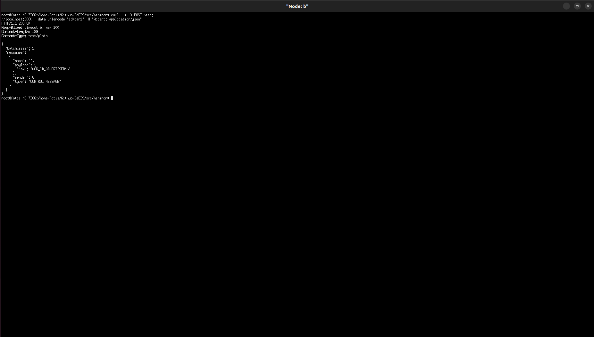

```
[2025-09-25 01:47:48.761] [info] [Producer] POST /add -> {"id":"car1"}
[2025-09-25 01:47:48.767] [info] [Producer] Published to broker OK: {"status": "success", "inserted_count_versioned": 1, "upserted_or_modified_count": 1}

[2025-09-25 01:47:48.767] [debug] [Producer] Appending body to broker journal: {"id":"car1"}
[2025-09-25 01:47:48.767] [info] [Producer] [resilience] mutate → ver=8 hash=550a0a8260c38dfc486f4ac95bfbe143
[2025-09-25 01:47:48.768] [debug] [Producer] [resilience] history versions: 0(37a6259c) 1(60b95123) 2(7813088c) 3(8416ddb1) 4(39a8f1b1) 5(82ca38de) 6(1498af55) 7(06a3f833) 8(550a0a82) 
[2025-09-25 01:47:48.768] [debug] [Producer] [resilience] ops from v7 → v8:
[
  {
    "op": "add",
    "path": "/broker/journal",
    "value": [
      {
        "id": "car1",
        "payload": {
          "id": "car1"
        },
        "ts": "2025-09-24T22:47:48Z",
        "type": "GENERIC"
      }
    ]
  }
]
[2025-09-25 01:47:48.768] [info] [Worker] Received content: 
[2025-09-25 01:47:48.768] [info] [Worker] Received payload: ACK_ID_ADVERTISED
[2025-09-25 01:47:48.768] [info] [Worker] Received type: BY_ID_ADVERTISEMENT
[2025-09-25 01:47:48.768] [info] [Worker] Received ACK Message with name:  payload: ACK_ID_ADVERTISED...
Message: 
Type: CONTROL_MESSAGE
Sender: WORKER
Payload: ACK_ID_ADVERTISED

HTTP Type: HTTP_EMPTY
Params:
[2025-09-25 01:47:48.768] [debug] [Worker] Writing message to service queue:
Message: 
Type: CONTROL_MESSAGE
Sender: WORKER
Payload: ACK_ID_ADVERTISED

HTTP Type: HTTP_EMPTY
Params:

[2025-09-25 01:47:48.768] [info] [Worker] Reading packet...
Message: BATCH
Type: GENERIC
Sender: WORKER
Payload: {
  "batch_size": 1,
  "messages": [
    {
      "name": "",
      "payload": {
        "raw": "ACK_ID_ADVERTISED\n"
      },
      "sender": 6,
      "type": "CONTROL_MESSAGE"
    }
  ]
}

HTTP Type: HTTP_EMPTY
Params:
[2025-09-25 01:47:48.768] [info] [HTTPServer] Read Message from queue:
Message: BATCH
Type: GENERIC
Sender: WORKER
Payload: {
  "batch_size": 1,
  "messages": [
    {
      "name": "",
      "payload": {
        "raw": "ACK_ID_ADVERTISED\n"
      },
      "sender": 6,
      "type": "CONTROL_MESSAGE"
    }
  ]
}

HTTP Type: HTTP_EMPTY
Params:

[2025-09-25 01:47:48.769] [info] [Producer] Successfully registered prefix: /SNDS/car1
```


Since there are multiple ``car1`` instances we should expect an [indirect mode response](#indirect-mode)


If we instead request an ID ``carNEW1``, which is present once in the Broker Database we should get [direct mode response](#direct-mode). Remind we should post the ``carNEW1`` to the NDN to be visible.

##### Direct Mode

```
[2025-09-25 05:54:32.975] [info] [Consumer] Created name /SNDS/carNew1/temporalQuery:id%3DcarNew1&type%3D&date%3D2025-09-28&count%3D2&timeframe%3Dnow&filters%3D
[2025-09-25 05:54:32.975] [info] [Consumer] Sending actual Interest /SNDS/carNew1/temporalQuery%3Aid%3DcarNew1%26type%3D%26date%3D2025-09-28%26count%3D2%26timeframe%3Dnow%26filters%3D?CanBePrefix&Lifetime=6000
[2025-09-25 05:54:32.975] [info] [Producer] Received interest in function: onInterest, name: /SNDS/carNew1/temporalQuery%3Aid%3DcarNew1%26type%3D%26date%3D2025-09-28%26count%3D2%26timeframe%3Dnow%26filters%3D
[2025-09-25 05:54:32.975] [info] [Producer] Parsed interest: Prefix: SNDS, Name: carNew1, Command: temporalQuery, Params: [id=carNew1, type=, date=2025-09-28, count=2, timeframe=now, filters=]
[2025-09-25 05:54:32.975] [debug] [Producer] Created interest response: /SNDS/carNew1/temporalQuery%3Aid%3DcarNew1%26type%3D%26date%3D2025-09-28%26count%3D2%26timeframe%3Dnow%26filters%3D in: process_temporal_query_interest
[2025-09-25 05:54:32.975] [debug] [Producer] TemporalQuery → id: carNew1, date: 2025-09-28, type: , timeframe: now, count: 2, filters: 
[2025-09-25 05:54:32.975] [debug] [Producer] Requesting to endpoint: /temporal-query?id=carNew1&type=&count=2&date=2025-09-28&timeframe=now&filters=
[2025-09-25 05:54:32.977] [info] [Producer] Successfully queried /temporal-query
[2025-09-25 05:54:32.977] [debug] [Producer] Sending data to the NDN…
[2025-09-25 05:54:32.977] [info] [Consumer] Received Data with name: /SNDS/carNew1/temporalQuery%3Aid%3DcarNew1%26type%3D%26date%3D2025-09-28%26count%3D2%26timeframe%3Dnow%26filters%3D in function onData
[2025-09-25 05:54:32.977] [info] [Consumer] Data packet payload: [
  {
    "now": [
      {
        "_id": {
          "_id": "carNew1",
          "timestamp": {
            "$date": 1758768831282
          }
        }
      }
    ]
  }
] in function onData
[2025-09-25 05:54:32.977] [info] [Consumer] Parsed interest: Prefix: SNDS, Name: carNew1, Command: temporalQuery, Params: [id=carNew1, type=, date=2025-09-28, count=2, timeframe=now, filters=] in onData
[2025-09-25 05:54:32.977] [info] [Consumer] Temporal Query Reponse...
[2025-09-25 05:54:32.977] [debug] [Consumer] Removed extra characters from payload (first 32 bytes hex): 5b 0a 20 20 7b 0a 20 20 20 20 22 6e 6f 77 22 3a 20 5b 0a 20 20 20 20 20 20 7b 0a 20 20 20 20 20 
[2025-09-25 05:54:32.977] [debug] [Consumer] Candidate JSON slice:
[
  {
    "now": [
      {
        "_id": {
          "_id": "carNew1",
          "timestamp": {
            "$date": 1758768831282
          }
        }
      }
    ]
  }
]
[2025-09-25 05:54:32.977] [debug] [Consumer] Sanitized payload to:
[
  {
    "now": [
      {
        "_id": {
          "_id": "carNew1",
          "timestamp": {
            "$date": 1758768831282
          }
        }
      }
    ]
  }
]
[2025-09-25 05:54:32.977] [debug] [Consumer] Direct mode (single id in bucket).
[2025-09-25 05:54:32.977] [info] [Worker] Received content: /?id=carNew1&type=&date=1758768831282&metafile=false&parentQueryHash=&lastInterest=true&mode=direct
[2025-09-25 05:54:32.977] [info] [Worker] Received payload: [
  {
    "now": [
      {
        "_id": {
          "_id": "carNew1",
          "timestamp": {
            "$date": 1758768831282
          }
        }
      }
    ]
  }
]
[2025-09-25 05:54:32.977] [info] [Worker] Received type: VERSION_RESPONSE
[2025-09-25 05:54:32.977] [debug] [Worker] Consumer intra message...
[2025-09-25 05:54:32.977] [info] [Consumer] Reading packet...
[2025-09-25 05:54:32.977] [info] [Worker] Direct mode...
[2025-09-25 05:54:32.977] [debug] [Worker] Cleared pending_get_by_id_requests for 'carNew1': erased=0
[2025-09-25 05:54:32.977] [info] [Worker] Reading packet...
```

##### Indirect Mode


```
[2025-09-25 01:49:28.968] [info] [Worker] Got new temporal query with hash: 9322238995621266204
[2025-09-25 01:49:28.968] [info] [Worker] Pushing TemporalQuery {"count":"2","date":"2025-09-28","id":"car1","timeframe":"now","type":""} for ID: car1
[2025-09-25 01:49:28.968] [info] [Worker] Reading packet...
[2025-09-25 01:49:28.968] [debug] [Consumer] Extracted content from message: {"count":"2","date":"2025-09-28","id":"car1","timeframe":"now","type":""}
[2025-09-25 01:49:28.968] [debug] [Consumer] Extracted content length from message: 73
[2025-09-25 01:49:28.968] [debug] [Consumer] Extracted message type from message: TEMPORAL_QUERY_REQUEST
[2025-09-25 01:49:28.968] [debug] [Consumer] Query.type: 
[2025-09-25 01:49:28.968] [debug] [Consumer] Query.id: car1
[2025-09-25 01:49:28.968] [info] [Consumer] Created name /SNDS/car1/temporalQuery:id%3Dcar1&type%3D&date%3D2025-09-28&count%3D2&timeframe%3Dnow&filters%3D
[2025-09-25 01:49:28.968] [info] [Consumer] Sending actual Interest /SNDS/car1/temporalQuery%3Aid%3Dcar1%26type%3D%26date%3D2025-09-28%26count%3D2%26timeframe%3Dnow%26filters%3D?CanBePrefix&Lifetime=6000
[2025-09-25 01:49:28.968] [info] [Producer] Received interest in function: onInterest, name: /SNDS/car1/temporalQuery%3Aid%3Dcar1%26type%3D%26date%3D2025-09-28%26count%3D2%26timeframe%3Dnow%26filters%3D
[2025-09-25 01:49:28.968] [info] [Producer] Parsed interest: Prefix: SNDS, Name: car1, Command: temporalQuery, Params: [id=car1, type=, date=2025-09-28, count=2, timeframe=now, filters=]
[2025-09-25 01:49:28.968] [debug] [Producer] Created interest response: /SNDS/car1/temporalQuery%3Aid%3Dcar1%26type%3D%26date%3D2025-09-28%26count%3D2%26timeframe%3Dnow%26filters%3D in: process_temporal_query_interest
[2025-09-25 01:49:28.968] [debug] [Producer] TemporalQuery → id: car1, date: 2025-09-28, type: , timeframe: now, count: 2, filters: 
[2025-09-25 01:49:28.968] [debug] [Producer] Requesting to endpoint: /temporal-query?id=car1&type=&count=2&date=2025-09-28&timeframe=now&filters=
[2025-09-25 01:49:28.970] [info] [Producer] Successfully queried /temporal-query
[2025-09-25 01:49:28.970] [debug] [Producer] Sending data to the NDN…
[2025-09-25 01:49:28.972] [info] [Consumer] Received Data with name: /SNDS/car1/temporalQuery%3Aid%3Dcar1%26type%3D%26date%3D2025-09-28%26count%3D2%26timeframe%3Dnow%26filters%3D in function onData
[2025-09-25 01:49:28.972] [info] [Consumer] Data packet payload: [
  {
    "now": [
      {
        "_id": {
          "_id": "car1",
          "timestamp": {
            "$date": 1758754068761
          }
        }
      },
      {
        "_id": {
          "_id": "car1",
          "timestamp": {
            "$date": 1758754017869
          }
        }
      }
    ]
  }
] in function onData
[2025-09-25 01:49:28.972] [info] [Consumer] Parsed interest: Prefix: SNDS, Name: car1, Command: temporalQuery, Params: [id=car1, type=, date=2025-09-28, count=2, timeframe=now, filters=] in onData
[2025-09-25 01:49:28.972] [info] [Consumer] Temporal Query Reponse...
[2025-09-25 01:49:28.972] [debug] [Consumer] Removed extra characters from payload (first 32 bytes hex): 5b 0a 20 20 7b 0a 20 20 20 20 22 6e 6f 77 22 3a 20 5b 0a 20 20 20 20 20 20 7b 0a 20 20 20 20 20 
[2025-09-25 01:49:28.972] [debug] [Consumer] Candidate JSON slice:
[
  {
    "now": [
      {
        "_id": {
          "_id": "car1",
          "timestamp": {
            "$date": 1758754068761
          }
        }
      },
      {
        "_id": {
          "_id": "car1",
          "timestamp": {
            "$date": 1758754017869
          }
        }
      }
    ]
  }
]
[2025-09-25 01:49:28.972] [debug] [Consumer] Sanitized payload to:
[
  {
    "now": [
      {
        "_id": {
          "_id": "car1",
          "timestamp": {
            "$date": 1758754068761
          }
        }
      },
      {
        "_id": {
          "_id": "car1",
          "timestamp": {
            "$date": 1758754017869
          }
        }
      }
    ]
  }
]
[2025-09-25 01:49:28.972] [warning] [Consumer] Direct mode flagged, but unable to extract item; falling back to manifest path.
[2025-09-25 01:49:28.972] [debug] [Consumer] Created Parent Temporal Query: timeframe=now&date=2025-09-28&id=car1&type=&count=2
[2025-09-25 01:49:28.972] [debug] [Consumer] Created parent_query_hash: 9322238995621266204 in send_metafile_interests
[2025-09-25 01:49:28.972] [debug] [Consumer] Parsing key: now
[2025-09-25 01:49:28.972] [debug] [Consumer] Doc fields -> id=car1, ts(ms)=1758754068761, type=
[2025-09-25 01:49:28.972] [debug] [Consumer] Adding params...
[2025-09-25 01:49:28.972] [debug] [Consumer] Added params...
[2025-09-25 01:49:28.972] [debug] [Consumer] Doc fields -> id=car1, ts(ms)=1758754017869, type=
[2025-09-25 01:49:28.972] [debug] [Consumer] Adding params...
[2025-09-25 01:49:28.972] [debug] [Consumer] Added params...
[2025-09-25 01:49:28.972] [info] [Consumer] Sending Interest (lastInterest=false): /SNDS/car1/version%3Aid%3Dcar1%26type%3D%26date%3D2025-09-24T22%3A47%3A48.761%2B00%3A00%26metafile%3Dtrue%26parentQueryHash%3D9322238995621266204%26lastInterest%3Dfalse
[2025-09-25 01:49:28.972] [debug] [Consumer] Created interest_name: /SNDS/car1/version%3Aid%3Dcar1%26type%3D%26date%3D2025-09-24T22%3A47%3A48.761%2B00%3A00%26metafile%3Dtrue%26parentQueryHash%3D9322238995621266204%26lastInterest%3Dfalse
[2025-09-25 01:49:28.972] [info] [Consumer] Sending Interest (lastInterest=true): /SNDS/car1/version%3Aid%3Dcar1%26type%3D%26date%3D2025-09-24T22%3A46%3A57.869%2B00%3A00%26metafile%3Dtrue%26parentQueryHash%3D9322238995621266204%26lastInterest%3Dtrue
[2025-09-25 01:49:28.972] [debug] [Consumer] Created interest_name: /SNDS/car1/version%3Aid%3Dcar1%26type%3D%26date%3D2025-09-24T22%3A46%3A57.869%2B00%3A00%26metafile%3Dtrue%26parentQueryHash%3D9322238995621266204%26lastInterest%3Dtrue
[2025-09-25 01:49:28.972] [info] [Producer] Received interest in function: onInterest, name: /SNDS/car1/version%3Aid%3Dcar1%26type%3D%26date%3D2025-09-24T22%3A47%3A48.761%2B00%3A00%26metafile%3Dtrue%26parentQueryHash%3D9322238995621266204%26lastInterest%3Dfalse
[2025-09-25 01:49:28.972] [info] [Producer] Parsed interest: Prefix: SNDS, Name: car1, Command: version, Params: [id=car1, type=, date=2025-09-24T22:47:48.761+00:00, metafile=true, parentQueryHash=9322238995621266204, lastInterest=false]
[2025-09-25 01:49:28.972] [debug] [Producer] Created interest response: /SNDS/car1/version%3Aid%3Dcar1%26type%3D%26date%3D2025-09-24T22%3A47%3A48.761%2B00%3A00%26metafile%3Dtrue%26parentQueryHash%3D9322238995621266204%26lastInterest%3Dfalse in process_version_metafile_interest
[2025-09-25 01:49:28.973] [info] [Producer] ID request received: id = car1
[2025-09-25 01:49:28.973] [info] [Producer] Successfully queried /get
[2025-09-25 01:49:28.973] [debug] [Producer] Sending data to the NDN…
[2025-09-25 01:49:28.973] [info] [Producer] Received interest in function: onInterest, name: /SNDS/car1/version%3Aid%3Dcar1%26type%3D%26date%3D2025-09-24T22%3A46%3A57.869%2B00%3A00%26metafile%3Dtrue%26parentQueryHash%3D9322238995621266204%26lastInterest%3Dtrue
[2025-09-25 01:49:28.973] [info] [Producer] Parsed interest: Prefix: SNDS, Name: car1, Command: version, Params: [id=car1, type=, date=2025-09-24T22:46:57.869+00:00, metafile=true, parentQueryHash=9322238995621266204, lastInterest=true]
[2025-09-25 01:49:28.973] [debug] [Producer] Created interest response: /SNDS/car1/version%3Aid%3Dcar1%26type%3D%26date%3D2025-09-24T22%3A46%3A57.869%2B00%3A00%26metafile%3Dtrue%26parentQueryHash%3D9322238995621266204%26lastInterest%3Dtrue in process_version_metafile_interest
[2025-09-25 01:49:28.973] [info] [Producer] ID request received: id = car1
[2025-09-25 01:49:28.973] [info] [Consumer] Received Data with name: /SNDS/car1/version%3Aid%3Dcar1%26type%3D%26date%3D2025-09-24T22%3A47%3A48.761%2B00%3A00%26metafile%3Dtrue%26parentQueryHash%3D9322238995621266204%26lastInterest%3Dfalse in function onData
[2025-09-25 01:49:28.973] [info] [Consumer] Data packet payload: {
  "_id": "car1",
  "id": "car1",
  "timestamp": {
    "$date": 1758754068765
  },
  "type": "GENERIC"
} in function onData
[2025-09-25 01:49:28.973] [info] [Consumer] Parsed interest: Prefix: SNDS, Name: car1, Command: version, Params: [id=car1, type=, date=2025-09-24T22:47:48.761+00:00, metafile=true, parentQueryHash=9322238995621266204, lastInterest=false] in onData
[2025-09-25 01:49:28.973] [info] [Consumer] Temporal Query Data Response from Metafile...
[2025-09-25 01:49:28.973] [info] [Consumer] Building query URI...
[2025-09-25 01:49:28.974] [info] [Worker] Received content: /?id=car1&type=&date=2025-09-24T22:47:48.761+00:00&metafile=true&parentQueryHash=9322238995621266204&lastInterest=false
[2025-09-25 01:49:28.974] [info] [Worker] Received payload: {
  "_id": "car1",
  "id": "car1",
  "timestamp": {
    "$date": 1758754068765
  },
  "type": "GENERIC"
}
[2025-09-25 01:49:28.974] [info] [Worker] Received type: VERSION_RESPONSE
[2025-09-25 01:49:28.974] [debug] [Worker] Consumer intra message...
[2025-09-25 01:49:28.974] [debug] [Worker] Buffered 1 items for hash 9322238995621266204 (waiting for lastInterest).
[2025-09-25 01:49:28.974] [info] [Worker] Reading packet...
[2025-09-25 01:49:28.974] [info] [Producer] Successfully queried /get
[2025-09-25 01:49:28.974] [debug] [Producer] Sending data to the NDN…
[2025-09-25 01:49:28.974] [info] [Consumer] Received Data with name: /SNDS/car1/version%3Aid%3Dcar1%26type%3D%26date%3D2025-09-24T22%3A46%3A57.869%2B00%3A00%26metafile%3Dtrue%26parentQueryHash%3D9322238995621266204%26lastInterest%3Dtrue in function onData
[2025-09-25 01:49:28.974] [info] [Consumer] Data packet payload: {
  "_id": "car1",
  "id": "car1",
  "timestamp": {
    "$date": 1758754068765
  },
  "type": "GENERIC"
} in function onData
[2025-09-25 01:49:28.974] [info] [Consumer] Parsed interest: Prefix: SNDS, Name: car1, Command: version, Params: [id=car1, type=, date=2025-09-24T22:46:57.869+00:00, metafile=true, parentQueryHash=9322238995621266204, lastInterest=true] in onData
[2025-09-25 01:49:28.974] [info] [Consumer] Temporal Query Data Response from Metafile...
[2025-09-25 01:49:28.974] [info] [Consumer] Building query URI...
[2025-09-25 01:49:28.974] [info] [Consumer] Reading packet...
[2025-09-25 01:49:28.974] [info] [Worker] Received content: /?id=car1&type=&date=2025-09-24T22:46:57.869+00:00&metafile=true&parentQueryHash=9322238995621266204&lastInterest=true
[2025-09-25 01:49:28.974] [info] [Worker] Received payload: {
  "_id": "car1",
  "id": "car1",
  "timestamp": {
    "$date": 1758754068765
  },
  "type": "GENERIC"
}
[2025-09-25 01:49:28.974] [info] [Worker] Received type: VERSION_RESPONSE
[2025-09-25 01:49:28.974] [debug] [Worker] Consumer intra message...
[2025-09-25 01:49:28.974] [debug] [Worker] Sending BULK temporal response (2 items) for hash 9322238995621266204
[2025-09-25 01:49:28.974] [debug] [Worker] Response looks like this:
{
  "items": [
    {
      "_id": "car1",
      "id": "car1",
      "timestamp": {
        "$date": 1758754068765
      },
      "type": "GENERIC"
    },
    {
      "_id": "car1",
      "id": "car1",
      "timestamp": {
        "$date": 1758754068765
      },
      "type": "GENERIC"
    }
  ],
  "mode": "manifest",
  "parentQueryHash": "9322238995621266204",
  "query": "{\"count\":\"2\",\"date\":\"2025-09-28\",\"id\":\"car1\",\"timeframe\":\"now\",\"type\":\"\"}"
}
[2025-09-25 01:49:28.974] [info] [Worker] Reading packet...

```

##### Requesting from other nodes

Publish through A: 


Request through B:


#### Filters 

In a single node that has a populated database like this: 

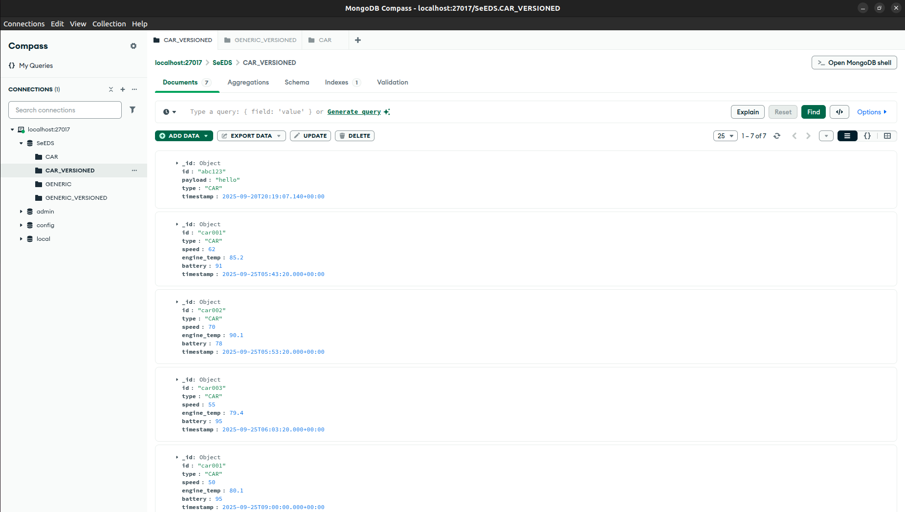

Post the ID ``car001`` to the network: 

```
fotis@fotis-MS-7B86:~/Github/SeEDS$ curl -X POST http://localhost:8080/   --data-urlencode "id=car001"   -H "Accept: application/json"
```

```
fotis@fotis-MS-7B86:~/Github/SeEDS$ curl -i -X GET "http://localhost:8080"   --data-urlencode "id=car001"   --data-urlencode "timeframe=now+before+after"   --data-urlencode "count=3"   --data-urlencode "date=2025-10-28"   --data-urlencode "type=CAR"  --data-urlencode "filters=id" "Accept: application/json"
```

Result: 

```
[2025-09-25 09:23:25.777] [info] [Worker] Received type: VERSION_RESPONSE
[2025-09-25 09:23:25.777] [debug] [Worker] Consumer intra message...
[2025-09-25 09:23:25.777] [debug] [Worker] Parent Query is: {"count":"3","date":"2025-10-28","filters":"id","id":"car001","timeframe":"now+before+after","type":"CAR"}
[2025-09-25 09:23:25.777] [debug] [Worker] Processing slice/doc: {
  "_id": "car001",
  "battery": 95,
  "engine_temp": 80.1,
  "id": "car001",
  "speed": 50,
  "timestamp": {
    "$date": 1758790800000
  },
  "type": "CAR"
} and trying to apply filters...
[2025-09-25 09:23:25.777] [debug] [Worker] Trying to apply filter: id
[2025-09-25 09:23:25.777] [debug] [Worker] Sending BULK temporal response (4 items) for hash 15316310682379764155
[2025-09-25 09:23:25.777] [debug] [Worker] Response looks like this:
{
  "items": [
    {
      "id": "car001"
    },
    {
      "id": "car001"
    },
    {
      "id": "car001"
    },
    {
      "id": "car001"
    }
  ],
  "mode": "manifest",
  "parentQueryHash": "15316310682379764155",
  "query": "{\"count\":\"3\",\"date\":\"2025-10-28\",\"filters\":\"id\",\"id\":\"car001\",\"timeframe\":\"now+before+after\",\"type\":\"CAR\"}"
}
[2025-09-25 09:23:25.777] [info] [Worker] Reading packet..
```

Another request: 
```
fotis@fotis-MS-7B86:~/Github/SeEDS$ curl -i -X GET "http://localhost:8080"   --data-urlencode "id=car001"   --data-urlencode "timeframe=now+before+after"   --data-urlencode "count=3"   --data-urlencode "date=2025-10-28"   --data-urlencode "type=CAR"  --data-urlencode "filters=engine_temp|battery" "Accept: application/json"
```


Result: 

```
}
[2025-09-25 09:26:35.759] [info] [Worker] Received type: VERSION_RESPONSE
[2025-09-25 09:26:35.759] [debug] [Worker] Consumer intra message...
[2025-09-25 09:26:35.759] [debug] [Worker] Parent Query is: {"count":"3","date":"2025-10-28","filters":"engine_temp|battery","id":"car001","timeframe":"now+before+after","type":"CAR"}
[2025-09-25 09:26:35.759] [debug] [Worker] Processing slice/doc: {
  "_id": "car001",
  "battery": 95,
  "engine_temp": 80.1,
  "id": "car001",
  "speed": 50,
  "timestamp": {
    "$date": 1758790800000
  },
  "type": "CAR"
} and trying to apply filters...
[2025-09-25 09:26:35.759] [debug] [Worker] Trying to apply filter: battery
[2025-09-25 09:26:35.759] [debug] [Worker] Trying to apply filter: engine_temp
[2025-09-25 09:26:35.759] [debug] [Worker] Sending BULK temporal response (4 items) for hash 10417565441930388828
[2025-09-25 09:26:35.759] [debug] [Worker] Response looks like this:
{
  "items": [
    {
      "battery": 95,
      "engine_temp": 80.1
    },
    {
      "battery": 95,
      "engine_temp": 80.1
    },
    {
      "battery": 95,
      "engine_temp": 80.1
    },
    {
      "battery": 95,
      "engine_temp": 80.1
    }
  ],
  "mode": "manifest",
  "parentQueryHash": "10417565441930388828",
  "query": "{\"count\":\"3\",\"date\":\"2025-10-28\",\"filters\":\"engine_temp|battery\",\"id\":\"car001\",\"timeframe\":\"now+before+after\",\"type\":\"CAR\"}"
}
[2025-09-25 09:26:35.759] [info] [Worker] Reading packet...
```

#### Resilience Requests

The way to run resilience is explained in the [resilience section](#resilience).


The poller can be run through B: 

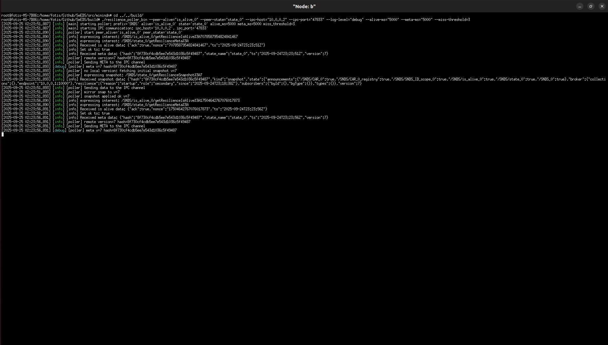

The interests sent by resilience: 


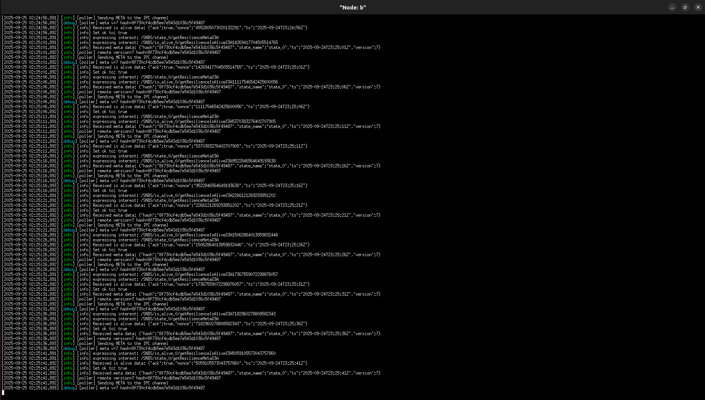


The interests received in A's scopes ``is_alive_0`` and ``state_0``:

```
[2025-09-25 02:27:01.893] [info] [Producer] Received interest in function: onInterest, name: /SNDS/state_0/getResilienceMeta%3A
[2025-09-25 02:27:01.893] [info] [Producer] Parsed interest: Prefix: SNDS, Name: state_0, Command: getResilienceMeta, Params: []
[2025-09-25 02:27:01.893] [info] [Producer] Received interest in function: onInterest, name: /SNDS/is_alive_0/getResilienceIsAlive%3A4795142743880949268
[2025-09-25 02:27:01.893] [info] [Producer] Parsed interest: Prefix: SNDS, Name: is_alive_0, Command: getResilienceIsAlive, Params: [4795142743880949268]
[2025-09-25 02:27:01.893] [debug] [Producer] Sending data to the NDN…
```

### Broker

The ``test-run.py`` script spins up a broker instance in each Node. You can query the database using the following requests: 

```
mini-ndn> b curl -X GET 'http://10.0.0.2:10000/dump' -H 'Content-Type: application/json' -H 'Accept: application/json'
mini-ndn> a curl -X POST 'http://10.0.0.1:10000/add' -H 'Content-Type: application/json' -H 'Accept: application/json' -d '{"id":"car2","date":"2025-06-28T15:41:50Z","type":"CAR"}'
mini-ndn> a curl -X GET 'http://10.0.0.1:10000/dump' -H 'Content-Type: application/json' -H 'Accept: application/json'
```

With the above ideas you can also use the rest of the requests like add, get etc...

#### Regarding the Secondary nodes

When the node is Secondary as [explained in](#resilience), it needs to receive the data of its Primary Node in start up to have matching versions. This happens through the ``\dump`` and ``\copy`` APIs of the Broker. In order's for this to happen you need to set up the correct ``PORT`` and ``IP`` to get the data from. For example if our Secondary Node is ``10.0.0.2`` and the Primary Node starts the Broker on ``10.0.0.1`` with port ``10000``: 

```python
# Start the SNDS daemon on every host, pointing to the per-node broker via node IP
host.cmdPrint(
  'cd /home/fotis/Github/SeEDS/build && '
  f'env HOME="{host_home}" {only_a_timeout} ./snds_daemon_bin '
  f'--log-level={args.log_level} '
  f'--num-services={number_of_services} '
  '--snds-prefix=SNDS '
  '--state-prefix=state '
  '--is-alive-prefix=is_alive '
  f'--snds-id={idx} '
  '--id-scope-prefix=SNDS_ID_scope_ '
  '--registry-file-postfix=_registry '
  f'--producer.broker-ip={node_ip} '
  '--producer.broker-port=10000 '
  f'--producer.registry-type={registry_key} '
  '--producer.enable-resilience-ipc=true '
  f'--producer.resilience-ipc-host={node_ip} '
  f'--producer.resilience-ipc-port={47832 + idx} '
  f'--producer.is-primary={"true" if is_primary else "false"} '
  f'--producer.seed-from-broker-ip={seed_from_ip} '
  f'--producer.seed-from-broker-port={seed_from_port} '
  f'> "{host_home}/log.txt" 2>&1 &'
)
```

The Broker IP and PORT should be this: 
```
--producer.seed-from-broker-ip=10.0.0.1
--producer.seed-from-broker-port=10000 
```

**Care** don't confuse this with the node's local broker: 

```
--producer.broker-ip=10.0.0.2
--producer.broker-port=10000
```


### Resilience


Currently the way I have set up the script ``test-run.py`` is that the second one becomes the secondary node: 

```py
sudo python ./topologies/test-topology.conf
```


Setup a Node to fail: 


```python
host.cmdPrint(
  'cd /home/fotis/Github/SeEDS/build &&
  f'( timeout 60s {cmd_core};
  f'{cmd_core}
  'rc=$?;
  'if [ "$rc" -eq 124 ]; then
  f'  echo "[TIMEOUT] $(date \"+%Y-%m-%d %H:%M:%S.%3N\") {host.name}: daemon exceeded 120s";
  'fi;
  'exit $rc
  f') > "{host_home}/log.txt" 2>&1 
)
```

You can set it up however you like. This is just a flag, which signifies whether the node is secondary. What this means is that the secondary node (in this case B) will start its Inter-Process-Communication ( IPC ) loop inside the C++ code. If the Node is primary ( in this case A ) it doesn't listen to the IPC for the resilience. **Care**: we also need to run the process of the ``./resilience_poller_bin``:

```python
# Start the SNDS daemon on every host, pointing to the per-node broker via node IP
host.cmdPrint(
  'cd /home/fotis/Github/SeEDS/build && '
  f'env HOME="{host_home}" {only_a_timeout} ./snds_daemon_bin '
  f'--log-level={args.log_level} '
  f'--num-services={number_of_services} '
  '--snds-prefix=SNDS '
  '--state-prefix=state '
  '--is-alive-prefix=is_alive '
  f'--snds-id={idx} '
  '--id-scope-prefix=SNDS_ID_scope_ '
  '--registry-file-postfix=_registry '
  f'--producer.broker-ip={node_ip} '
  '--producer.broker-port=10000 '
  f'--producer.registry-type={registry_key} '
  '--producer.enable-resilience-ipc=true '
  f'--producer.resilience-ipc-host={node_ip} '
  f'--producer.resilience-ipc-port={47832 + idx} '
  f'--producer.is-primary={"true" if is_primary else "false"} '
  f'--producer.seed-from-broker-ip={seed_from_ip} '
  f'--producer.seed-from-broker-port={seed_from_port} '
  f'> "{host_home}/log.txt" 2>&1 &'
)
```

**Notice** the ``is-primary`` flag here. 


During start the Secondary Service ( Node B ) will try to ``\dump`` and ``\copy`` the data of the Primary Service ( Node A ) in order for them to start with the same data: 

```
[2025-09-24 21:52:50.567] [warning] [Producer] [seed] bootstrap via /dump → /copy (src=10.0.0.1:10000, dst(local)=10.0.0.2:10000, mirror_to_secondary_=false, suffix='_SECONDARY')
[2025-09-24 21:52:50.567] [info] [Producer] [resilience-ipc] listening on 10.0.0.2:47833
[2025-09-24 21:52:50.617] [warning] [Producer] [seed] /copy OK: {
  "failed": 2,
  "inserted": 0,
  "replaced": 2,
  "skipped": 0,
  "status": "ok"
}
```

The fails here are due to the same Primary Keys inside the Mongo database, due to the previous initialization. Just make sure the above runs okay, when in startup: 


Primary dump:

```json
mini-ndn> a curl http://10.0.0.1:10000/dump
{
  "GENERIC": [
    {
      "_id": "car2213213asfsdsad",
      "id": "car2213213asfsdsad",
      "timestamp": {
        "$date": 1758736757651
      },
      "type": "GENERIC"
    },
    {
      "_id": "car2",
      "id": "car2",
      "timestamp": {
        "$date": 1758736761662
      },
      "type": "GENERIC"
    }
  ],
  "GENERIC_VERSIONED": [
    {
      "_id": {
        "_id": "car2213213asfsdsad",
        "timestamp": {
          "$date": 1758736757640
        }
      },
      "id": "car2213213asfsdsad",
      "timestamp": {
        "$date": 1758736757640
      },
      "type": "GENERIC"
    },
    {
      "_id": {
        "_id": "car2",
        "timestamp": {
          "$date": 1758736761661
        }
      },
      "id": "car2",
      "timestamp": {
        "$date": 1758736761661
      },
      "type": "GENERIC"
    }
  ]
}
```

Secondary dump:

```json
mini-ndn> b curl http://10.0.0.2:10000/dump
{
  "GENERIC": [
    {
      "_id": "car2213213asfsdsad",
      "id": "car2213213asfsdsad",
      "timestamp": {
        "$date": 1758736757651
      },
      "type": "GENERIC"
    },
    {
      "_id": "car2",
      "id": "car2",
      "timestamp": {
        "$date": 1758736761662
      },
      "type": "GENERIC"
    }
  ],
  "GENERIC_VERSIONED": [
    {
      "_id": {
        "_id": "car2213213asfsdsad",
        "timestamp": {
          "$date": 1758736758397
        }
      },
      "id": "car2213213asfsdsad",
      "timestamp": {
        "$date": 1758736758397
      },
      "type": "GENERIC"
    },
    {
      "_id": {
        "_id": "car2",
        "timestamp": {
          "$date": 1758736762417
        }
      },
      "id": "car2",
      "timestamp": {
        "$date": 1758736762417
      },
      "type": "GENERIC"
    },
    {
      "_id": {
        "_id": "car2213213asfsdsad",
        "timestamp": {
          "$date": 1758736757640
        }
      },
      "id": "car2213213asfsdsad",
      "timestamp": {
        "$date": 1758736757640
      },
      "type": "GENERIC"
    },
    {
      "_id": {
        "_id": "car2",
        "timestamp": {
          "$date": 1758736761661
        }
      },
      "id": "car2",
      "timestamp": {
        "$date": 1758736761661
      },
      "type": "GENERIC"
    }
  ]
}
```


In node B, which is the second of the topology, you can set up the resilience poller by running through the terminal: 

```
./resilience_poller_bin --log-level="DEBUG" --ipc-port="47833" --ipc-host="10.0.0.16" --peer-alive="is_alive_0" --peer-state="state_0" --alive-ms="200" --meta-ms="200" --miss-threshold=1
```

This way B is going to become the `secondary` of A, because we are listening to the resilience scopes of A ``state_0`` and ``is_alive_0``. You can see the IPs of each host through the logs.txt. Assigning the ``PORT`` and the ``IP`` is **crucial** here, because the secondary node receives the patches through the IPC (inter process communication). The ``PORT`` and ``IP`` should be what is assigned to the node during start up:

```
  f'--producer.resilience-ipc-host={node_ip} '
  f'--producer.resilience-ipc-port={47832 + idx} '
```

You can also set it up through the MiniNDN python utilities hopefully. 


You can set up A to exit the process after 120s to simulate a crash of A.

```
host.cmdPrint(
  'cd /home/fotis/Github/SeEDS/build && '
  f'env HOME="{host_home}" timeout 120s ./snds_daemon_bin '
  ...
)
```

You should see B merging of all its data with A. We have only published through A: 


Let's dump the database of A and see it's contents: 

```json
mini-ndn> a curl http://10.0.0.1:10000/dump
{
  "GENERIC": [
    {
      "_id": "car2213213asfsdsad",
      "id": "car2213213asfsdsad",
      "timestamp": {
        "$date": 1758736757651
      },
      "type": "GENERIC"
    },
    {
      "_id": "car2",
      "id": "car2",
      "timestamp": {
        "$date": 1758736761662
      },
      "type": "GENERIC"
    }
  ],
  "GENERIC_VERSIONED": [
    {
      "_id": {
        "_id": "car2213213asfsdsad",
        "timestamp": {
          "$date": 1758736757640
        }
      },
      "id": "car2213213asfsdsad",
      "timestamp": {
        "$date": 1758736757640
      },
      "type": "GENERIC"
    },
    {
      "_id": {
        "_id": "car2",
        "timestamp": {
          "$date": 1758736761661
        }
      },
      "id": "car2",
      "timestamp": {
        "$date": 1758736761661
      },
      "type": "GENERIC"
    }
  ]
}
```


Let's dump B's database: 

```json
mini-ndn> b curl http://10.0.0.2:10000/dump
{
  "GENERIC": [
    {
      "_id": "car2213213asfsdsad",
      "id": "car2213213asfsdsad",
      "timestamp": {
        "$date": 1758736758407
      },
      "type": "GENERIC"
    },
    {
      "_id": "car2",
      "id": "car2",
      "timestamp": {
        "$date": 1758736762418
      },
      "type": "GENERIC"
    }
  ],
  "GENERIC_VERSIONED": [
    {
      "_id": {
        "_id": "car2213213asfsdsad",
        "timestamp": {
          "$date": 1758736758397
        }
      },
      "id": "car2213213asfsdsad",
      "timestamp": {
        "$date": 1758736758397
      },
      "type": "GENERIC"
    },
    {
      "_id": {
        "_id": "car2",
        "timestamp": {
          "$date": 1758736762417
        }
      },
      "id": "car2",
      "timestamp": {
        "$date": 1758736762417
      },
      "type": "GENERIC"
    }
  ]
}
```

We can see through B's terminal, which runs the resilience poller that the SNDS service of A has crashed. Note that the last message is when the poller received the crash report after 3 retries:

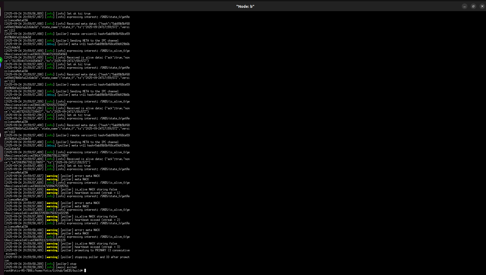


Let's see how all of the data is republished through B: 

```
[2025-09-24 20:59:58.420] [warning] [Producer] [resilience] applying promotion side-effects on main loop
[2025-09-24 20:59:58.420] [debug] [Producer] [overlay] merge: applying json_patch_against_base (ops=10)
[2025-09-24 20:59:58.420] [debug] [Producer] [resilience] assign → ver=6 hash=3492bb151e0cc6340d5b972c3294d625
[2025-09-24 20:59:58.420] [debug] [Producer] [overlay] SQUASH → base version 5→6  hash 1f453d6893773fe014bb6a4b381cac23→3492bb151e0cc6340d5b972c3294d625  overlay ver=11 hash=3da45d0bde2d0ff8e8034f5693871a27
[2025-09-24 20:59:58.420] [debug] [Producer] [overlay] CLEARED
[2025-09-24 20:59:58.420] [debug] [Producer] [promotion] rebuilt containers from store:
[2025-09-24 20:59:58.420] [debug] [Producer]   type_registry[CAR_1] = []
[2025-09-24 20:59:58.420] [debug] [Producer]   announcements = [/SNDS_0 /SNDS/SNDS_ID_scope_1 /SNDS/CAR_1_registry /SNDS_1 /SNDS/is_alive_1 /SNDS/state_1 /SNDS/CAR_1 /SNDS/CAR_0 /SNDS/CAR_0_registry /SNDS/is_alive_0 /SNDS/car2 /SNDS/SNDS_ID_scope_0 /SNDS/car2213213asfsdsad /SNDS/state_0 ]
[2025-09-24 20:59:58.420] [info] [Producer] [promotion] summary: types=1 ids=0 subs(byId)=0 subs(byType)=0 announced=14
[2025-09-24 20:59:58.421] [info] [Producer] [promotion] (re)announcing /SNDS_0
[2025-09-24 20:59:58.424] [info] [Producer] [promotion] (re)announcing /SNDS/SNDS_ID_scope_1
[2025-09-24 20:59:58.424] [info] [Producer] [promotion] (re)announcing /SNDS/CAR_1_registry
[2025-09-24 20:59:58.424] [info] [Producer] [promotion] (re)announcing /SNDS_1
[2025-09-24 20:59:58.424] [info] [Producer] [promotion] (re)announcing /SNDS/is_alive_1
[2025-09-24 20:59:58.424] [info] [Producer] [promotion] (re)announcing /SNDS/state_1
[2025-09-24 20:59:58.424] [info] [Producer] [promotion] (re)announcing /SNDS/CAR_1
[2025-09-24 20:59:58.424] [info] [Producer] [promotion] (re)announcing /SNDS/CAR_0
[2025-09-24 20:59:58.424] [info] [Producer] [promotion] (re)announcing /SNDS/CAR_0_registry
[2025-09-24 20:59:58.424] [info] [Producer] [promotion] (re)announcing /SNDS/is_alive_0
[2025-09-24 20:59:58.425] [info] [Producer] [promotion] (re)announcing /SNDS/car2
[2025-09-24 20:59:58.425] [info] [Producer] [promotion] (re)announcing /SNDS/SNDS_ID_scope_0
[2025-09-24 20:59:58.425] [info] [Producer] [promotion] (re)announcing /SNDS/car2213213asfsdsad
[2025-09-24 20:59:58.425] [info] [Producer] [promotion] (re)announcing /SNDS/state_0
[2025-09-24 20:59:58.425] [info] [Producer] Getting from IP: 10.0.0.2 and port: 10000
[2025-09-24 20:59:58.425] [debug] [Producer] HTTP GET /state?type=CAR_1
[2025-09-24 20:59:58.426] [info] [Producer] [resilience] mutate → ver=7 hash=242d7dde27ce09f34e9f576a6f77c264
[2025-09-24 20:59:58.427] [debug] [Producer] [resilience] history versions: 0(37a6259c) 1(194c8ce9) 2(0b70c131) 3(69615fd2) 4(5ab89b5b) 5(1f453d68) 6(3492bb15) 7(242d7dde) 
[2025-09-24 20:59:58.427] [debug] [Producer] [resilience] ops from v6 → v7:
[
  {
    "op": "add",
    "path": "/broker/collections/CAR_1",
    "value": {
      "algo": "SHA-256",
      "count": 0,
      "hash": "e3b0c44298fc1c149afbf4c8996fb92427ae41e4649b934ca495991b7852b855",
      "lastSeen": "2025-09-24T17:59:58Z"
    }
  }
]
[2025-09-24 20:59:58.428] [info] [Producer] Successfully registered prefix: /SNDS_0
[2025-09-24 20:59:58.428] [info] [Producer] Successfully registered prefix: /SNDS/SNDS_ID_scope_1
[2025-09-24 20:59:58.428] [info] [Producer] Successfully registered prefix: /SNDS/CAR_1_registry
[2025-09-24 20:59:58.428] [info] [Producer] Successfully registered prefix: /SNDS_1
[2025-09-24 20:59:58.429] [info] [Producer] Successfully registered prefix: /SNDS/is_alive_1
[2025-09-24 20:59:58.429] [info] [Producer] Successfully registered prefix: /SNDS/state_1
[2025-09-24 20:59:58.431] [info] [Producer] Successfully registered prefix: /SNDS/CAR_1
[2025-09-24 20:59:58.431] [info] [Producer] Successfully registered prefix: /SNDS/CAR_0
[2025-09-24 20:59:58.431] [info] [Producer] Successfully registered prefix: /SNDS/CAR_0_registry
[2025-09-24 20:59:58.431] [info] [Producer] Successfully registered prefix: /SNDS/is_alive_0
[2025-09-24 20:59:58.431] [info] [Producer] Successfully registered prefix: /SNDS/car2
[2025-09-24 20:59:58.431] [info] [Producer] Successfully registered prefix: /SNDS/SNDS_ID_scope_0
[2025-09-24 20:59:58.431] [info] [Producer] Successfully registered prefix: /SNDS/car2213213asfsdsad
[2025-09-24 20:59:58.432] [info] [Producer] Successfully registered prefix: /SNDS/state_0
[2025-09-24 21:10:15.069] [info] [Producer] Received interest in function: onInterest, name: /SNDS/car2/temporalQuery%3Aid%3Dcar2%26type%3D%26date%3D%26count%3D%26timeframe%3D%26filters%3D
[2025-09-24 21:10:15.069] [info] [Producer] Parsed interest: Prefix: SNDS, Name: car2, Command: temporalQuery, Params: [id=car2, type=, date=, count=, timeframe=, filters=]
[2025-09-24 21:10:15.069] [debug] [Producer] Created interest response: /SNDS/car2/temporalQuery%3Aid%3Dcar2%26type%3D%26date%3D%26count%3D%26timeframe%3D%26filters%3D in: process_temporal_query_interest
[2025-09-24 21:10:15.069] [debug] [Producer] TemporalQuery → id: car2, date: , type: , timeframe: , count: , filters: 
[2025-09-24 21:10:15.069] [debug] [Producer] Requesting to endpoint: /temporal-query?id=car2&type=&count=&date=&timeframe=&filters=
[2025-09-24 21:10:15.070] [info] [Producer] Successfully queried /temporal-query
[2025-09-24 21:10:15.070] [debug] [Producer] Sending data to the NDN…
```

Let's now ask for A's data through some other Node like C: 

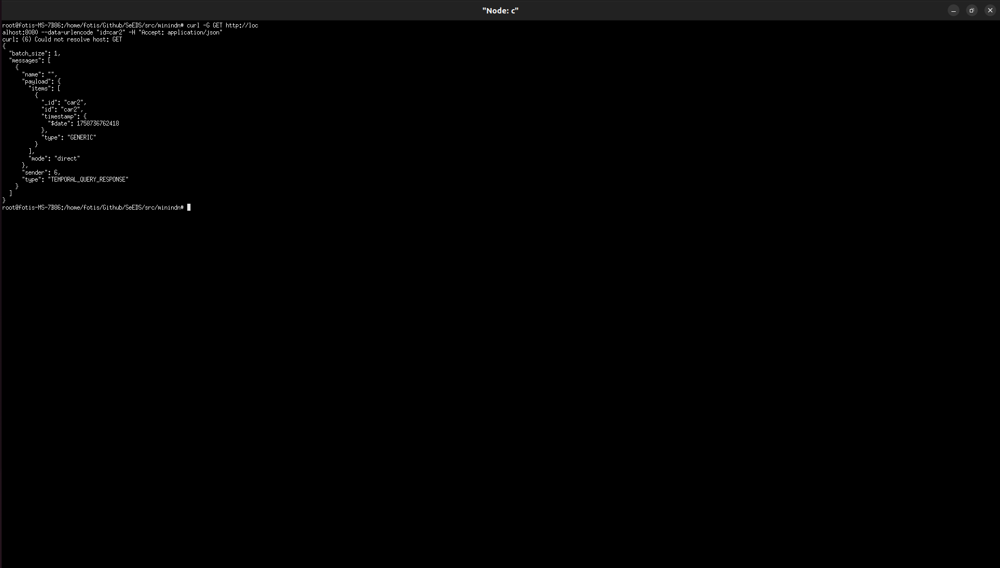


The data of A is available in the service despite it crashing. Note here I have only shown the IDs and the Broker, but subscriptions, registry also get inherited by B.


Also did a second run with subscriptions and registries: 

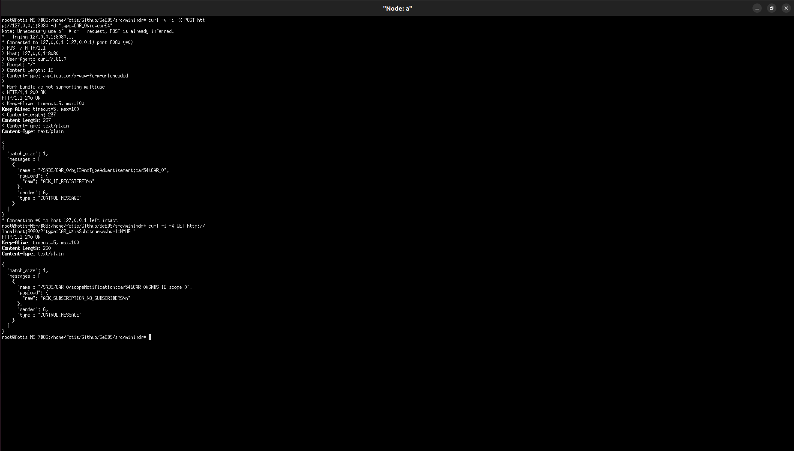


Here are B's data now: 


```
[2025-09-24 21:26:37.438] [warning] [Producer] [resilience] applying promotion side-effects on main loop
[2025-09-24 21:26:37.438] [debug] [Producer] [overlay] merge: applying json_patch_against_base (ops=7)
[2025-09-24 21:26:37.438] [debug] [Producer] [resilience] assign → ver=6 hash=7372eeb2a41c982eb0221e3de1002dab
[2025-09-24 21:26:37.438] [debug] [Producer] [overlay] SQUASH → base version 5→6  hash 29930bc8a3bff6a66c6ac8211dc06b35→7372eeb2a41c982eb0221e3de1002dab  overlay ver=9 hash=193d4e424b04b2168edc061a2944da29
[2025-09-24 21:26:37.438] [debug] [Producer] [overlay] CLEARED
[2025-09-24 21:26:37.438] [debug] [Producer] [promotion] rebuilt containers from store:
[2025-09-24 21:26:37.438] [debug] [Producer]   type_registry[CAR_0] = [car54 ]
[2025-09-24 21:26:37.438] [debug] [Producer]   type_registry[CAR_1] = []
[2025-09-24 21:26:37.438] [debug] [Producer]   subscribed_nodes_for_type[CAR_0] = [SNDS_ID_scope_0 ]
[2025-09-24 21:26:37.438] [debug] [Producer]   announcements = [/SNDS_0 /SNDS/state_0 /SNDS/SNDS_ID_scope_0 /SNDS/is_alive_0 /SNDS/CAR_0 /SNDS/CAR_0_registry /SNDS/CAR_1 /SNDS/state_1 /SNDS/is_alive_1 /SNDS/CAR_1_registry /SNDS/SNDS_ID_scope_1 /SNDS_1 ]
[2025-09-24 21:26:37.438] [info] [Producer] [promotion] summary: types=2 ids=1 subs(byId)=0 subs(byType)=1 announced=12
[2025-09-24 21:26:37.438] [info] [Producer] [promotion] (re)announcing /SNDS_0
[2025-09-24 21:26:37.438] [info] [Producer] [promotion] (re)announcing /SNDS/state_0
[2025-09-24 21:26:37.439] [info] [Producer] [promotion] (re)announcing /SNDS/SNDS_ID_scope_0
[2025-09-24 21:26:37.439] [info] [Producer] [promotion] (re)announcing /SNDS/is_alive_0
[2025-09-24 21:26:37.439] [info] [Producer] [promotion] (re)announcing /SNDS/CAR_0
[2025-09-24 21:26:37.439] [info] [Producer] [promotion] (re)announcing /SNDS/CAR_0_registry
[2025-09-24 21:26:37.439] [info] [Producer] [promotion] (re)announcing /SNDS/CAR_1
[2025-09-24 21:26:37.439] [info] [Producer] [promotion] (re)announcing /SNDS/state_1
[2025-09-24 21:26:37.439] [info] [Producer] [promotion] (re)announcing /SNDS/is_alive_1
[2025-09-24 21:26:37.439] [info] [Producer] [promotion] (re)announcing /SNDS/CAR_1_registry
[2025-09-24 21:26:37.439] [info] [Producer] [promotion] (re)announcing /SNDS/SNDS_ID_scope_1
[2025-09-24 21:26:37.440] [info] [Producer] [promotion] (re)announcing /SNDS_1
[2025-09-24 21:26:37.440] [info] [Producer] Getting from IP: 10.0.0.2 and port: 10000
[2025-09-24 21:26:37.440] [debug] [Producer] HTTP GET /state?type=CAR_0
[2025-09-24 21:26:37.441] [info] [Producer] [resilience] mutate → ver=7 hash=45c6ea954f7d4d819d96d644850dd23b
[2025-09-24 21:26:37.442] [debug] [Producer] [resilience] history versions: 0(37a6259c) 1(a4703547) 2(d8b1f0f6) 3(327a56af) 4(32a3f5e2) 5(29930bc8) 6(7372eeb2) 7(45c6ea95) 
[2025-09-24 21:26:37.442] [debug] [Producer] [resilience] ops from v6 → v7:
[
  {
    "op": "replace",
    "path": "/broker/collections/CAR_0/lastSeen",
    "value": "2025-09-24T18:26:37Z"
  }
]
[2025-09-24 21:26:37.442] [info] [Producer] Getting from IP: 10.0.0.2 and port: 10000
[2025-09-24 21:26:37.442] [debug] [Producer] HTTP GET /state?type=CAR_1
[2025-09-24 21:26:37.443] [info] [Producer] [resilience] mutate → ver=8 hash=76ec77d0ac1971096757b9d01c80be4e
[2025-09-24 21:26:37.443] [debug] [Producer] [resilience] history versions: 0(37a6259c) 1(a4703547) 2(d8b1f0f6) 3(327a56af) 4(32a3f5e2) 5(29930bc8) 6(7372eeb2) 7(45c6ea95) 8(76ec77d0) 
[2025-09-24 21:26:37.443] [debug] [Producer] [resilience] ops from v7 → v8:
[
  {
    "op": "add",
    "path": "/broker/collections/CAR_1",
    "value": {
      "algo": "SHA-256",
      "count": 0,
      "hash": "e3b0c44298fc1c149afbf4c8996fb92427ae41e4649b934ca495991b7852b855",
      "lastSeen": "2025-09-24T18:26:37Z"
    }
  }
]
[2025-09-24 21:26:37.444] [info] [Producer] Successfully registered prefix: /SNDS_0
[2025-09-24 21:26:37.446] [info] [Producer] Successfully registered prefix: /SNDS/state_0
[2025-09-24 21:26:37.446] [info] [Producer] Successfully registered prefix: /SNDS/SNDS_ID_scope_0
[2025-09-24 21:26:37.446] [info] [Producer] Successfully registered prefix: /SNDS/is_alive_0
[2025-09-24 21:26:37.447] [info] [Producer] Successfully registered prefix: /SNDS/CAR_0
[2025-09-24 21:26:37.447] [info] [Producer] Successfully registered prefix: /SNDS/CAR_0_registry
[2025-09-24 21:26:37.447] [info] [Producer] Successfully registered prefix: /SNDS/CAR_1
[2025-09-24 21:26:37.447] [info] [Producer] Successfully registered prefix: /SNDS/state_1
[2025-09-24 21:26:37.447] [info] [Producer] Successfully registered prefix: /SNDS/is_alive_1
[2025-09-24 21:26:37.447] [info] [Producer] Successfully registered prefix: /SNDS/CAR_1_registry
[2025-09-24 21:26:37.447] [info] [Producer] Successfully registered prefix: /SNDS/SNDS_ID_scope_1
[2025-09-24 21:26:37.447] [info] [Producer] Successfully registered prefix: /SNDS_1
```

Pay attention to: 

```
[2025-09-24 21:26:37.438] [debug] [Producer] [overlay] CLEARED
[2025-09-24 21:26:37.438] [debug] [Producer] [promotion] rebuilt containers from store:
[2025-09-24 21:26:37.438] [debug] [Producer]   type_registry[CAR_0] = [car54 ]
[2025-09-24 21:26:37.438] [debug] [Producer]   type_registry[CAR_1] = []
[2025-09-24 21:26:37.438] [debug] [Producer]   subscribed_nodes_for_type[CAR_0] = [SNDS_ID_scope_0 ]
[2025-09-24 21:26:37.438] [debug] [Producer]   announcements = [/SNDS_0 /SNDS/state_0 /SNDS/SNDS_ID_scope_0 /SNDS/is_alive_0 /SNDS/CAR_0 /SNDS/CAR_0_registry /SNDS/CAR_1 /SNDS/state_1 /SNDS/is_alive_1 /SNDS/CAR_1_registry /SNDS/SNDS_ID_scope_1 /SNDS_1 ]
```

Let's try to subscribe to node A's ex registry ``CAR_0`` through C: 

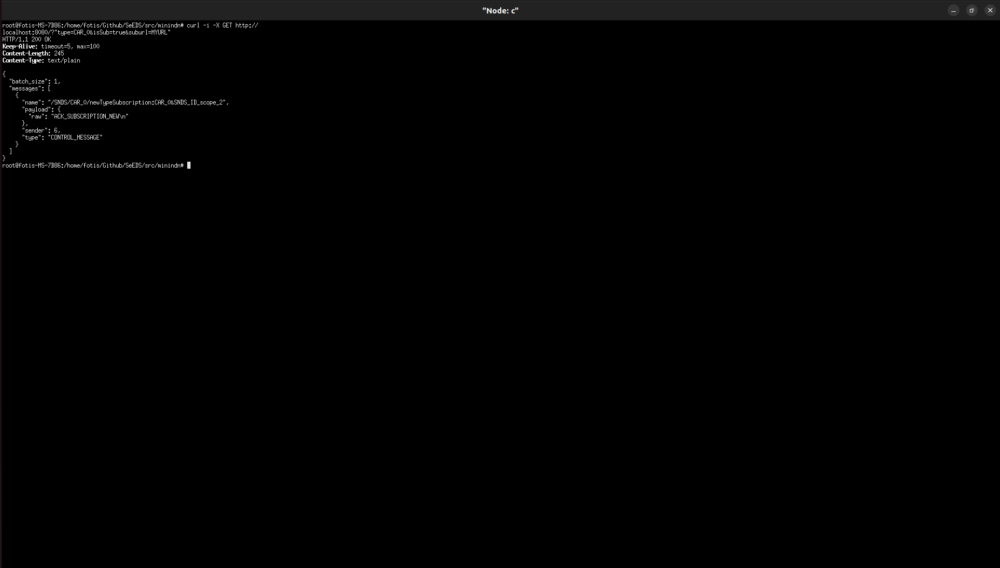

And B receives the message: 

```
[2025-09-24 21:26:48.788] [info] [Producer] Received interest in function: onInterest, name: /SNDS/CAR_0/newTypeSubscription%3ACAR_0%26SNDS_ID_scope_2
[2025-09-24 21:26:48.788] [info] [Producer] Parsed interest: Prefix: SNDS, Name: CAR_0, Command: newTypeSubscription, Params: [CAR_0, SNDS_ID_scope_2]
[2025-09-24 21:26:48.789] [info] [Producer] Received our_snds_node_id: CAR_0 in func: process_new_subscription_interest
[2025-09-24 21:26:48.789] [info] [Producer] Got interest indicating new subscription for name: CAR_0, and snds node: SNDS_ID_scope_2
[2025-09-24 21:26:48.789] [info] [Producer] [event] subscribe_type: node=SNDS_ID_scope_2 -> type=CAR_0
[2025-09-24 21:26:48.789] [info] [Producer] [resilience] mutate → ver=9 hash=e251a7d99bdb6c6192744e9d30f595e5
[2025-09-24 21:26:48.789] [debug] [Producer] [resilience] history versions: 0(37a6259c) 1(a4703547) 2(d8b1f0f6) 3(327a56af) 4(32a3f5e2) 5(29930bc8) 6(7372eeb2) 7(45c6ea95) 8(76ec77d0) 9(e251a7d9) 
[2025-09-24 21:26:48.789] [debug] [Producer] [resilience] ops from v8 → v9:
[
  {
    "op": "add",
    "path": "/subscribers/byType/CAR_0/nodes/SNDS_ID_scope_2",
    "value": true
  }
]
[2025-09-24 21:26:48.789] [info] [Producer] [debug][event:on_subscribe_type SNDS_ID_scope_2->CAR_0] summary → types=2 ids=1 subs(byId)=0 subs(byType)=2 announced=12
[2025-09-24 21:26:48.789] [debug] [Producer] [debug][event:on_subscribe_type SNDS_ID_scope_2->CAR_0] type_registry:
[2025-09-24 21:26:48.789] [debug] [Producer]   [CAR_0] car54 
[2025-09-24 21:26:48.789] [debug] [Producer]   [CAR_1] 
[2025-09-24 21:26:48.789] [debug] [Producer] [debug][event:on_subscribe_type SNDS_ID_scope_2->CAR_0] subscribed_nodes_for_id:
[2025-09-24 21:26:48.789] [debug] [Producer] [debug][event:on_subscribe_type SNDS_ID_scope_2->CAR_0] subscribed_nodes_for_type:
[2025-09-24 21:26:48.789] [debug] [Producer]   [CAR_0] SNDS_ID_scope_2 SNDS_ID_scope_0 
[2025-09-24 21:26:48.789] [debug] [Producer] [debug][event:on_subscribe_type SNDS_ID_scope_2->CAR_0] announcements: /SNDS_0 /SNDS/state_0 /SNDS/SNDS_ID_scope_0 /SNDS/is_alive_0 /SNDS/CAR_0 /SNDS/CAR_0_registry /SNDS/CAR_1 /SNDS/state_1 /SNDS/is_alive_1 /SNDS/CAR_1_registry /SNDS/SNDS_ID_scope_1 /SNDS_1 
[2025-09-24 21:26:48.789] [info] [Producer] [debug][event:on_subscribe_type SNDS_ID_scope_2->CAR_0] broker.journal: entries=0 cursor=0 last_fp=
[2025-09-24 21:26:48.789] [debug] [Producer] [overlay][event:on_subscribe_type SNDS_ID_scope_2->CAR_0] ver=0 hash=d41d8cd98f00b204e9800998ecf8427e keys=0
[2025-09-24 21:26:48.789] [info] [Producer] [BY_TYPE] New subscription: SNDS_ID_scope_2 subscribed to CAR_0
[2025-09-24 21:26:48.789] [info] [Producer] [BY_TYPE] Responding to interest: /SNDS/CAR_0/newTypeSubscription%3ACAR_0%26SNDS_ID_scope_2
[2025-09-24 21:26:48.789] [debug] [Producer] Sending data to the NDN…
```


#### Does this happen sub 200ms? 


```
./resilience_poller_bin --log-level="DEBUG" --ipc-port="47833" --ipc-host="10.0.0.2" --peer-alive="is_alive_0" --peer-state="state_0" --alive-ms="100" --meta-ms="100" --miss-threshold=1
```

Check when the process stops: 

```
[TIMEOUT] 2025-09-24 21:53:47.602 a: daemon exceeded 120s
```

Check when the promotion to primary of B happens: 

```
[2025-09-24 21:53:47.569] [info] [Producer] [resilience-ipc] Found message type: meta
[2025-09-24 21:53:47.569] [debug] [Producer] [resilience-ipc] meta v=10 hash=94c4318f96749282dad3ea69fc2b01e5
[2025-09-24 21:53:47.618] [info] [Producer] [resilience-ipc] Client connected...
[2025-09-24 21:53:47.619] [info] [Producer] [resilience-ipc] Found message type: role
[2025-09-24 21:53:47.619] [warning] [Producer] [resilience-ipc] promotion to PRIMARY (reason=alive-missed, misses=1)
[2025-09-24 21:53:47.619] [info] [Producer] [resilience] mutate → ver=5 hash=ef9ce601ec2b3ac83c68782f3313cbbf
[2025-09-24 21:53:47.619] [debug] [Producer] [resilience] history versions: 0(37a6259c) 1(2cc785ae) 2(b4284429) 3(fbe59e85) 4(94c4318f) 5(ef9ce601) 
[2025-09-24 21:53:47.619] [debug] [Producer] [resilience] ops from v4 → v5:
[
  {
    "op": "replace",
    "path": "/resilience/reason",
    "value": "alive-missed"
  },
  {
    "op": "replace",
    "path": "/resilience/role",
    "value": "primary"
  },
  {
    "op": "replace",
    "path": "/resilience/since",
    "value": "2025-09-24T18:53:47Z"
  },
  {
    "op": "add",
    "path": "/resilience/misses",
    "value": 1
  }
]
[2025-09-24 21:53:47.619] [warning] [Producer] [resilience-ipc] stop requested; will be joined from main loop
[2025-09-24 21:53:48.619] [warning] [Producer] [resilience] applying promotion side-effects on main loop
[2025-09-24 21:53:48.619] [debug] [Producer] [overlay] merge: applying json_patch_against_base (ops=7)
[2025-09-24 21:53:48.620] [debug] [Producer] [resilience] assign → ver=6 hash=1b35da6a3dacb12481e6462c67ac36ab
[2025-09-24 21:53:48.620] [debug] [Producer] [overlay] SQUASH → base version 5→6  hash ef9ce601ec2b3ac83c68782f3313cbbf→1b35da6a3dacb12481e6462c67ac36ab  overlay ver=9 hash=193d4e424b04b2168edc061a2944da29
[2025-09-24 21:53:48.620] [debug] [Producer] [overlay] CLEARED
[2025-09-24 21:53:48.620] [debug] [Producer] [promotion] rebuilt containers from store:
[2025-09-24 21:53:48.620] [debug] [Producer]   type_registry[CAR_0] = [car54 ]
[2025-09-24 21:53:48.620] [debug] [Producer]   type_registry[CAR_1] = []
[2025-09-24 21:53:48.620] [debug] [Producer]   subscribed_nodes_for_type[CAR_0] = [SNDS_ID_scope_0 ]
[2025-09-24 21:53:48.620] [debug] [Producer]   announcements = [/SNDS_0 /SNDS/state_0 /SNDS/SNDS_ID_scope_0 /SNDS/is_alive_0 /SNDS/CAR_0 /SNDS/CAR_0_registry /SNDS/CAR_1 /SNDS/state_1 /SNDS/is_alive_1 /SNDS/CAR_1_registry /SNDS/SNDS_ID_scope_1 /SNDS_1 ]
[2025-09-24 21:53:48.620] [info] [Producer] [promotion] summary: types=2 ids=1 subs(byId)=0 subs(byType)=1 announced=12
[2025-09-24 21:53:48.620] [info] [Producer] [promotion] (re)announcing /SNDS_0
[2025-09-24 21:53:48.620] [info] [Producer] [promotion] (re)announcing /SNDS/state_0
[2025-09-24 21:53:48.620] [info] [Producer] [promotion] (re)announcing /SNDS/SNDS_ID_scope_0
[2025-09-24 21:53:48.620] [info] [Producer] [promotion] (re)announcing /SNDS/is_alive_0
[2025-09-24 21:53:48.620] [info] [Producer] [promotion] (re)announcing /SNDS/CAR_0
[2025-09-24 21:53:48.620] [info] [Producer] [promotion] (re)announcing /SNDS/CAR_0_registry
[2025-09-24 21:53:48.620] [info] [Producer] [promotion] (re)announcing /SNDS/CAR_1
[2025-09-24 21:53:48.620] [info] [Producer] [promotion] (re)announcing /SNDS/state_1
[2025-09-24 21:53:48.620] [info] [Producer] [promotion] (re)announcing /SNDS/is_alive_1
[2025-09-24 21:53:48.620] [info] [Producer] [promotion] (re)announcing /SNDS/CAR_1_registry
[2025-09-24 21:53:48.620] [info] [Producer] [promotion] (re)announcing /SNDS/SNDS_ID_scope_1
[2025-09-24 21:53:48.620] [info] [Producer] [promotion] (re)announcing /SNDS_1
[2025-09-24 21:53:48.620] [info] [Producer] Getting from IP: 10.0.0.2 and port: 10000
[2025-09-24 21:53:48.620] [debug] [Producer] HTTP GET /state?type=CAR_0
[2025-09-24 21:53:48.622] [info] [Producer] [resilience] mutate → ver=7 hash=91554cef1da8effb57dd58c504971109
[2025-09-24 21:53:48.622] [debug] [Producer] [resilience] history versions: 0(37a6259c) 1(2cc785ae) 2(b4284429) 3(fbe59e85) 4(94c4318f) 5(ef9ce601) 6(1b35da6a) 7(91554cef) 
[2025-09-24 21:53:48.622] [debug] [Producer] [resilience] ops from v6 → v7:
[
  {
    "op": "replace",
    "path": "/broker/collections/CAR_0/lastSeen",
    "value": "2025-09-24T18:53:48Z"
  }
]
[2025-09-24 21:53:48.622] [info] [Producer] Getting from IP: 10.0.0.2 and port: 10000
[2025-09-24 21:53:48.622] [debug] [Producer] HTTP GET /state?type=CAR_1
[2025-09-24 21:53:48.623] [info] [Producer] [resilience] mutate → ver=8 hash=29dfba80f7bdcff77e7d65b53a3bb1bd
[2025-09-24 21:53:48.623] [debug] [Producer] [resilience] history versions: 0(37a6259c) 1(2cc785ae) 2(b4284429) 3(fbe59e85) 4(94c4318f) 5(ef9ce601) 6(1b35da6a) 7(91554cef) 8(29dfba80) 
[2025-09-24 21:53:48.623] [debug] [Producer] [resilience] ops from v7 → v8:
[
  {
    "op": "add",
    "path": "/broker/collections/CAR_1",
    "value": {
      "algo": "SHA-256",
      "count": 0,
      "hash": "e3b0c44298fc1c149afbf4c8996fb92427ae41e4649b934ca495991b7852b855",
      "lastSeen": "2025-09-24T18:53:48Z"
    }
  }
]
[2025-09-24 21:53:48.624] [info] [Producer] Successfully registered prefix: /SNDS_0
[2025-09-24 21:53:48.624] [info] [Producer] Successfully registered prefix: /SNDS/state_0
[2025-09-24 21:53:48.625] [info] [Producer] Successfully registered prefix: /SNDS/SNDS_ID_scope_0
[2025-09-24 21:53:48.625] [info] [Producer] Successfully registered prefix: /SNDS/is_alive_0
[2025-09-24 21:53:48.625] [info] [Producer] Successfully registered prefix: /SNDS/CAR_0
[2025-09-24 21:53:48.625] [info] [Producer] Successfully registered prefix: /SNDS/CAR_0_registry
[2025-09-24 21:53:48.627] [info] [Producer] Successfully registered prefix: /SNDS/CAR_1
[2025-09-24 21:53:48.627] [info] [Producer] Successfully registered prefix: /SNDS/state_1
[2025-09-24 21:53:48.627] [info] [Producer] Successfully registered prefix: /SNDS/is_alive_1
[2025-09-24 21:53:48.627] [info] [Producer] Successfully registered prefix: /SNDS/CAR_1_registry
[2025-09-24 21:53:48.627] [info] [Producer] Successfully registered prefix: /SNDS/SNDS_ID_scope_1
[2025-09-24 21:53:48.627] [info] [Producer] Successfully registered prefix: /SNDS_1
```


Check when the message to promote is received compared to the timestamp when the SNDS Service of A crashed: 

```
[TIMEOUT] 2025-09-24 21:53:47.602 a: daemon exceeded 120s
[2025-09-24 21:53:47.619] [warning] [Producer] [resilience-ipc] promotion to PRIMARY (reason=alive-missed, misses=1)
```

So it happened in 619 - 602 = 17ms. Of course the topology is set to have minimal delay: 

```test-topology.conf
[nodes]
a: _ nfd-log-level=DEBUG
b: _ nfd-log-level=DEBUG
c: _ nfd-log-level=DEBUG
d: _ nfd-log-level=DEBUG

[links]
a:b delay=10ms
b:a delay=10ms
b:c delay=10ms
c:b delay=10ms
c:a delay=10ms
a:c delay=10ms
d:a delay=10ms
a:d delay=10ms
```

# Components

## Service 

At runtime, SeEDS is a small distributed system composed of five cooperating services that run inside one process (each on its own thread) and talk over in-memory message queues. External I/O happens via NDN Interests/Data and a tiny HTTP API:

- SNDSHTTPService: small HTTP server (cpp-httplib) that turns HTTP GET/POST into internal messages.
- Worker: Parses requests, deduplicates, tracks state, aggregates results, and sends responses back to HTTP.
- SNDSConsumer: emits NDN Interests constructed from Worker’s requests, receives Data packets, and forwards payloads back.
- SNDSProducer: answers incoming NDN Interests (publishes Data) and also initiates outbound Interests when needed.
- DigitalTwin: drives advertisements (by-ID / by-type / scope) and forwards “temporal query” announcements to Producer.


### Main Requests 

#### GET by ID ( Forwarded to the NDN through the temporal query API )

HTTP receives ```GET /?id=<ID>``` (or POST body). It packs params into an intra-message and sends to Worker.

Worker:
- Deduplicates with pending_get_by_id_requests (set).
- Builds an NDN name: ```/<snds_prefix>/<id>/getByID:<id>``` using parsed_interest_name helpers.
- Sends a GET_BY_ID_REQUEST message to Consumer.

Consumer:
- Expresses the NDN Interest. Note that all the interests are forwarded through the temporal query API.
- On Data: forwards payload to Worker as GET_BY_ID_RESPONSE.

Worker:
- Confirms the ID was pending; clears it; optionally tells DigitalTwin to erase pending state.
- Writes the final response to the HTTP queue as TEMPORAL_QUERY_RESPONSE (used uniformly for JSON).

HTTP:
- Waits for one message from the service queue and returns 200 with the payload.

#### GET by TYPE 

HTTP receives ```GET /?type=<TYPE>```.

Worker:
- Deduplicates with pending_get_by_type_requests.
- Computes <TYPE>_registry (configurable postfix).
- Sends GET_BY_TYPE_REQUEST to Consumer with NDN name: ```/<snds_prefix>/<TYPE>_registry/getByType:<TYPE>``` or ```/<snds_prefix>/<TYPE>/getByType:<TYPE>``` which is equivalent.

Consumer: 
- fetches the registry file (a list of IDs) and sends it to Worker as REGISTRY_PAYLOAD.
Worker ( TODO this should be changed when we optimize cache hits ):
- Parses IDs with parse_ids_from_registry_file_payload(...).
- For each ID, sends GET_BY_ID_FOR_TYPE_REQUEST to Consumer with name: ```/<snds_prefix>/<TYPE>/getByIDForType:<ID>&<TYPE>```
- Tracks which IDs are outstanding in pending_ids_to_type_map[TYPE].
- Consumer replies for each ID with GET_BY_ID_FOR_TYPE_RESPONSE.( Forwarded to the NDN through the temporal query API )

Worker: 
- accumulates (id,payload) in payloads_for_get_by_type[TYPE].

When the last ID arrives, it assembles and sends it to HTTP as a single message:
```json
{ "type": "<TYPE>", "items": [ {"id": "...", "payload": "..."} ] }
```

#### Subscriptions & scope

Users can subscribe to events by sending ```GET /?id=<ID>&isSub=true&suburl=<URL>``` (or by type in the place of id=).

HTTP → Worker: BY_ID_SUBSCRIPTION or BY_TYPE_SUBSCRIPTION.

Worker:
- Stores the subscriber URL in subscribed_by_id_users or subscribed_by_type_users.
- Only on the first subscription for a key, it computes the node scope name
(getSNDSNodeScopeNameForSubscription) and asks Consumer to notify the appropriate scope:

```
/<snds_prefix>/<node_scope>/newIdSubscription:<ID>&<our_scope>
```
or: 
```
/<snds_prefix>/<node_scope>/newTypeSubscription:<type>&<our_scope>
```

#### Temporal queries (historical data)
Temporal queries fetch historical “metafile” records around a date, optionally filtered.

HTTP POST body or query string, e.g.:

```
id=car2&date=2025-06-28T15:41:50Z&timeframe=before+after&count=10
```

Worker: 
- Worker parses to a TemporalQuery
- frame: bitmask of NOW|BEFORE|AFTER (temporal_query::string_to_timeframe + to_fields)
- date, id, optional type, count, optional filters and extras
- Worker computes a stable hash (temporal_query_hash_string) and inserts the query into
pending_temporal_queries[hash]. Then it forwards the serialized query to Consumer

Consumer: 
```
/<snds_prefix>/<entity>/temporalQuery:id=...&date=...&timeframe=...&count=...[&filters=...]
```
where ```entity = (type.empty() ? id : type)```.

Network returns one of two shapes:

a. Direct mode (single item)

  > Payload returns only one items back to the consumer.Consumer detects it (_is_direct_temporal_payload), extracts the item, converts it into a Version envelope (with is_metafile=false, mode="direct"), and sends one VERSION_RESPONSE back to Worker via a canonical query-URI (using build_query_uri).

b. Manifest mode (metafile list)

> Payload is an array of documents with _id containing { _id: "<id>", timestamp: {"$date": <ms>} }. Consumer fans out: for each doc, it constructs a metafile interest 
```
/<snds_prefix>/<id>/version?id=...&type=...&date=...&metafile=true&parentQueryHash=...
```
> It sends all but the last with lastInterest=false, and the last with lastInterest=true.(A duplicate filter with a canonicalized name avoids resending.)

Worker aggregation

a. Direct mode: Worker extracts the single item and immediately returns:

```json
{"mode":"direct","items":[{...}]}
```
b. Manifest mode:

- Worker buffers every VERSION_RESPONSE per parentQueryHash in temporal_buffers[hash].
- Each slice is sanitized (fix_mixed_utf8_cp1252) and optionally field-filtered (if filters present).
- On the lastInterest it sends a single bundle back to HTTP:
```json
{
  "mode": "manifest",
  "parentQueryHash": "<hash>",
  "query": "<serialized query>",
  "items": [ <filtered JSON slices> ]
}
```
- Then it clears pending_temporal_queries[hash] and the buffer.
- Filtering: users can pass filters=a,b,c in the query; Worker will keep only those keys per item (object-wise).


## Broker
You can run test the broker as a standalone binary. No need to run through the snds_broker_bin.

### Summary 

The Broker is a small HTTP service in front of MongoDB that stores, retrieves,fingerprints, and bulk-copies JSON documents. It supports both latest (unversioned) and historical (versioned) views of the same data and exposes a handful of endpoints for SNDS components (producers/consumers, resilience tools).

#### Key ideas
Two collections per type:
- Unversioned: <TYPE> — contains only the latest record for each id (upserted).
- Versioned: <TYPE>_VERSIONED — append-only history: _id is a document { _id: "<id>", timestamp: <date> }.
- For mirroring, a secondary suffix may be used: *_SECONDARY.

Deterministic fingerprints:
- Each document is canonicalized (keys sorted) and MD5’d.
- A collection fingerprint is SHA-256 over the per-doc MD5s, iterating in _id order.
- GET /state?type=<TYPE> returns { algo, hash, count }. Secondary collections are skipped.

Timestamps always present
- Every record gets a server-side timestamp (BSON date). Versioned _id also embeds the timestamp.

Graceful runtime:
- Single binary HTTP server (cpp-httplib), structured logs (spdlog), SIGINT-aware shutdown.

#### Endpoints (quick reference)

- POST /add: Insert/Upsert a document into both stores. Body must include at least id; type defaults to "GENERIC" if missing. 
  1. Unversioned: replace_one(..., upsert=true) on <TYPE>.
  2. Versioned: insert_one on <TYPE>_VERSIONED (or *_VERSIONED_SECONDARY if the incoming type name already carries _SECONDARY).
- GET /get?id=<ID>&type=<TYPE>: Returns the latest document for that id from <TYPE>.
- GET /temporal-query?id=<ID>&type=<TYPE>&date=<ISO>&timeframe=<NOW|BEFORE|AFTER[+...]>&count=<N>. Reads from <TYPE>_VERSIONED using MongoDB pipelines. This returns an array with one element per timeframe token:
  1. NOW: nearest entries to date
  2. BEFORE: entries <= date (ascending)
  3. AFTER: entries >= date (ascending)

- GET /state?type=<TYPE> Returns a fingerprint of <TYPE>:
  1. ``{ "collection": "TYPE", "algo": "SHA-256", "hash": "<hex>", "count": <n> }``
  2. For *_SECONDARY types, returns an empty fingerprint and secondary: true.

- GET /dump[?type=<TYPE>]: Export all (or one) non-secondary collections as Extended JSON.

- POST /copy: Bulk (re)hydrate collections from a JSON dump. Body shape:
```json
{
  "mirror_to_secondary": true,
  "secondary_suffix": "_SECONDARY",
  "collections": {
    "CAR": [ /* docs */ ],
    "CAR_VERSIONED": [ /* docs */ ]
  }
}
```
1. Unversioned docs → upsert by string _id.
2. Versioned docs → insert by composite _id {_id, timestamp}.
3. When mirror_to_secondary=true, data is written to <NAME>_SECONDARY.


### Example CURL

```bash
# Add or update a record
curl -sX POST localhost:8080/add \
  -H 'content-type: application/json' \
  -d '{"type":"CAR","id":"X123","speed":42}'

# Latest read
curl -s 'localhost:8080/get?id=X123&type=CAR'

# Temporal query (5 items before a date)
curl -s 'localhost:8080/temporal-query?id=X123&type=CAR&date=2025-06-26T14:30:00Z&timeframe=BEFORE&count=5'

# Collection fingerprint
curl -s 'localhost:8080/state?type=CAR'

# Dump all non-secondary collections
curl -s 'localhost:8080/dump'
```

### Compile 

Compile everything along with the broker:

```
sudo make (-j) 
```

Compile only the broker target: 

```
sudo cmake --build . --target snds_broker_bin (-j)
```
### Run
Note you need to provide the arguments like port,ip inside the main function.

```cpp
#include <iostream>
#include <string>
#include <sstream>

#include "broker.h"


int main(int argc, char* argv[]){

    if (argc != 4) {
        std::cerr << "Usage: ./app <username> <password> <database>\n";
        return 1;
    }

    std::string username = argv[1];
    std::string password = argv[2];
    std::string database = argv[3];

    std::string uri_str = "mongodb+srv://" + username + ":" + password +
                          "@cluster0.czndtc9.mongodb.net/?retryWrites=true&w=majority&appName=Cluster0";

    try {
        mongocxx::instance instance{};
        mongocxx::uri uri(uri_str);
        Broker broker(uri, database, spdlog::level::debug, "Broker.log", "Broker", "0.0.0.0", 10000);
        broker.listen();
    } catch (const std::exception& e) {
        std::cerr << "MongoDB Exception: " << e.what() << '\n';
        return 1;
    }
    return 0;
}
```

The only thing you need to provide through the command line is the password, username and the database name of the MongoDB instance.

```
Usage: ./app <username> <password> <database>
```
### Requests
Currently the HTTP API supports: 

- (POST) add-one. The type parameter does not have to be filled. If its not filled or doesn't exist the system will default to the `GENERIC` type:
```
curl -X POST http://localhost:10000/add \
  -H "Content-Type: application/json" \
  -H "Accept: application/json" \
  -d '{
    "id": "car2",
    "date": "2025-06-28T15:41:50Z",
    "type": "CAR"
    // rest_of_the_data...
  }'
```
- (GET) temporal-query. The type parameter does not have to be filled. If its not filled or doesn't exist the system will default to the `GENERIC` type: 
```
curl -G http://localhost:10000/temporal-query \
  --data-urlencode "id=car2" \
  --data-urlencode "type=CAR" \
  --data-urlencode "count=10" \
  --data-urlencode "date=2025-06-28T15:41:50Z" \
  --data-urlencode "timeframe=before+after" \
  -H "Accept: application/json"
```

- (GET) state:
```
curl -G http://localhost:10000/state \
  --data-urlencode "type=sensor" \
  -H "Accept: application/json"
```

## Resilience 

The resilience layer keeps a SECONDARY node in sync with a PRIMARY by exchanging tiny JSON envelopes over NDN. It prefers JSON Patch deltas for speed and falls back to full snapshots when needed. Everything is content-addressed with a deterministic hash so both sides can prove they agree.

### Store (PRIMARY)
Canonical, versioned JSON store with a bounded history. Each change bumps a version, recomputes a canonical hash, and keeps a snapshot for patch generation. Exposes:

- Meta → {version, hash}: a lightweight head descriptor for quick “are we in sync?” checks.
- Patch → {base_version, target_version, target_hash, ops} where ops is RFC6902 JSON Patch ``(nlohmann::json::diff(base,target))``. Apply with ``json.patch(ops)``.
- Snapshot → {version, hash, state}: full state transfer for cold start or when a patch isn’t possible.

### Mirror (SECONDARY)
Local follower that applies Snapshot or Patch. Validates via canonical hash; on mismatch it logs and normalizes locally (the goal is convergence, not crypto).

### ResiliencePoller (SECONDARY)
A tiny scheduler that probes the PRIMARY and pulls updates. It runs two periodic loops and posts all I/O onto the NDN Face’s io_context:

- Alive loop: proves reachability with a nonce echo.
- Meta loop: reads {version, hash, ts} and decides whether to fetch a patch or snapshot.

### Run 

| Arg index | Meaning                 | Default      | Example      |
| --------- | ----------------------- | ------------ | ------------ |
| 1         | NDN prefix              | `SNDS`       | `SNDS`       |
| 2         | peer “is alive” name    | `is_alive_0` | `is_alive_2` |
| 3         | peer “state” name       | `state_0`    | `state_2`    |
| 4         | alive probe period (ms) | `2000`       | `1000`       |
| 5         | meta poll period (ms)   | `2000`       | `3000`       |
| 6         | IPC host                | `127.0.0.1`  | `0.0.0.0`    |
| 7         | IPC port                | `47832`      | `49000`      |
| 8         | Miss threshold          | 3            | 1            |

Example with all defaults:

```
./resilience_poller_bin
```

Example specifying everything:

```
./resilience_poller_bin --prefix="SNDS" --peer-alive="is_alive_2" --peer-state="state_2" alive-ms="1000" meta-ms="3000" ipc-host="127.0.0.1" ipc-port="49000" --miss-threshold=1
```

If you need help with the parameters: 

```
./resilience_poller_bin --help
``` 


### Wire protocol (NDN interest)

Names are built under your SNDS prefix with per-peer components:

#### Liveness probe

- Purpose: “Are you up, and did you see my nonce?”
- Interest name: /<SNDS-prefix>/<peer_is_alive_name>/getResilienceIsAlive:<nonce>
- Example: /SNDS/is_alive_2/getResilienceIsAlive:123456789
- Data (JSON):

```json
{ "ack": true, "nonce": "123456789", "ts": "2025-06-26T14:30:00Z" }
```
- Client behavior: Accept only if ack == true and the echoed nonce matches.

#### Head metadata

- Purpose: “What version and hash is your current state?”
- Interest name: /<SNDS-prefix>/<peer_state_name>/getResilienceMeta
- Example: /SNDS/state_2/getResilienceMeta
- Data (JSON):
```json
{ "version": 42, "hash": "7c4ff521...md5...", "ts": "2025-06-26T14:31:00Z" }
```
- Client behavior: Compare version to your local version to decide whether you need a patch or a snapshot.

#### Patch (delta) request

- Purpose: “Give me the JSON Patch from my version → your version.”
- Interest name:/<SNDS-prefix>/<peer_state_name>/getResiliencePatch:<from_version>&<to_version>
- Example: /SNDS/state_2/getResiliencePatch:40&42
- Success Data (JSON):
```json
{
  "kind": "patch",
  "base_version": 40,
  "target_version": 42,
  "target_hash": "7c4ff521...md5...",
  "ops": [ /* RFC6902 JSON Patch ops */ ]
}
```
- Possible error Data (JSON): (producer guides you to fall back)
```json
{ "error": "patch_unavailable", "advice": "fetch_snapshot", "latest": 42 }
```
- Other error values you might see: ``missing_parameters, invalid_parameters, non_increasing_version, unknown_target_version, store_advanced``.
- Client behavior: Try applying ops to your local state. If apply fails or you get an error, fetch a snapshot of target_version (or of latest).

#### Snapshot (full state) request
- Purpose: “Give me the full state at your head (or at the specified version).”
- Interest name:/<SNDS-prefix>/<peer_state_name>/getResilienceSnapshot:<to_version>
- Example: /SNDS/state_2/getResilienceSnapshot:42
- Success Data (JSON):
```json
{
  "kind": "snapshot",
  "version": 42,
  "hash": "7c4ff521...md5...",
  "state": { /* entire canonical JSON state */ }
}
```
- Possible error Data (JSON):
```json
{ "error": "store_advanced", "advice": "fetch_snapshot", "latest": 43 }
```

(You asked for 42, but the head moved to 43; ask again for 43.)


#### Determinism & hashing

Canonicalization uses nlohmann::ordered_json + compact .dump() so the same logical object hashes identically everywhere.

Hashing is MD5 over the canonical dump. It’s a fast, stable fingerprint for identity checks—not a security guarantee.

#### Client behavior (SECONDARY)

- Boot → send META. With no local version, fetch SNAPSHOT at the advertised version and apply.
- Steady state → on META showing a higher version, request PATCH {local→remote}.
- If PATCH NACKs/times out/fails to apply, fetch SNAPSHOT {remote}.
- Liveness & promotion → on 3 consecutive is_alive misses, the example app self-promotes to PRIMARY, emits an IPC "role":"primary" envelope, and stops the poller.

