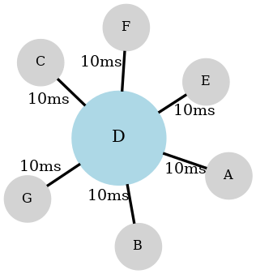
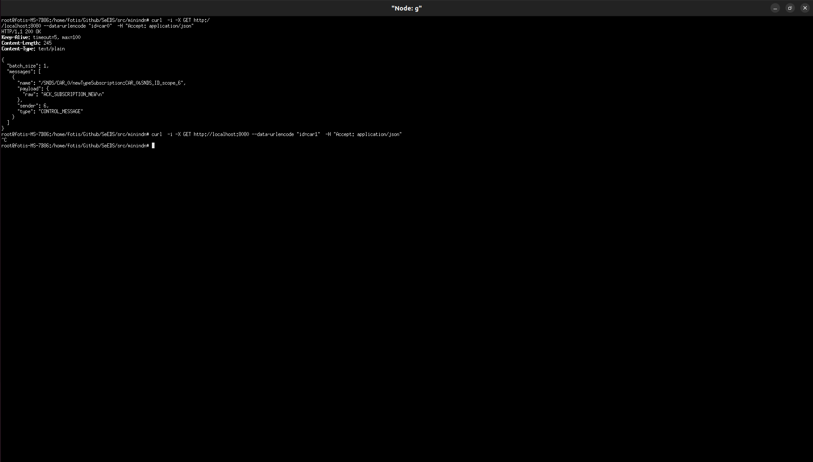
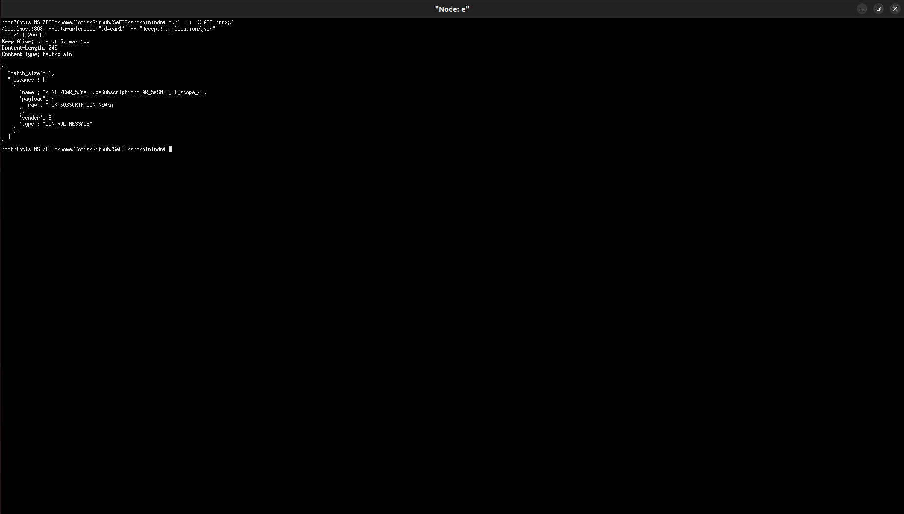
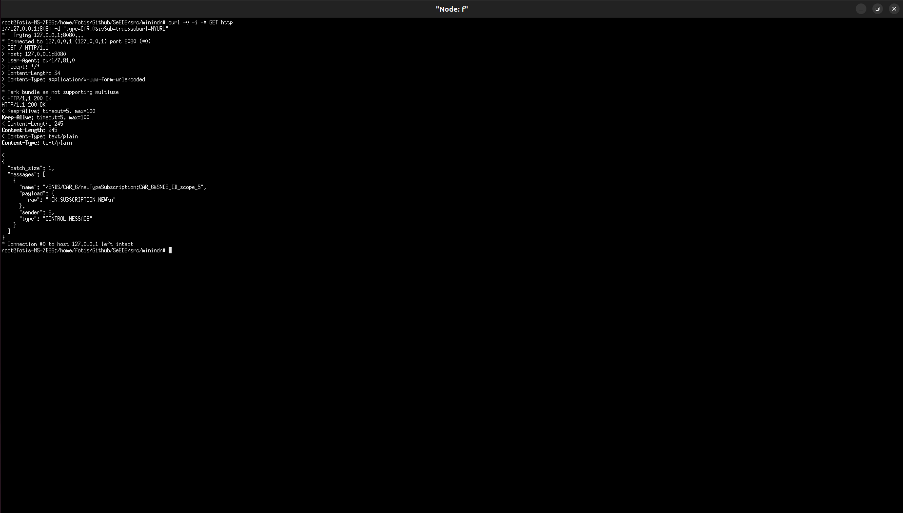

# Distributed Data Intermediary  

## Overview  

The resilience layer in SeEDS ensures that a SECONDARY node continuously converges towards the state of a PRIMARY node through lightweight synchronization protocols built on Named Data Networking (NDN). At the core of this mechanism lies a versioned canonical JSON store on the PRIMARY, which exposes its state through a set of standardized NDN Interests and Data packets. The SECONDARY maintains a local mirror of this store, applying updates received from the network and validating them against deterministic fingerprints.

### System Architecture  

The PRIMARY store maintains a bounded history of mutations. Each change increments a version counter, recomputes a canonical hash of the entire state, and records a snapshot to support future patch generation. It responds to queries with one of three data views: a lightweight metadata descriptor containing only the version and hash; a delta, represented as an RFC 6902 JSON Patch from one version to another; or a full snapshot of the canonical state. The SECONDARY mirror accepts these responses and applies them locally. Whenever patch application fails, or when the requested patch is unavailable, the mirror falls back to a snapshot, ensuring eventual consistency even in the presence of divergence.

The coordination of this synchronization is delegated to the Resilience Poller, a lightweight client running on the SECONDARY side. The poller periodically issues two types of queries to the PRIMARY: a liveness probe to verify reachability and a metadata request to determine the current head version. If the metadata reveals that the SECONDARY is behind, the poller requests either a patch from its current version to the remote version, or a snapshot when a patch cannot be applied. All results are communicated back to the local SeEDS services via inter-process communication (IPC), enabling the services to remain aware of the node’s role and state without themselves participating in the NDN protocol.

The Broker plays a dual role within this architecture. At startup, it hydrates the local store of a SECONDARY node by copying the current collections from MongoDB. During normal operation providing it deterministic fingerprints and collection hashes that the resilience layer can compare against those received from the PRIMARY. This dual function positions the broker as both the entry point for system initialization and the reference anchor for ongoing hash validation.

The resilience system is designed to handle failures gracefully. If the poller records consecutive failures in its liveness probes that exceed a configurable threshold, the SECONDARY promotes itself to PRIMARY and terminates the polling loop. This self-promotion is communicated to the local services through IPC, ensuring that the system can continue to operate without interruption despite the failure of the original PRIMARY.

## Experiment-Evaluation

The experimental evaluation was conducted using MiniNDN. The primary objective of this experiment was to measure system resilience under partial failure conditions, with the specific target of demonstrating that recovery latency does not fall below 200 ms when 50% of the data intermediary nodes fail.

### Network Topology  

The experimental evaluation was carried out on a seven-node star topology. In this configuration, node D functions as the central hub responsible for interconnecting all peripheral nodes through the Named Data Networking Forwarding Daemon (NFD). The peripheral nodes do not maintain direct links with one another; instead, every communication event must traverse the central hub. Consequently, all data exchanges and request forwarding operations are mediated by node D.


The nodes that will fail here are *A,B,C* which will be the **Primary Nodes** and the nodes that will be set up to be **Secondary** and remain alive will be *E,F,G*

Here's a graph visualizing the topology: 




Here's the config file inserted in MiniNDN: 

```conf
[nodes]
a: _ nfd-log-level=DEBUG
b: _ nfd-log-level=DEBUG
c: _ nfd-log-level=DEBUG
d: _ nfd-log-level=DEBUG
e: _ nfd-log-level=DEBUG
f: _ nfd-log-level=DEBUG
g: _ nfd-log-level=DEBUG
[links]
d:a delay=10ms
a:d delay=10ms
d:b delay=10ms
b:d delay=10ms
c:d delay=10ms
d:c delay=10ms
d:e delay=10ms
e:d delay=10ms
d:f delay=10ms
f:d delay=10ms
d:g delay=10ms
g:d delay=10ms
```

### Failure Injection

To emulate node failures, we deliberately terminated half of the non-hub nodes during the experiment. This was achieved by applying a configurable timeout mechanism, after which the designated PRIMARY nodes were forced to stop their daemons and thus become unavailable. The remaining nodes (SECONDARY) continued to operate, monitoring their paired failing counterparts through the resilience poller.

### Data Replication

Prior to node failures, data was actively published into the NDN network by all participating nodes. Each node contributed multiple data objects (e.g., key-value pairs of IDs and associated types) into the system, ensuring that the global dataset was replicated across the distributed MongoDB instances running locally on each host. The publication mechanism guaranteed redundancy, such that information was not confined to a single point of failure.

### Data Retrieval from Surviving Nodes

Following the induced failures, retrieval operations were performed exclusively from the surviving SECONDARY nodes. By design, these nodes were configured to subscribe to content from their peers, ensuring that they could continue to respond to queries despite the absence of their PRIMARY counterparts. This allowed us to verify that replicated data remained accessible through alternative nodes.

### Measurement of Recovery Time

Recovery was evaluated by analyzing the log files produced during the experiment. Each node continuously recorded system events with millisecond granularity. The recovery time metric was defined as the difference between two logged timestamps:

The timestamp recorded at the moment a PRIMARY node was declared failed, which corresponds to the daemon termination triggered by the timeout mechanism.

The timestamp of the subsequent event when the paired SECONDARY node successfully published the final replicated data entry back into the NDN network.

This difference represents the effective duration required for the system to detect the failure, promote the SECONDARY, and ensure that data availability was restored.


### Logs and screenshots


#### Data publication 

Each node uses it's unique ID to make the following announcements: 

```log
[2025-09-26 07:53:42.456] [info] [Producer] Announcing ID Scope name: SNDS/SNDS_ID_scope_id
[2025-09-26 07:53:42.456] [info] [Producer] Announcing name: SNDS/is_alive_id
[2025-09-26 07:53:42.456] [info] [Producer] Announcing name: SNDS/state_id
[2025-09-26 07:53:42.457] [info] [Producer] Announcing name: /SNDS/CAR_id
[2025-09-26 07:53:42.457] [info] [Producer] Announcing name: /SNDS/CAR_id_registry
[2025-09-26 07:53:42.458] [info] [Producer] Successfully registered prefix: /SNDS_id
```

ID is a placeholder for each node's unique ID.


Then the python script is configured to publish data to the node's Type, Subscriber Registries and publish ID's locally. Here are some examples: 

Inside Node A: 

```log
[2025-09-26 10:01:07.876] [info] [HTTPServer] Received POST request for / with body id=car0
[2025-09-26 10:01:07.876] [info] [HTTPServer] Received POST request from 127.0.0.1
Message: {id=car0}
Type: BY_ID_ADVERTISEMENT
Sender: HTTP_SRV
Payload: 
HTTP Type: HTTP_POST
Params:
id = car0
[2025-09-26 10:01:07.876] [debug] [HTTPServer] Writing message from POST request to service queue...
Message: {id=car0}
Type: BY_ID_ADVERTISEMENT
Sender: HTTP_SRV
Payload: 
HTTP Type: HTTP_POST
Params:
id = car0

[2025-09-26 10:01:07.876] [debug] [DigitalTwin] Extracted content from message {id=car0}
[2025-09-26 10:01:07.876] [debug] [DigitalTwin] Extracted content length from message 9
[2025-09-26 10:01:07.876] [debug] [DigitalTwin] Extracted type from message: BY_ID_ADVERTISEMENT
[2025-09-26 10:01:07.876] [info] [DigitalTwin] Received by ID get request...
[2025-09-26 10:01:07.876] [debug] [DigitalTwin] Pushed ID car0 to the announced IDs vector...
[2025-09-26 10:01:07.876] [debug] [DigitalTwin] Extracted id Scope from message SNDS_ID_scope_0
Message: /SNDS/car0/postID:car0
Type: BY_ID_ADVERTISEMENT
Sender: DIGITAL_TWIN
Payload: 
HTTP Type: HTTP_EMPTY
Params:
[2025-09-26 10:01:07.876] [info] [DigitalTwin] Pushing byID advertisement to the Producer...
Message: /SNDS/car0/postID:car0
Type: BY_ID_ADVERTISEMENT
Sender: DIGITAL_TWIN
Payload: 
HTTP Type: HTTP_EMPTY
Params:

[2025-09-26 10:01:07.876] [debug] [DigitalTwin] Sleeping 2000 ms before sending scope advertisement...
[2025-09-26 10:01:07.880] [info] [Producer] Received interest in function: onInterest, name: /SNDS/state_0/getResilienceMeta%3A
[2025-09-26 10:01:07.880] [info] [Producer] Parsed interest: Prefix: SNDS, Name: state_0, Command: getResilienceMeta, Params: []
[2025-09-26 10:01:07.881] [info] [Producer] Received interest in function: onInterest, name: /SNDS/is_alive_0/getResilienceIsAlive%3A17432869098159683528
[2025-09-26 10:01:07.882] [info] [Producer] Parsed interest: Prefix: SNDS, Name: is_alive_0, Command: getResilienceIsAlive, Params: [17432869098159683528]
[2025-09-26 10:01:07.882] [debug] [Producer] Sending data to the NDN…
[2025-09-26 10:01:07.902] [info] [Producer] Received interest in function: onInterest, name: /SNDS/is_alive_0/getResilienceIsAlive%3A11341762269107256235
[2025-09-26 10:01:07.902] [info] [Producer] Parsed interest: Prefix: SNDS, Name: is_alive_0, Command: getResilienceIsAlive, Params: [11341762269107256235]
[2025-09-26 10:01:07.902] [debug] [Producer] Sending data to the NDN…
[2025-09-26 10:01:07.920] [info] [Producer] Received interest in function: onInterest, name: /SNDS/state_0/getResilienceMeta%3A
[2025-09-26 10:01:07.920] [info] [Producer] Parsed interest: Prefix: SNDS, Name: state_0, Command: getResilienceMeta, Params: []
[2025-09-26 10:01:07.922] [info] [Producer] Received interest in function: onInterest, name: /SNDS/is_alive_0/getResilienceIsAlive%3A7264770695334591861
[2025-09-26 10:01:07.922] [info] [Producer] Parsed interest: Prefix: SNDS, Name: is_alive_0, Command: getResilienceIsAlive, Params: [7264770695334591861]
[2025-09-26 10:01:07.922] [debug] [Producer] Sending data to the NDN…
[2025-09-26 10:01:07.942] [info] [Producer] Received interest in function: onInterest, name: /SNDS/is_alive_0/getResilienceIsAlive%3A10537152589682238699
[2025-09-26 10:01:07.942] [info] [Producer] Parsed interest: Prefix: SNDS, Name: is_alive_0, Command: getResilienceIsAlive, Params: [10537152589682238699]
[2025-09-26 10:01:07.942] [debug] [Producer] Sending data to the NDN…
[2025-09-26 10:01:07.960] [info] [Producer] Received interest in function: onInterest, name: /SNDS/state_0/getResilienceMeta%3A
[2025-09-26 10:01:07.960] [info] [Producer] Parsed interest: Prefix: SNDS, Name: state_0, Command: getResilienceMeta, Params: []
[2025-09-26 10:01:07.962] [info] [Producer] Received interest in function: onInterest, name: /SNDS/is_alive_0/getResilienceIsAlive%3A12718435922522655948
[2025-09-26 10:01:07.962] [info] [Producer] Parsed interest: Prefix: SNDS, Name: is_alive_0, Command: getResilienceIsAlive, Params: [12718435922522655948]
[2025-09-26 10:01:07.962] [debug] [Producer] Sending data to the NDN…
Message: /SNDS/car0/postID:car0
Type: BY_ID_ADVERTISEMENT
Sender: DIGITAL_TWIN
Payload: 
HTTP Type: HTTP_EMPTY
Params:
[2025-09-26 10:01:07.971] [info] [Producer] Got new ID advertisement request...
Message: /SNDS/car0/postID:car0
Type: BY_ID_ADVERTISEMENT
Sender: DIGITAL_TWIN
Payload: 
HTTP Type: HTTP_EMPTY
Params:

[2025-09-26 10:01:07.971] [debug] [Producer] Parsed interest Prefix: SNDS, Name: car0, Command: postID, Params: [car0] from string
[2025-09-26 10:01:07.971] [info] [Producer] Announcing name: /SNDS/car0
```


Inside node B:

```log
[2025-09-26 10:01:19.920] [info] [HTTPServer] Received POST request for / with body id=car1
[2025-09-26 10:01:19.920] [info] [HTTPServer] Received POST request from 127.0.0.1
Message: {id=car1}
Type: BY_ID_ADVERTISEMENT
Sender: HTTP_SRV
Payload: 
HTTP Type: HTTP_POST
Params:
id = car1
[2025-09-26 10:01:19.920] [debug] [HTTPServer] Writing message from POST request to service queue...
Message: {id=car1}
Type: BY_ID_ADVERTISEMENT
Sender: HTTP_SRV
Payload: 
HTTP Type: HTTP_POST
Params:
id = car1

[2025-09-26 10:01:19.920] [debug] [DigitalTwin] Extracted content from message {id=car1}
[2025-09-26 10:01:19.920] [debug] [DigitalTwin] Extracted content length from message 9
[2025-09-26 10:01:19.920] [debug] [DigitalTwin] Extracted type from message: BY_ID_ADVERTISEMENT
[2025-09-26 10:01:19.920] [info] [DigitalTwin] Received by ID get request...
[2025-09-26 10:01:19.920] [debug] [DigitalTwin] Pushed ID car1 to the announced IDs vector...
[2025-09-26 10:01:19.920] [debug] [DigitalTwin] Extracted id Scope from message SNDS_ID_scope_5
Message: /SNDS/car1/postID:car1
Type: BY_ID_ADVERTISEMENT
Sender: DIGITAL_TWIN
Payload: 
HTTP Type: HTTP_EMPTY
Params:
[2025-09-26 10:01:19.920] [info] [DigitalTwin] Pushing byID advertisement to the Producer...
Message: /SNDS/car1/postID:car1
Type: BY_ID_ADVERTISEMENT
Sender: DIGITAL_TWIN
Payload: 
HTTP Type: HTTP_EMPTY
Params:

[2025-09-26 10:01:19.920] [debug] [DigitalTwin] Sleeping 2000 ms before sending scope advertisement...
Message: /SNDS/car1/postID:car1
Type: BY_ID_ADVERTISEMENT
Sender: DIGITAL_TWIN
Payload: 
HTTP Type: HTTP_EMPTY
Params:
[2025-09-26 10:01:19.921] [info] [Producer] Got new ID advertisement request...
Message: /SNDS/car1/postID:car1
Type: BY_ID_ADVERTISEMENT
Sender: DIGITAL_TWIN
Payload: 
HTTP Type: HTTP_EMPTY
Params:

[2025-09-26 10:01:19.921] [debug] [Producer] Parsed interest Prefix: SNDS, Name: car1, Command: postID, Params: [car1] from string
[2025-09-26 10:01:19.921] [info] [Producer] Announcing name: /SNDS/car1
```


#### Recovery 

Node A's logs which is the first **Primary Node**: 

```log
[TIMEOUT] 2025-09-26 10:03:08.446 a: daemon exceeded timeout
```

Node E's logs which is set up to be the **Secondary Node** of A: 

```log
[2025-09-26 10:03:08.456] [warning] [Producer] [resilience-ipc] promotion to PRIMARY (reason=alive-missed, misses=1)
[2025-09-26 10:03:08.456] [info] [Producer] [resilience] mutate → ver=6 hash=73f0555c38af9c19ece369fcb898abc0
[2025-09-26 10:03:08.456] [debug] [Producer] [resilience] history versions: 0(37a6259c) 1(c76727ce) 2(04168ec0) 3(b4d35eeb) 4(e9df653a) 5(0ef09630) 6(73f0555c) 
[2025-09-26 10:03:08.456] [debug] [Producer] [resilience] ops from v5 → v6:
[
  {
    "op": "replace",
    "path": "/resilience/reason",
    "value": "alive-missed"
  },
  {
    "op": "replace",
    "path": "/resilience/role",
    "value": "primary"
  },
  {
    "op": "replace",
    "path": "/resilience/since",
    "value": "2025-09-26T07:03:08Z"
  },
  {
    "op": "add",
    "path": "/resilience/misses",
    "value": 1
  }
]
[2025-09-26 10:03:08.456] [warning] [Producer] [resilience-ipc] stop requested; will be joined from main loop
[2025-09-26 10:03:08.522] [warning] [Producer] [resilience] applying promotion side-effects on main loop
[2025-09-26 10:03:08.522] [debug] [Producer] [overlay] merge: applying json_patch_against_base (ops=7)
[2025-09-26 10:03:08.522] [debug] [Producer] [resilience] assign → ver=7 hash=19f8dbf49001bae4f664a330312d42a9
[2025-09-26 10:03:08.522] [debug] [Producer] [overlay] SQUASH → base version 6→7  hash 73f0555c38af9c19ece369fcb898abc0→19f8dbf49001bae4f664a330312d42a9  overlay ver=16 hash=994121709bfc030ff093864add91033d
[2025-09-26 10:03:08.522] [debug] [Producer] [overlay] CLEARED
[2025-09-26 10:03:08.523] [debug] [Producer] [promotion] rebuilt containers from store:
[2025-09-26 10:03:08.523] [debug] [Producer]   type_registry[CAR_0] = [car10 ]
[2025-09-26 10:03:08.523] [debug] [Producer]   type_registry[CAR_4] = [car14 ]
[2025-09-26 10:03:08.523] [debug] [Producer]   subscribed_nodes_for_type[CAR_0] = [SNDS_ID_scope_6 ]
[2025-09-26 10:03:08.523] [debug] [Producer]   subscribed_nodes_for_type[CAR_4] = [SNDS_ID_scope_3 ]
[2025-09-26 10:03:08.523] [debug] [Producer]   announcements = [/SNDS/SNDS_ID_scope_4 /SNDS/is_alive_4 /SNDS/state_4 /SNDS/CAR_4_registry /SNDS/CAR_4 /SNDS/car4 /SNDS_0 /SNDS/car0 /SNDS/CAR_0 /SNDS/CAR_0_registry /SNDS/is_alive_0 /SNDS/SNDS_ID_scope_0 /SNDS_4 /SNDS/state_0 ]
[2025-09-26 10:03:08.523] [info] [Producer] [promotion] summary: types=2 ids=2 subs(byId)=0 subs(byType)=2 announced=14
[2025-09-26 10:03:08.523] [info] [Producer] [promotion] (re)announcing /SNDS/SNDS_ID_scope_4
[2025-09-26 10:03:08.523] [info] [Producer] [promotion] (re)announcing /SNDS/is_alive_4
[2025-09-26 10:03:08.523] [info] [Producer] [promotion] (re)announcing /SNDS/state_4
[2025-09-26 10:03:08.523] [info] [Producer] [promotion] (re)announcing /SNDS/CAR_4_registry
[2025-09-26 10:03:08.523] [info] [Producer] [promotion] (re)announcing /SNDS/CAR_4
[2025-09-26 10:03:08.523] [info] [Producer] [promotion] (re)announcing /SNDS/car4
[2025-09-26 10:03:08.524] [info] [Producer] [promotion] (re)announcing /SNDS_0
[2025-09-26 10:03:08.524] [info] [Producer] [promotion] (re)announcing /SNDS/car0
[2025-09-26 10:03:08.524] [info] [Producer] [promotion] (re)announcing /SNDS/CAR_0
[2025-09-26 10:03:08.524] [info] [Producer] [promotion] (re)announcing /SNDS/CAR_0_registry
[2025-09-26 10:03:08.524] [info] [Producer] [promotion] (re)announcing /SNDS/is_alive_0
[2025-09-26 10:03:08.524] [info] [Producer] [promotion] (re)announcing /SNDS/SNDS_ID_scope_0
[2025-09-26 10:03:08.524] [info] [Producer] [promotion] (re)announcing /SNDS_4
[2025-09-26 10:03:08.525] [info] [Producer] [promotion] (re)announcing /SNDS/state_0
[2025-09-26 10:03:08.525] [info] [Producer] Getting from IP: 10.0.0.26 and port: 10000
[2025-09-26 10:03:08.525] [debug] [Producer] HTTP GET /state?type=CAR_0
[2025-09-26 10:03:08.527] [info] [Producer] [resilience] mutate → ver=8 hash=85a5cbdd3d895ce5212470a8dfe17f55
[2025-09-26 10:03:08.527] [debug] [Producer] [resilience] history versions: 0(37a6259c) 1(c76727ce) 2(04168ec0) 3(b4d35eeb) 4(e9df653a) 5(0ef09630) 6(73f0555c) 7(19f8dbf4) 8(85a5cbdd) 
[2025-09-26 10:03:08.527] [debug] [Producer] [resilience] ops from v7 → v8:
[
  {
    "op": "replace",
    "path": "/broker/collections/CAR_0/lastSeen",
    "value": "2025-09-26T07:03:08Z"
  }
]
[2025-09-26 10:03:08.527] [info] [Producer] Getting from IP: 10.0.0.26 and port: 10000
[2025-09-26 10:03:08.527] [debug] [Producer] HTTP GET /state?type=CAR_4
[2025-09-26 10:03:08.528] [info] [Producer] [resilience] mutate → ver=9 hash=71624b465ef5120729971953ad41ec36
[2025-09-26 10:03:08.529] [debug] [Producer] [resilience] history versions: 0(37a6259c) 1(c76727ce) 2(04168ec0) 3(b4d35eeb) 4(e9df653a) 5(0ef09630) 6(73f0555c) 7(19f8dbf4) 8(85a5cbdd) 9(71624b46) 
[2025-09-26 10:03:08.529] [debug] [Producer] [resilience] ops from v8 → v9:
[
  {
    "op": "add",
    "path": "/broker/collections/CAR_4",
    "value": {
      "algo": "SHA-256",
      "count": 0,
      "hash": "e3b0c44298fc1c149afbf4c8996fb92427ae41e4649b934ca495991b7852b855",
      "lastSeen": "2025-09-26T07:03:08Z"
    }
  }
]
[2025-09-26 10:03:08.530] [info] [Producer] Successfully registered prefix: /SNDS/SNDS_ID_scope_4
[2025-09-26 10:03:08.530] [info] [Producer] Successfully registered prefix: /SNDS/is_alive_4
[2025-09-26 10:03:08.530] [info] [Producer] Successfully registered prefix: /SNDS/state_4
[2025-09-26 10:03:08.530] [info] [Producer] Successfully registered prefix: /SNDS/CAR_4_registry
[2025-09-26 10:03:08.532] [info] [Producer] Successfully registered prefix: /SNDS/CAR_4
[2025-09-26 10:03:08.532] [info] [Producer] Successfully registered prefix: /SNDS/car4
[2025-09-26 10:03:08.533] [info] [Producer] Successfully registered prefix: /SNDS_0
[2025-09-26 10:03:08.533] [info] [Producer] Successfully registered prefix: /SNDS/car0
[2025-09-26 10:03:08.533] [info] [Producer] Successfully registered prefix: /SNDS/CAR_0
[2025-09-26 10:03:08.533] [info] [Producer] Successfully registered prefix: /SNDS/CAR_0_registry
[2025-09-26 10:03:08.533] [info] [Producer] Successfully registered prefix: /SNDS/is_alive_0
[2025-09-26 10:03:08.533] [info] [Producer] Successfully registered prefix: /SNDS/SNDS_ID_scope_0
[2025-09-26 10:03:08.533] [info] [Producer] Successfully registered prefix: /SNDS_4
[2025-09-26 10:03:08.533] [info] [Producer] Successfully registered prefix: /SNDS/state_0
```

We can see that the failure of Node A happened at **2025-09-26 10:03:08.446**  and the **Secondary Node** published the last data at **2025-09-26 10:03:08.533**. This means that the system recovered in *87ms*. This is to be expected, because the data is continuously replicated in our system and it is essentially ready to be published once the **Primary Node** fails.


Let's see now if the data of A, which now are essentially the data of E, are retrievable through the network. Let's ask for the data through G, which is the id=``car0``:



Let's check E's logs: 

```log
[2025-09-26 10:22:14.393] [info] [Producer] Received interest in function: onInterest, name: /SNDS/car0/temporalQuery%3Aid%3Dcar0%26type%3D%26date%3D%26count%3D%26timeframe%3D%26filters%3D
[2025-09-26 10:22:14.394] [info] [Producer] Parsed interest: Prefix: SNDS, Name: car0, Command: temporalQuery, Params: [id=car0, type=, date=, count=, timeframe=, filters=]
[2025-09-26 10:22:14.394] [debug] [Producer] Created interest response: /SNDS/car0/temporalQuery%3Aid%3Dcar0%26type%3D%26date%3D%26count%3D%26timeframe%3D%26filters%3D in: process_temporal_query_interest
[2025-09-26 10:22:14.394] [debug] [Producer] TemporalQuery → id: car0, date: , type: , timeframe: , count: , filters: 
[2025-09-26 10:22:14.394] [debug] [Producer] Requesting to endpoint: /temporal-query?id=car0&type=&count=&date=&timeframe=&filters=
[2025-09-26 10:22:14.395] [info] [Producer] Successfully queried /temporal-query
[2025-09-26 10:22:14.395] [debug] [Producer] Sending data to the NDN…
```

Let's check G's logs: 

```log
[2025-09-26 10:22:14.393] [info] [HTTPServer] Received GET request for / with body id=car0
[2025-09-26 10:22:14.393] [info] [HTTPServer] Received GET request for / with target /
[2025-09-26 10:22:14.393] [info] [HTTPServer] Received GET request from 127.0.0.1
Message: {id=car0}
Type: GET_BY_ID_REQUEST
Sender: HTTP_SRV
Payload: 
HTTP Type: HTTP_GET
Params:
id = car0
[2025-09-26 10:22:14.393] [debug] [HTTPServer] Writing message from GET request to service queue...
Message: {id=car0}
Type: GET_BY_ID_REQUEST
Sender: HTTP_SRV
Payload: 
HTTP Type: HTTP_GET
Params:
id = car0

[2025-09-26 10:22:14.393] [info] [Worker] Received content: {id=car0}
[2025-09-26 10:22:14.393] [info] [Worker] Received payload: 
[2025-09-26 10:22:14.393] [info] [Worker] Received type: GET_BY_ID_REQUEST
[2025-09-26 10:22:14.393] [debug] [Worker] Server intra message...
Message: BATCH
Type: GENERIC
Sender: WORKER
Payload: {
  "batch_size": 1,
  "messages": [
    {
      "name": "/SNDS/CAR_0/newTypeSubscription:CAR_0&SNDS_ID_scope_6",
      "payload": {
        "raw": "ACK_SUBSCRIPTION_NEW\n"
      },
      "sender": 6,
      "type": "CONTROL_MESSAGE"
    }
  ]
}

HTTP Type: HTTP_EMPTY
Params:
[2025-09-26 10:22:14.393] [info] [HTTPServer] Read Message from queue:
Message: BATCH
Type: GENERIC
Sender: WORKER
Payload: {
  "batch_size": 1,
  "messages": [
    {
      "name": "/SNDS/CAR_0/newTypeSubscription:CAR_0&SNDS_ID_scope_6",
      "payload": {
        "raw": "ACK_SUBSCRIPTION_NEW\n"
      },
      "sender": 6,
      "type": "CONTROL_MESSAGE"
    }
  ]
}

HTTP Type: HTTP_EMPTY
Params:

[2025-09-26 10:22:14.393] [info] [Worker] Inserted ID: car0 into set. Pushing regular getByID request for ID: car0
[2025-09-26 10:22:14.393] [info] [Worker] Reading packet...
[2025-09-26 10:22:14.393] [debug] [Consumer] Extracted content from message: /SNDS/car0/getByID:car0
[2025-09-26 10:22:14.393] [debug] [Consumer] Extracted content length from message: 23
[2025-09-26 10:22:14.393] [debug] [Consumer] Extracted message type from message: GET_BY_ID_REQUEST
[2025-09-26 10:22:14.393] [debug] [Consumer] Query.type: 
[2025-09-26 10:22:14.393] [debug] [Consumer] Query.id: car0
[2025-09-26 10:22:14.393] [info] [Consumer] Created name /SNDS/car0/temporalQuery:id%3Dcar0&type%3D&date%3D&count%3D&timeframe%3D&filters%3D
[2025-09-26 10:22:14.393] [info] [Consumer] Sending actual Interest /SNDS/car0/temporalQuery%3Aid%3Dcar0%26type%3D%26date%3D%26count%3D%26timeframe%3D%26filters%3D?CanBePrefix&Lifetime=6000
[2025-09-26 10:22:14.396] [info] [Consumer] Received Data with name: /SNDS/car0/temporalQuery%3Aid%3Dcar0%26type%3D%26date%3D%26count%3D%26timeframe%3D%26filters%3D in function onData
[2025-09-26 10:22:14.396] [info] [Consumer] Data packet payload: [
  {
    "": {
      "_id": "car0",
      "id": "car0",
      "timestamp": {
        "$date": 1758870068072
      },
      "type": "GENERIC"
    }
  }
] in function onData
[2025-09-26 10:22:14.396] [info] [Consumer] Parsed interest: Prefix: SNDS, Name: car0, Command: temporalQuery, Params: [id=car0, type=, date=, count=, timeframe=, filters=] in onData
[2025-09-26 10:22:14.396] [info] [Consumer] Temporal Query Reponse...
[2025-09-26 10:22:14.396] [debug] [Consumer] Removed extra characters from payload (first 32 bytes hex): 5b 0a 20 20 7b 0a 20 20 20 20 22 22 3a 20 7b 0a 20 20 20 20 20 20 22 5f 69 64 22 3a 20 22 63 61 
[2025-09-26 10:22:14.396] [debug] [Consumer] Candidate JSON slice:
[
  {
    "": {
      "_id": "car0",
      "id": "car0",
      "timestamp": {
        "$date": 1758870068072
      },
      "type": "GENERIC"
    }
  }
]
[2025-09-26 10:22:14.396] [debug] [Consumer] Sanitized payload to:
[
  {
    "": {
      "_id": "car0",
      "id": "car0",
      "timestamp": {
        "$date": 1758870068072
      },
      "type": "GENERIC"
    }
  }
]
```

Nice G got a response back with the data. 

Let's also check B's logs, which is another **Primary Node**: 

```log
[TIMEOUT] 2025-09-26 10:03:11.493 b: daemon exceeded timeout
```

Let's check F's logs, which is the **Secondary Node** of B: 

```log
[2025-09-26 10:03:11.496] [warning] [Producer] [resilience-ipc] promotion to PRIMARY (reason=alive-missed, misses=1)
[2025-09-26 10:03:11.496] [info] [Producer] [resilience] mutate → ver=6 hash=ac41eea00ae8385b88550b5d064cee98
[2025-09-26 10:03:11.496] [debug] [Producer] [resilience] history versions: 0(37a6259c) 1(3b6ede70) 2(b4b2de78) 3(050d6435) 4(20c5c4af) 5(7ee82c13) 6(ac41eea0) 
[2025-09-26 10:03:11.496] [debug] [Producer] [resilience] ops from v5 → v6:
[
  {
    "op": "replace",
    "path": "/resilience/reason",
    "value": "alive-missed"
  },
  {
    "op": "replace",
    "path": "/resilience/role",
    "value": "primary"
  },
  {
    "op": "replace",
    "path": "/resilience/since",
    "value": "2025-09-26T07:03:11Z"
  },
  {
    "op": "add",
    "path": "/resilience/misses",
    "value": 1
  }
]
[2025-09-26 10:03:11.496] [warning] [Producer] [resilience-ipc] stop requested; will be joined from main loop
[2025-09-26 10:03:11.530] [warning] [Producer] [resilience] applying promotion side-effects on main loop
[2025-09-26 10:03:11.530] [debug] [Producer] [overlay] merge: applying json_patch_against_base (ops=7)
[2025-09-26 10:03:11.530] [debug] [Producer] [resilience] assign → ver=7 hash=9b408c51324d2bb669672017a28994e2
[2025-09-26 10:03:11.530] [debug] [Producer] [overlay] SQUASH → base version 6→7  hash ac41eea00ae8385b88550b5d064cee98→9b408c51324d2bb669672017a28994e2  overlay ver=16 hash=59d0966e24c8873e2ec151dfd7a8b395
[2025-09-26 10:03:11.530] [debug] [Producer] [overlay] CLEARED
[2025-09-26 10:03:11.530] [debug] [Producer] [promotion] rebuilt containers from store:
[2025-09-26 10:03:11.530] [debug] [Producer]   type_registry[CAR_1] = [car11 ]
[2025-09-26 10:03:11.531] [debug] [Producer]   type_registry[CAR_5] = [car15 ]
[2025-09-26 10:03:11.531] [debug] [Producer]   subscribed_nodes_for_type[CAR_1] = [SNDS_ID_scope_0 ]
[2025-09-26 10:03:11.531] [debug] [Producer]   subscribed_nodes_for_type[CAR_5] = [SNDS_ID_scope_4 ]
[2025-09-26 10:03:11.531] [debug] [Producer]   announcements = [/SNDS/SNDS_ID_scope_5 /SNDS/is_alive_5 /SNDS/CAR_1 /SNDS/CAR_5 /SNDS/CAR_5_registry /SNDS_1 /SNDS_5 /SNDS/is_alive_1 /SNDS/car5 /SNDS/CAR_1_registry /SNDS/SNDS_ID_scope_1 /SNDS/car1 /SNDS/state_5 /SNDS/state_1 ]
[2025-09-26 10:03:11.531] [info] [Producer] [promotion] summary: types=2 ids=2 subs(byId)=0 subs(byType)=2 announced=14
[2025-09-26 10:03:11.531] [info] [Producer] [promotion] (re)announcing /SNDS/SNDS_ID_scope_5
[2025-09-26 10:03:11.531] [info] [Producer] [promotion] (re)announcing /SNDS/is_alive_5
[2025-09-26 10:03:11.531] [info] [Producer] [promotion] (re)announcing /SNDS/CAR_1
[2025-09-26 10:03:11.531] [info] [Producer] [promotion] (re)announcing /SNDS/CAR_5
[2025-09-26 10:03:11.531] [info] [Producer] [promotion] (re)announcing /SNDS/CAR_5_registry
[2025-09-26 10:03:11.531] [info] [Producer] [promotion] (re)announcing /SNDS_1
[2025-09-26 10:03:11.532] [info] [Producer] [promotion] (re)announcing /SNDS_5
[2025-09-26 10:03:11.532] [info] [Producer] [promotion] (re)announcing /SNDS/is_alive_1
[2025-09-26 10:03:11.532] [info] [Producer] [promotion] (re)announcing /SNDS/car5
[2025-09-26 10:03:11.532] [info] [Producer] [promotion] (re)announcing /SNDS/CAR_1_registry
[2025-09-26 10:03:11.532] [info] [Producer] [promotion] (re)announcing /SNDS/SNDS_ID_scope_1
[2025-09-26 10:03:11.532] [info] [Producer] [promotion] (re)announcing /SNDS/car1
[2025-09-26 10:03:11.532] [info] [Producer] [promotion] (re)announcing /SNDS/state_5
[2025-09-26 10:03:11.532] [info] [Producer] [promotion] (re)announcing /SNDS/state_1
[2025-09-26 10:03:11.533] [info] [Producer] Getting from IP: 10.0.0.34 and port: 10000
[2025-09-26 10:03:11.533] [debug] [Producer] HTTP GET /state?type=CAR_1
[2025-09-26 10:03:11.535] [info] [Producer] [resilience] mutate → ver=8 hash=d13592ce859b022333f677c5267aa2b9
[2025-09-26 10:03:11.535] [debug] [Producer] [resilience] history versions: 0(37a6259c) 1(3b6ede70) 2(b4b2de78) 3(050d6435) 4(20c5c4af) 5(7ee82c13) 6(ac41eea0) 7(9b408c51) 8(d13592ce) 
[2025-09-26 10:03:11.535] [debug] [Producer] [resilience] ops from v7 → v8:
[
  {
    "op": "replace",
    "path": "/broker/collections/CAR_1/lastSeen",
    "value": "2025-09-26T07:03:11Z"
  }
]
[2025-09-26 10:03:11.535] [info] [Producer] Getting from IP: 10.0.0.34 and port: 10000
[2025-09-26 10:03:11.535] [debug] [Producer] HTTP GET /state?type=CAR_5
[2025-09-26 10:03:11.537] [info] [Producer] [resilience] mutate → ver=9 hash=1d452cd075217771307c5fa18c634be8
[2025-09-26 10:03:11.537] [debug] [Producer] [resilience] history versions: 0(37a6259c) 1(3b6ede70) 2(b4b2de78) 3(050d6435) 4(20c5c4af) 5(7ee82c13) 6(ac41eea0) 7(9b408c51) 8(d13592ce) 9(1d452cd0) 
[2025-09-26 10:03:11.537] [debug] [Producer] [resilience] ops from v8 → v9:
[
  {
    "op": "add",
    "path": "/broker/collections/CAR_5",
    "value": {
      "algo": "SHA-256",
      "count": 0,
      "hash": "e3b0c44298fc1c149afbf4c8996fb92427ae41e4649b934ca495991b7852b855",
      "lastSeen": "2025-09-26T07:03:11Z"
    }
  }
]
[2025-09-26 10:03:11.539] [info] [Producer] Successfully registered prefix: /SNDS/SNDS_ID_scope_5
[2025-09-26 10:03:11.540] [info] [Producer] Successfully registered prefix: /SNDS/is_alive_5
[2025-09-26 10:03:11.542] [info] [Producer] Successfully registered prefix: /SNDS/CAR_1
[2025-09-26 10:03:11.542] [info] [Producer] Successfully registered prefix: /SNDS/CAR_5
[2025-09-26 10:03:11.542] [info] [Producer] Successfully registered prefix: /SNDS/CAR_5_registry
[2025-09-26 10:03:11.543] [info] [Producer] Successfully registered prefix: /SNDS_1
[2025-09-26 10:03:11.543] [info] [Producer] Successfully registered prefix: /SNDS_5
[2025-09-26 10:03:11.543] [info] [Producer] Successfully registered prefix: /SNDS/is_alive_1
[2025-09-26 10:03:11.543] [info] [Producer] Successfully registered prefix: /SNDS/car5
[2025-09-26 10:03:11.543] [info] [Producer] Successfully registered prefix: /SNDS/CAR_1_registry
[2025-09-26 10:03:11.543] [info] [Producer] Successfully registered prefix: /SNDS/SNDS_ID_scope_1
[2025-09-26 10:03:11.543] [info] [Producer] Successfully registered prefix: /SNDS/car1
[2025-09-26 10:03:11.543] [info] [Producer] Successfully registered prefix: /SNDS/state_5
[2025-09-26 10:03:11.543] [info] [Producer] Successfully registered prefix: /SNDS/state_1
```

We can see that the fail timestamp for Node B **2025-09-26 10:03:11.493** and the full recovery timestamp is at **2025-09-26 10:03:11.543** which is a *50ms* difference. 

Let's see if the data of B, which are now F's are retrievable through the NDN network.

Let's request data from E, the id=``car1`` which was originally published to B: 



F's logs: 

```log
[2025-09-26 10:22:24.170] [info] [Producer] Received interest in function: onInterest, name: /SNDS/car1/temporalQuery%3Aid%3Dcar1%26type%3D%26date%3D%26count%3D%26timeframe%3D%26filters%3D
[2025-09-26 10:22:24.170] [info] [Producer] Parsed interest: Prefix: SNDS, Name: car1, Command: temporalQuery, Params: [id=car1, type=, date=, count=, timeframe=, filters=]
[2025-09-26 10:22:24.170] [debug] [Producer] Created interest response: /SNDS/car1/temporalQuery%3Aid%3Dcar1%26type%3D%26date%3D%26count%3D%26timeframe%3D%26filters%3D in: process_temporal_query_interest
[2025-09-26 10:22:24.170] [debug] [Producer] TemporalQuery → id: car1, date: , type: , timeframe: , count: , filters: 
[2025-09-26 10:22:24.170] [debug] [Producer] Requesting to endpoint: /temporal-query?id=car1&type=&count=&date=&timeframe=&filters=
[2025-09-26 10:22:24.171] [info] [Producer] Successfully queried /temporal-query
[2025-09-26 10:22:24.171] [debug] [Producer] Sending data to the NDN…
```

E's logs: 

```log
[2025-09-26 10:26:55.977] [info] [HTTPServer] Received GET request for / with body id=car1
[2025-09-26 10:26:55.977] [info] [HTTPServer] Received GET request for / with target /
[2025-09-26 10:26:55.977] [info] [HTTPServer] Received GET request from 127.0.0.1
Message: {id=car1}
Type: GET_BY_ID_REQUEST
Sender: HTTP_SRV
Payload: 
HTTP Type: HTTP_GET
Params:
id = car1
[2025-09-26 10:26:55.977] [debug] [HTTPServer] Writing message from GET request to service queue...
Message: {id=car1}
Type: GET_BY_ID_REQUEST
Sender: HTTP_SRV
Payload: 
HTTP Type: HTTP_GET
Params:
id = car1

Message: BATCH
Type: GENERIC
Sender: WORKER
Payload: {
  "batch_size": 1,
  "messages": [
    {
      "name": "/SNDS/CAR_5/newTypeSubscription:CAR_5&SNDS_ID_scope_4",
      "payload": {
        "raw": "ACK_SUBSCRIPTION_NEW\n"
      },
      "sender": 6,
      "type": "CONTROL_MESSAGE"
    }
  ]
}

HTTP Type: HTTP_EMPTY
Params:
[2025-09-26 10:26:55.977] [info] [HTTPServer] Read Message from queue:
Message: BATCH
Type: GENERIC
Sender: WORKER
Payload: {
  "batch_size": 1,
  "messages": [
    {
      "name": "/SNDS/CAR_5/newTypeSubscription:CAR_5&SNDS_ID_scope_4",
      "payload": {
        "raw": "ACK_SUBSCRIPTION_NEW\n"
      },
      "sender": 6,
      "type": "CONTROL_MESSAGE"
    }
  ]
}

HTTP Type: HTTP_EMPTY
Params:

[2025-09-26 10:26:55.977] [info] [Worker] Received content: {id=car1}
[2025-09-26 10:26:55.977] [info] [Worker] Received payload: 
[2025-09-26 10:26:55.977] [info] [Worker] Received type: GET_BY_ID_REQUEST
[2025-09-26 10:26:55.977] [debug] [Worker] Server intra message...
[2025-09-26 10:26:55.977] [info] [Worker] Inserted ID: car1 into set. Pushing regular getByID request for ID: car1
[2025-09-26 10:26:55.977] [info] [Worker] Reading packet...
[2025-09-26 10:26:55.977] [debug] [Consumer] Extracted content from message: /SNDS/car1/getByID:car1
[2025-09-26 10:26:55.977] [debug] [Consumer] Extracted content length from message: 23
[2025-09-26 10:26:55.977] [debug] [Consumer] Extracted message type from message: GET_BY_ID_REQUEST
[2025-09-26 10:26:55.977] [debug] [Consumer] Query.type: 
[2025-09-26 10:26:55.977] [debug] [Consumer] Query.id: car1
[2025-09-26 10:26:55.977] [info] [Consumer] Created name /SNDS/car1/temporalQuery:id%3Dcar1&type%3D&date%3D&count%3D&timeframe%3D&filters%3D
[2025-09-26 10:26:55.977] [info] [Consumer] Sending actual Interest /SNDS/car1/temporalQuery%3Aid%3Dcar1%26type%3D%26date%3D%26count%3D%26timeframe%3D%26filters%3D?CanBePrefix&Lifetime=6000
[2025-09-26 10:26:55.977] [info] [Consumer] Received Data with name: /SNDS/car1/temporalQuery%3Aid%3Dcar1%26type%3D%26date%3D%26count%3D%26timeframe%3D%26filters%3D in function onData
[2025-09-26 10:26:55.977] [info] [Consumer] Data packet payload: [
  {
    "": {
      "_id": "car1",
      "id": "car1",
      "timestamp": {
        "$date": 1758870079983
      },
      "type": "GENERIC"
    }
  }
] in function onData
[2025-09-26 10:26:55.977] [info] [Consumer] Parsed interest: Prefix: SNDS, Name: car1, Command: temporalQuery, Params: [id=car1, type=, date=, count=, timeframe=, filters=] in onData
[2025-09-26 10:26:55.977] [info] [Consumer] Temporal Query Reponse...
[2025-09-26 10:26:55.977] [debug] [Consumer] Removed extra characters from payload (first 32 bytes hex): 5b 0a 20 20 7b 0a 20 20 20 20 22 22 3a 20 7b 0a 20 20 20 20 20 20 22 5f 69 64 22 3a 20 22 63 61 
[2025-09-26 10:26:55.977] [debug] [Consumer] Candidate JSON slice:
[
  {
    "": {
      "_id": "car1",
      "id": "car1",
      "timestamp": {
        "$date": 1758870079983
      },
      "type": "GENERIC"
    }
  }
]
[2025-09-26 10:26:55.977] [debug] [Consumer] Sanitized payload to:
[
  {
    "": {
      "_id": "car1",
      "id": "car1",
      "timestamp": {
        "$date": 1758870079983
      },
      "type": "GENERIC"
    }
  }
]
```

Nice E got the data back! 


Now let's try to subscribe through F to A's, which is now E's, ``CAR_0`` registry: 



Let's check E's logs: 

```log
[2025-09-26 10:29:48.673] [info] [Producer] Received interest in function: onInterest, name: /SNDS/CAR_0/newTypeSubscription%3ACAR_0%26SNDS_ID_scope_5
[2025-09-26 10:29:48.674] [info] [Producer] Parsed interest: Prefix: SNDS, Name: CAR_0, Command: newTypeSubscription, Params: [CAR_0, SNDS_ID_scope_5]
[2025-09-26 10:29:48.674] [info] [Producer] Received our_snds_node_id: CAR_0 in func: process_new_subscription_interest
[2025-09-26 10:29:48.674] [info] [Producer] Got interest indicating new subscription for name: CAR_0, and snds node: SNDS_ID_scope_5
[2025-09-26 10:29:48.674] [info] [Producer] [event] subscribe_type: node=SNDS_ID_scope_5 -> type=CAR_0
[2025-09-26 10:29:48.674] [info] [Producer] [resilience] mutate → ver=10 hash=e2c45524fae91095e69b2b57d179f295
[2025-09-26 10:29:48.674] [debug] [Producer] [resilience] history versions: 0(37a6259c) 1(c76727ce) 2(04168ec0) 3(b4d35eeb) 4(e9df653a) 5(0ef09630) 6(73f0555c) 7(19f8dbf4) 8(85a5cbdd) 9(71624b46) 10(e2c45524) 
[2025-09-26 10:29:48.674] [debug] [Producer] [resilience] ops from v9 → v10:
[
  {
    "op": "add",
    "path": "/subscribers/byType/CAR_0/nodes/SNDS_ID_scope_5",
    "value": true
  }
]
[2025-09-26 10:29:48.674] [info] [Producer] [debug][event:on_subscribe_type SNDS_ID_scope_5->CAR_0] summary → types=2 ids=2 subs(byId)=0 subs(byType)=3 announced=14
[2025-09-26 10:29:48.674] [debug] [Producer] [debug][event:on_subscribe_type SNDS_ID_scope_5->CAR_0] type_registry:
[2025-09-26 10:29:48.674] [debug] [Producer]   [CAR_0] car10 
[2025-09-26 10:29:48.674] [debug] [Producer]   [CAR_4] car14 
[2025-09-26 10:29:48.674] [debug] [Producer] [debug][event:on_subscribe_type SNDS_ID_scope_5->CAR_0] subscribed_nodes_for_id:
[2025-09-26 10:29:48.674] [debug] [Producer] [debug][event:on_subscribe_type SNDS_ID_scope_5->CAR_0] subscribed_nodes_for_type:
[2025-09-26 10:29:48.674] [debug] [Producer]   [CAR_0] SNDS_ID_scope_5 SNDS_ID_scope_6 
[2025-09-26 10:29:48.674] [debug] [Producer]   [CAR_4] SNDS_ID_scope_3 
[2025-09-26 10:29:48.674] [debug] [Producer] [debug][event:on_subscribe_type SNDS_ID_scope_5->CAR_0] announcements: /SNDS/SNDS_ID_scope_4 /SNDS/is_alive_4 /SNDS/state_4 /SNDS/CAR_4_registry /SNDS/CAR_4 /SNDS/car4 /SNDS_0 /SNDS/car0 /SNDS/CAR_0 /SNDS/CAR_0_registry /SNDS/is_alive_0 /SNDS/SNDS_ID_scope_0 /SNDS_4 /SNDS/state_0 
[2025-09-26 10:29:48.674] [info] [Producer] [debug][event:on_subscribe_type SNDS_ID_scope_5->CAR_0] broker.journal: entries=0 cursor=1 last_fp=2025-09-26
[2025-09-26 10:29:48.674] [debug] [Producer] [overlay][event:on_subscribe_type SNDS_ID_scope_5->CAR_0] ver=0 hash=d41d8cd98f00b204e9800998ecf8427e keys=0
[2025-09-26 10:29:48.674] [info] [Producer] [BY_TYPE] New subscription: SNDS_ID_scope_5 subscribed to CAR_0
[2025-09-26 10:29:48.674] [info] [Producer] [BY_TYPE] Responding to interest: /SNDS/CAR_0/newTypeSubscription%3ACAR_0%26SNDS_ID_scope_5
[2025-09-26 10:29:48.674] [debug] [Producer] Sending data to the NDN…
```

Let's check F's logs:

```log
[2025-09-26 10:29:48.673] [info] [HTTPServer] Received GET request for / with body type=CAR_0&isSub=true&suburl=MYURL
[2025-09-26 10:29:48.673] [info] [HTTPServer] Received GET request for / with target /
[2025-09-26 10:29:48.673] [info] [HTTPServer] Received GET request from 127.0.0.1
Message: {type=CAR_0,suburl=MYURL,isSub=1}
Type: BY_TYPE_SUBSCRIPTION
Sender: HTTP_SRV
Payload: 
HTTP Type: HTTP_GET
Params:
type = CAR_0
suburl = MYURL
isSub = 1
[2025-09-26 10:29:48.673] [debug] [HTTPServer] Writing message from GET request to service queue...
Message: {type=CAR_0,suburl=MYURL,isSub=1}
Type: BY_TYPE_SUBSCRIPTION
Sender: HTTP_SRV
Payload: 
HTTP Type: HTTP_GET
Params:
type = CAR_0
suburl = MYURL
isSub = 1

Message: BATCH
Type: GENERIC
Sender: WORKER
Payload: {
  "batch_size": 1,
  "messages": [
    {
      "name": "/SNDS/CAR_6/newTypeSubscription:CAR_6&SNDS_ID_scope_5",
      "payload": {
        "raw": "ACK_SUBSCRIPTION_NEW\n"
      },
      "sender": 6,
      "type": "CONTROL_MESSAGE"
    }
  ]
}

HTTP Type: HTTP_EMPTY
Params:
[2025-09-26 10:29:48.673] [info] [Worker] Received content: {type=CAR_0,suburl=MYURL,isSub=1}
[2025-09-26 10:29:48.673] [info] [Worker] Received payload: 
[2025-09-26 10:29:48.673] [info] [Worker] Received type: BY_TYPE_SUBSCRIPTION
[2025-09-26 10:29:48.673] [info] [HTTPServer] Read Message from queue:
Message: BATCH
Type: GENERIC
Sender: WORKER
Payload: {
  "batch_size": 1,
  "messages": [
    {
      "name": "/SNDS/CAR_6/newTypeSubscription:CAR_6&SNDS_ID_scope_5",
      "payload": {
        "raw": "ACK_SUBSCRIPTION_NEW\n"
      },
      "sender": 6,
      "type": "CONTROL_MESSAGE"
    }
  ]
}

HTTP Type: HTTP_EMPTY
Params:

[2025-09-26 10:29:48.673] [debug] [Worker] Server intra message...
[2025-09-26 10:29:48.673] [info] [Worker] Stored FIRST subscription for Name: CAR_0 and URL: MYURL
[2025-09-26 10:29:48.673] [info] [Worker] Since this is a byType subscription we don't need to create a scope. Using the Type: CAR_0 as a scope
[2025-09-26 10:29:48.673] [info] [Worker] Created interest name: /SNDS/CAR_0/newTypeSubscription:CAR_0&SNDS_ID_scope_5
Message: /SNDS/CAR_0/newTypeSubscription:CAR_0&SNDS_ID_scope_5
Type: BY_TYPE_SUBSCRIPTION
Sender: WORKER
Payload: 
HTTP Type: HTTP_EMPTY
Params:
[2025-09-26 10:29:48.673] [debug] [Worker] Sending message to consumer...
Message: /SNDS/CAR_0/newTypeSubscription:CAR_0&SNDS_ID_scope_5
Type: BY_TYPE_SUBSCRIPTION
Sender: WORKER
Payload: 
HTTP Type: HTTP_EMPTY
Params:

[2025-09-26 10:29:48.673] [info] [Worker] Reading packet...
[2025-09-26 10:29:48.673] [debug] [Consumer] Extracted content from message: /SNDS/CAR_0/newTypeSubscription:CAR_0&SNDS_ID_scope_5
[2025-09-26 10:29:48.673] [debug] [Consumer] Extracted content length from message: 53
[2025-09-26 10:29:48.673] [debug] [Consumer] Extracted message type from message: BY_TYPE_SUBSCRIPTION
[2025-09-26 10:29:48.673] [info] [Consumer] Received other scope name: CAR_0 in express_subscription_interest
[2025-09-26 10:29:48.673] [info] [Consumer] Received other scope name: CAR_0, our scope name: SNDS_ID_scope_5 for name: CAR_0 in func: express_subscription_interest
[2025-09-26 10:29:48.673] [debug] [Consumer] Created name: /SNDS/CAR_0/newTypeSubscription:CAR_0&SNDS_ID_scope_5 in func: express_subscription_interest
[2025-09-26 10:29:48.673] [debug] [Consumer] Sending actual interest to the network: /SNDS/CAR_0/newTypeSubscription%3ACAR_0%26SNDS_ID_scope_5?CanBePrefix&Lifetime=6000
[2025-09-26 10:29:48.674] [info] [Consumer] Received Data with name: /SNDS/CAR_0/newTypeSubscription%3ACAR_0%26SNDS_ID_scope_5 in function onData
[2025-09-26 10:29:48.674] [info] [Consumer] Data packet payload: ACK_SUBSCRIPTION_NEW in function onData
[2025-09-26 10:29:48.674] [info] [Consumer] Parsed interest: Prefix: SNDS, Name: CAR_0, Command: newTypeSubscription, Params: [CAR_0, SNDS_ID_scope_5] in onData
[2025-09-26 10:29:48.674] [info] [Consumer] Got ACK ACK_SUBSCRIPTION_NEW. Skipping...
[2025-09-26 10:29:48.674] [info] [Consumer] Reading packet...
[2025-09-26 10:29:48.674] [info] [Worker] Received content: /SNDS/CAR_0/newTypeSubscription:CAR_0&SNDS_ID_scope_5
[2025-09-26 10:29:48.674] [info] [Worker] Received payload: ACK_SUBSCRIPTION_NEW
[2025-09-26 10:29:48.674] [info] [Worker] Received type: GET_BY_ID_FOR_TYPE_RESPONSE
[2025-09-26 10:29:48.674] [debug] [Worker] Consumer intra message...
[2025-09-26 10:29:48.674] [info] [Worker] Received ACK Message with name: /SNDS/CAR_0/newTypeSubscription:CAR_0&SNDS_ID_scope_5 payload: ACK_SUBSCRIPTION_NEW...
Message: /SNDS/CAR_0/newTypeSubscription:CAR_0&SNDS_ID_scope_5
Type: CONTROL_MESSAGE
Sender: WORKER
Payload: ACK_SUBSCRIPTION_NEW

HTTP Type: HTTP_EMPTY
Params:
[2025-09-26 10:29:48.674] [debug] [Worker] Writing message to service queue:
Message: /SNDS/CAR_0/newTypeSubscription:CAR_0&SNDS_ID_scope_5
Type: CONTROL_MESSAGE
Sender: WORKER
Payload: ACK_SUBSCRIPTION_NEW

HTTP Type: HTTP_EMPTY
Params:

[2025-09-26 10:29:48.674] [info] [Worker] Reading packet...
```


Nice F ( SNDS_ID_SCOPE_5 ) subscribed to E's, ex A's ``CAR_0`` registry.


Finally let's also check the time of failure of **Primary Node** C and the recovery of **Secondary Node** G: 


C's logs: 

```log
[TIMEOUT] 2025-09-26 10:03:14.265 c: daemon exceeded timeout
```

G's logs: 

```log
[2025-09-26 10:03:14.281] [warning] [Producer] [resilience-ipc] promotion to PRIMARY (reason=alive-missed, misses=1)
[2025-09-26 10:03:14.281] [info] [Producer] [resilience] mutate → ver=6 hash=be7008804c441ae38b5c667e74638083
[2025-09-26 10:03:14.281] [debug] [Producer] [resilience] history versions: 0(37a6259c) 1(e9af7cdf) 2(721c5a31) 3(1743154a) 4(8a357a28) 5(a3baea0e) 6(be700880) 
[2025-09-26 10:03:14.281] [debug] [Producer] [resilience] ops from v5 → v6:
[
  {
    "op": "replace",
    "path": "/resilience/reason",
    "value": "alive-missed"
  },
  {
    "op": "replace",
    "path": "/resilience/role",
    "value": "primary"
  },
  {
    "op": "replace",
    "path": "/resilience/since",
    "value": "2025-09-26T07:03:14Z"
  },
  {
    "op": "add",
    "path": "/resilience/misses",
    "value": 1
  }
]
[2025-09-26 10:03:14.281] [warning] [Producer] [resilience-ipc] stop requested; will be joined from main loop
[2025-09-26 10:03:14.320] [warning] [Producer] [resilience] applying promotion side-effects on main loop
[2025-09-26 10:03:14.320] [debug] [Producer] [overlay] merge: applying json_patch_against_base (ops=7)
[2025-09-26 10:03:14.320] [debug] [Producer] [resilience] assign → ver=7 hash=75a517298fe7436e7751682d14c27144
[2025-09-26 10:03:14.320] [debug] [Producer] [overlay] SQUASH → base version 6→7  hash be7008804c441ae38b5c667e74638083→75a517298fe7436e7751682d14c27144  overlay ver=16 hash=6f373a7c7c0c7f801932225586b6fa4f
[2025-09-26 10:03:14.320] [debug] [Producer] [overlay] CLEARED
[2025-09-26 10:03:14.320] [debug] [Producer] [promotion] rebuilt containers from store:
[2025-09-26 10:03:14.320] [debug] [Producer]   type_registry[CAR_2] = [car12 ]
[2025-09-26 10:03:14.320] [debug] [Producer]   type_registry[CAR_6] = [car16 ]
[2025-09-26 10:03:14.320] [debug] [Producer]   subscribed_nodes_for_type[CAR_2] = [SNDS_ID_scope_1 ]
[2025-09-26 10:03:14.320] [debug] [Producer]   subscribed_nodes_for_type[CAR_6] = [SNDS_ID_scope_5 ]
[2025-09-26 10:03:14.320] [debug] [Producer]   announcements = [/SNDS_2 /SNDS/CAR_6 /SNDS_6 /SNDS/car6 /SNDS/car2 /SNDS/SNDS_ID_scope_6 /SNDS/is_alive_6 /SNDS/CAR_6_registry /SNDS/state_6 /SNDS/CAR_2 /SNDS/state_2 /SNDS/CAR_2_registry /SNDS/SNDS_ID_scope_2 /SNDS/is_alive_2 ]
[2025-09-26 10:03:14.320] [info] [Producer] [promotion] summary: types=2 ids=2 subs(byId)=0 subs(byType)=2 announced=14
[2025-09-26 10:03:14.320] [info] [Producer] [promotion] (re)announcing /SNDS_2
[2025-09-26 10:03:14.320] [info] [Producer] [promotion] (re)announcing /SNDS/CAR_6
[2025-09-26 10:03:14.320] [info] [Producer] [promotion] (re)announcing /SNDS_6
[2025-09-26 10:03:14.320] [info] [Producer] [promotion] (re)announcing /SNDS/car6
[2025-09-26 10:03:14.321] [info] [Producer] [promotion] (re)announcing /SNDS/car2
[2025-09-26 10:03:14.321] [info] [Producer] [promotion] (re)announcing /SNDS/SNDS_ID_scope_6
[2025-09-26 10:03:14.321] [info] [Producer] [promotion] (re)announcing /SNDS/is_alive_6
[2025-09-26 10:03:14.321] [info] [Producer] [promotion] (re)announcing /SNDS/CAR_6_registry
[2025-09-26 10:03:14.321] [info] [Producer] [promotion] (re)announcing /SNDS/state_6
[2025-09-26 10:03:14.321] [info] [Producer] [promotion] (re)announcing /SNDS/CAR_2
[2025-09-26 10:03:14.321] [info] [Producer] [promotion] (re)announcing /SNDS/state_2
[2025-09-26 10:03:14.321] [info] [Producer] [promotion] (re)announcing /SNDS/CAR_2_registry
[2025-09-26 10:03:14.321] [info] [Producer] [promotion] (re)announcing /SNDS/SNDS_ID_scope_2
[2025-09-26 10:03:14.322] [info] [Producer] [promotion] (re)announcing /SNDS/is_alive_2
[2025-09-26 10:03:14.322] [info] [Producer] Getting from IP: 10.0.0.42 and port: 10000
[2025-09-26 10:03:14.322] [debug] [Producer] HTTP GET /state?type=CAR_2
[2025-09-26 10:03:14.324] [info] [Producer] [resilience] mutate → ver=8 hash=8e464c8782cf6591d70ef4f5885d1acb
[2025-09-26 10:03:14.324] [debug] [Producer] [resilience] history versions: 0(37a6259c) 1(e9af7cdf) 2(721c5a31) 3(1743154a) 4(8a357a28) 5(a3baea0e) 6(be700880) 7(75a51729) 8(8e464c87) 
[2025-09-26 10:03:14.324] [debug] [Producer] [resilience] ops from v7 → v8:
[
  {
    "op": "replace",
    "path": "/broker/collections/CAR_2/lastSeen",
    "value": "2025-09-26T07:03:14Z"
  }
]
[2025-09-26 10:03:14.324] [info] [Producer] Getting from IP: 10.0.0.42 and port: 10000
[2025-09-26 10:03:14.324] [debug] [Producer] HTTP GET /state?type=CAR_6
[2025-09-26 10:03:14.325] [info] [Producer] [resilience] mutate → ver=9 hash=8d00fd7121cc9637c59c2b2698b4f4fb
[2025-09-26 10:03:14.325] [debug] [Producer] [resilience] history versions: 0(37a6259c) 1(e9af7cdf) 2(721c5a31) 3(1743154a) 4(8a357a28) 5(a3baea0e) 6(be700880) 7(75a51729) 8(8e464c87) 9(8d00fd71) 
[2025-09-26 10:03:14.325] [debug] [Producer] [resilience] ops from v8 → v9:
[
  {
    "op": "add",
    "path": "/broker/collections/CAR_6",
    "value": {
      "algo": "SHA-256",
      "count": 0,
      "hash": "e3b0c44298fc1c149afbf4c8996fb92427ae41e4649b934ca495991b7852b855",
      "lastSeen": "2025-09-26T07:03:14Z"
    }
  }
]
[2025-09-26 10:03:14.327] [info] [Producer] Successfully registered prefix: /SNDS_2
[2025-09-26 10:03:14.327] [info] [Producer] Successfully registered prefix: /SNDS/CAR_6
[2025-09-26 10:03:14.327] [info] [Producer] Successfully registered prefix: /SNDS_6
[2025-09-26 10:03:14.327] [info] [Producer] Successfully registered prefix: /SNDS/car6
[2025-09-26 10:03:14.327] [info] [Producer] Successfully registered prefix: /SNDS/car2
[2025-09-26 10:03:14.328] [info] [Producer] Successfully registered prefix: /SNDS/SNDS_ID_scope_6
[2025-09-26 10:03:14.329] [info] [Producer] Successfully registered prefix: /SNDS/is_alive_6
[2025-09-26 10:03:14.329] [info] [Producer] Successfully registered prefix: /SNDS/CAR_6_registry
[2025-09-26 10:03:14.329] [info] [Producer] Successfully registered prefix: /SNDS/state_6
[2025-09-26 10:03:14.329] [info] [Producer] Successfully registered prefix: /SNDS/CAR_2
[2025-09-26 10:03:14.330] [info] [Producer] Successfully registered prefix: /SNDS/state_2
[2025-09-26 10:03:14.330] [info] [Producer] Successfully registered prefix: /SNDS/CAR_2_registry
[2025-09-26 10:03:14.330] [info] [Producer] Successfully registered prefix: /SNDS/SNDS_ID_scope_2
[2025-09-26 10:03:14.330] [info] [Producer] Successfully registered prefix: /SNDS/is_alive_2
```

C's failure log is at: **2025-09-26 10:03:14.265** and G's last data recovered is at: **2025-09-26 10:03:14.330**. This gives us a difference of *65ms*.

#### Ensure databases of Broker are the same

Did another run because the data was too much to visualize in the previous run. 


Here's is the database of A. Reminder that A has published id=``car0`` into the NDN network: 

```json
mini-ndn> a curl http://10.0.0.2:10000/dump
{
  "GENERIC": [
    {
      "_id": "car0",
      "id": "car0",
      "timestamp": {
        "$date": 1758873650890
      },
      "type": "GENERIC"
    }
  ],
  "GENERIC_VERSIONED": [
    {
      "_id": {
        "_id": "car0",
        "timestamp": {
          "$date": 1758873650880
        }
      },
      "id": "car0",
      "timestamp": {
        "$date": 1758873650880
      },
      "type": "GENERIC"
    }
  ]
}
```

Here's is the database of E. Reminder that E is the seconday of A so we should see E's local published id=``car4`` and A's local published id=``car0``:

```json
mini-ndn> e curl http://10.0.0.26:10000/dump
{
  "GENERIC": [
    {
      "_id": "car0",
      "id": "car0",
      "timestamp": {
        "$date": 1758873653544
      },
      "type": "GENERIC"
    },
    {
      "_id": "car4",
      "id": "car4",
      "timestamp": {
        "$date": 1758873698973
      },
      "type": "GENERIC"
    }
  ],
  "GENERIC_VERSIONED": [
    {
      "_id": {
        "_id": "car0",
        "timestamp": {
          "$date": 1758873653534
        }
      },
      "id": "car0",
      "timestamp": {
        "$date": 1758873653534
      },
      "type": "GENERIC"
    },
    {
      "_id": {
        "_id": "car4",
        "timestamp": {
          "$date": 1758873698972
        }
      },
      "id": "car4",
      "timestamp": {
        "$date": 1758873698972
      },
      "type": "GENERIC"
    }
  ]
}
```

Now let's do the same for pair B and F: 

Here are B's data, reminder that B has published id=``car1`` into the network: 

```json
mini-ndn> b curl http://10.0.0.10:10000/dump
{
  "GENERIC": [
    {
      "_id": "car1",
      "id": "car1",
      "timestamp": {
        "$date": 1758873662884
      },
      "type": "GENERIC"
    }
  ],
  "GENERIC_VERSIONED": [
    {
      "_id": {
        "_id": "car1",
        "timestamp": {
          "$date": 1758873662872
        }
      },
      "id": "car1",
      "timestamp": {
        "$date": 1758873662872
      },
      "type": "GENERIC"
    }
  ]
}
```

Here are F's data. Reminder that F has published id=``car5`` into the network while B has published id=``car1`` in the network:

```json
mini-ndn> f curl http://10.0.0.34:10000/dump
{
  "GENERIC": [
    {
      "_id": "car1",
      "id": "car1",
      "timestamp": {
        "$date": 1758873666169
      },
      "type": "GENERIC"
    },
    {
      "_id": "car5",
      "id": "car5",
      "timestamp": {
        "$date": 1758873711097
      },
      "type": "GENERIC"
    }
  ],
  "GENERIC_VERSIONED": [
    {
      "_id": {
        "_id": "car1",
        "timestamp": {
          "$date": 1758873666158
        }
      },
      "id": "car1",
      "timestamp": {
        "$date": 1758873666158
      },
      "type": "GENERIC"
    },
    {
      "_id": {
        "_id": "car5",
        "timestamp": {
          "$date": 1758873711096
        }
      },
      "id": "car5",
      "timestamp": {
        "$date": 1758873711096
      },
      "type": "GENERIC"
    }
  ]
}
```

Now let's check pair C and G. 


Here's the data of C. Reminder that C has published id=``car2`` into the network: 

```json
mini-ndn> c curl http://10.0.0.17:10000/dump
{
  "GENERIC": [
    {
      "_id": "car2",
      "id": "car2",
      "timestamp": {
        "$date": 1758873674928
      },
      "type": "GENERIC"
    }
  ],
  "GENERIC_VERSIONED": [
    {
      "_id": {
        "_id": "car2",
        "timestamp": {
          "$date": 1758873674918
        }
      },
      "id": "car2",
      "timestamp": {
        "$date": 1758873674918
      },
      "type": "GENERIC"
    }
  ]
}
```

And now let's check G's data. Reminder that G has published id=``car6`` into the network and C has published id=``car2``: 

```json
mini-ndn> g curl http://10.0.0.42:10000/dump
{
  "GENERIC": [
    {
      "_id": "car2",
      "id": "car2",
      "timestamp": {
        "$date": 1758873678792
      },
      "type": "GENERIC"
    },
    {
      "_id": "car6",
      "id": "car6",
      "timestamp": {
        "$date": 1758873723122
      },
      "type": "GENERIC"
    }
  ],
  "GENERIC_VERSIONED": [
    {
      "_id": {
        "_id": "car2",
        "timestamp": {
          "$date": 1758873678782
        }
      },
      "id": "car2",
      "timestamp": {
        "$date": 1758873678782
      },
      "type": "GENERIC"
    },
    {
      "_id": {
        "_id": "car6",
        "timestamp": {
          "$date": 1758873723121
        }
      },
      "id": "car6",
      "timestamp": {
        "$date": 1758873723121
      },
      "type": "GENERIC"
    }
  ]
}
```


We can see that the **Secondary Nodes** have the data of the **Primary Nodes** inside their databases. Note the timestamp is different, because it is runtime inserted into the database.